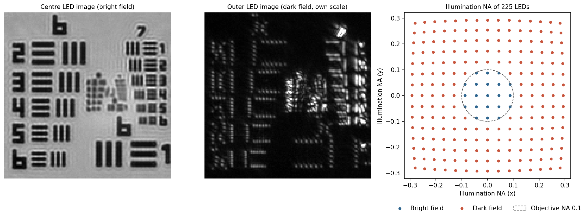
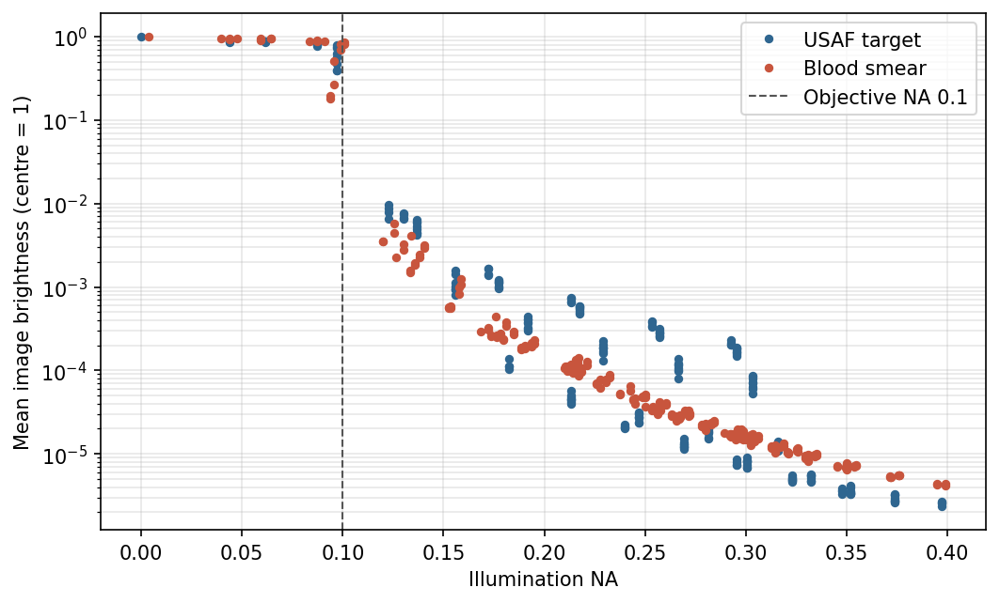
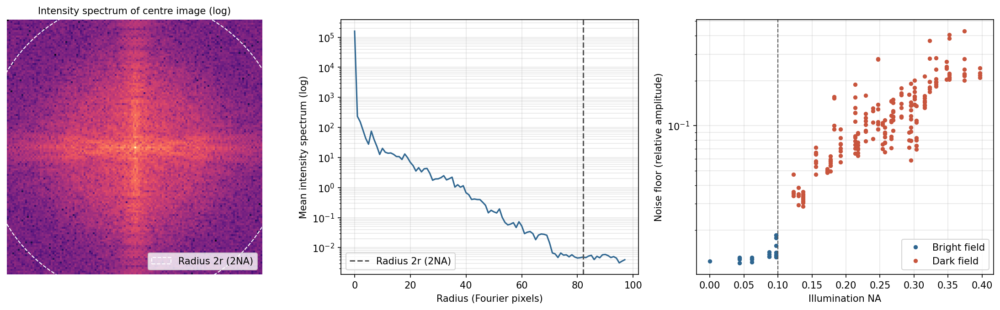
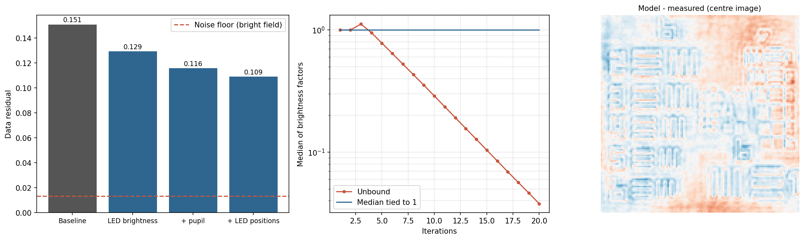
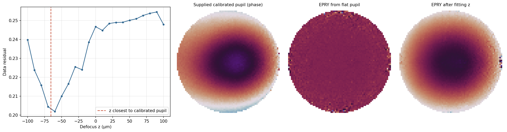
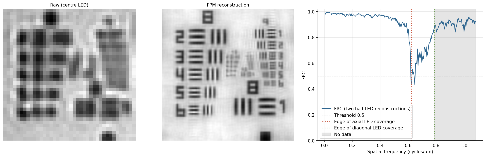

Up to post 10, every calculation in this series used synthetic data. We built a true sample first, computed its diffraction patterns, and measured the error of the reconstruction against the true sample. An error of 0.01 meant a good reconstruction, 0.3 a failure. This is the ideal way to study how algorithms behave. Images taken in a lab, however, do not come with a true sample attached.

What changes when we move to experimental data? First, we do not know the numbers that go into the model. The instrument does not tell us exactly where each LED sits, how much aberration the lens has, or how much the LEDs differ in brightness. Second, the reconstruction does not stop when those numbers are wrong. The algorithm will produce some image even from a wrong model. Third, there is no ground truth to compare the result with. This post centres on the third problem. To trust a reconstruction without ground truth, what should we measure?

The material is two public data sets. One is the Fourier ptychography (FP) data released by Zheng's group at the University of Connecticut (UConn): a USAF resolution target and a blood smear recorded with a 2× objective (NA 0.1) and a 32×32 LED array. The other is the USAF target from the PtyLab public data. The principle was covered in [post 8](/posts/ptycho-fourier-ptychography/), so here we look only at what is new with real measurements.

## 1. What Does the Data File Tell Us, and What Does It Leave Out?

The UConn data file holds 225 images, the wavelength (630 nm for the USAF target), the rotation and offset of the LED array, and a known defocus $z$. The accompanying description gives an LED pitch of 4 mm, an LED-to-sample distance of 90.88 mm, a pixel size of 1.845 µm at the sample, and a 1 mm glass slide (refractive index 1.52) under the sample. It also says the LEDs were lit in a spiral from the centre outwards. The images are HDR composites of several exposures.

Some things are not in the file. The description does not say whether the stored values are intensities or amplitudes. Questions like this are answered by asking the data. We reconstruct under each interpretation and check how well images recomputed from the reconstruction match the measurements. We call this measure of agreement the data residual.

$$
\varepsilon = \sqrt{\frac{\sum_j \sum_{\mathbf{r}} \left( s_j\, m_j(\mathbf{r}) - a_j(\mathbf{r}) \right)^2}{\sum_j \sum_{\mathbf{r}} a_j(\mathbf{r})^2}}
$$

Here $$a_j$$ is the amplitude of the $j$-th measured image and $$m_j$$ the amplitude of the model image. $$s_j$$ is one scale factor per image, so that small differences in LED brightness are not penalised. Without ground truth, this is in the end the only measure we have. Reading the stored values as amplitudes gives a residual of 0.151; reading them as intensities gives 0.210. They are amplitudes. The UConn reconstruction code indeed treats them that way.

## 2. Where Are the LEDs?

In FP, each LED is a plane wave illuminating the sample at an angle. If $\theta$ is the angle between the illumination and the optical axis, its sine is the illumination NA, $$\mathrm{NA_{ill}} = \sin\theta$$, and the sample spectrum passes through the objective pupil shifted by $$\mathrm{NA_{ill}}/\lambda$$. If $L$ is the side length of the image at the sample, the shift in Fourier pixels is

$$
k = \frac{\mathrm{NA_{ill}}\, L}{\lambda}.
$$

The objective pupil radius in the same units is $\mathrm{NA}\,L/\lambda$. For the USAF images (140×140, $L$ = 258 µm), the pupil radius $r$ is 41 pixels and the outermost LED shifts the spectrum by 120 pixels.

Two things enter when we compute $$\mathrm{NA_{ill}}$$ from the LED coordinates. One is the rotation and offset of the array, which the file provides. The other is the glass. The sample sits on 1 mm of glass, so light from an LED bends at the bottom of the slide. To reach the sample, the ray travels a lateral distance $a$ in air and $$t\tan\theta_g$$ in glass, so we solve

$$
a + t\tan\theta_g = l, \qquad \sin\theta_a = n_g \sin\theta_g
$$

together and take $$\mathrm{NA_{ill}} = \sin\theta_a$$, where $l$ is the distance of the LED from the axis. Because the ray also moves sideways by $$t\tan\theta_g$$ inside the glass, the lateral travel $a$ in air is shorter than $l$. The angle in air, and so the illumination NA, become slightly smaller. In this setup the effect is small. Even for the LED farthest from the axis (39.6 mm), $$\mathrm{NA_{ill}}$$ drops only from 0.399 to 0.397, by 0.0023, and ignoring the glass actually lowers the residual slightly, from 0.151 to 0.149. The offsets in the file may already have been fitted with the glass included. A small correction matters only when it is large enough for the data to feel it.

Orientation is a bigger problem. Whether the spiral runs clockwise, and whether the array's $x$ axis is the image's horizontal or vertical axis, cannot be known without seeing the instrument. So we reconstructed all eight combinations (2 axis swaps × 4 sign pairs) and compared residuals. Swapping the axes is clearly worse, at 0.229–0.231. The signs are a different story. Flipping both signs (0.151) and keeping both (0.154) give almost the same residual. Why can they not be told apart? If the pupil is real, flipping the sign of every illumination wavevector and conjugating the sample leaves the camera images unchanged. This is the same ambiguity as the twin image of [post 2](/posts/ptycho-phase-problem-iterative-retrieval/). Only the phase of the pupil, an aberration such as defocus, separates the two. The known defocus of 5 µm is very small, so the difference is only 0.003.

How do we check that the geometry is right? There is one test that needs no ground truth. If the illumination NA is smaller than the objective NA, the undiffracted part of the illumination passes through the lens and the image forms on a bright background. This is bright field. If the illumination NA exceeds the objective NA, the undiffracted light misses the lens, only light scattered by the sample enters, and the image is dark field on a dark background. So when we sort image brightness by the computed $$\mathrm{NA_{ill}}$$, the brightness should drop sharply at 0.1.

_Fig 1. UConn USAF data. Bright-field image with the centre LED (left), dark-field image with an outer LED (middle, separate brightness range), and the computed illumination NA of the 225 LEDs (right). The 21 LEDs inside the dashed circle are bright field_

_Fig 2. Mean image brightness against computed illumination NA (centre LED = 1). Brightness drops by more than two orders of magnitude at the objective NA of 0.1_

Fig 2 shows the result. In the USAF data, the 21 bright-field images have illumination NAs of 0.097 or less, and dark field starts at 0.123. The brightest dark-field image is only 2.5% of the darkest bright-field image. The boundary falls exactly at the computed 0.1, which means the LED map and the objective NA share the same scale. In the blood-smear data, a few images near the boundary are half dark. These are probably images where the LED, being not a point but a source of finite size, sends only part of its light into the pupil.

## 3. How Low Should the Residual Go?

Is a residual of 0.151 good or bad? With synthetic data we judged by the error against the true sample; here we need a reference. The natural reference is noise. Even a perfect model leaves a residual as large as the measurement noise. How do we measure the noise, then? With two images taken under the same LED we could use their difference, but this data set has none.

Fortunately, FP images reveal their own noise. A camera image is the intensity $\lvert u \rvert^2$ of the field $u$ that passed through the pupil. The spectrum of $u$ lies inside a circle of radius $\mathrm{NA}/\lambda$, so the spectrum of $\lvert u \rvert^2$, the autocorrelation of that circle, lies only inside a circle of radius $2\mathrm{NA}/\lambda$. This is the same relation between coherent and incoherent cutoff frequencies we saw in [Wave Optics Background 4](/posts/wave-optics-fourier-imaging/). Energy left outside radius $2r$ in the intensity spectrum is something light cannot produce: noise. Assuming the noise is spread evenly over frequency, the mean level outside gives an estimate of the total noise energy. Intensity noise $$\sigma_I$$ maps to amplitude noise as $$\sigma_a \approx \sigma_I / (2\sqrt{I})$$.

_Fig 3. Intensity spectrum of the centre image (left) and its radial average (middle). The spectrum flattens outside radius 2r. Right: amplitude noise of each image measured from that flat floor_

In the middle of Fig 3, the intensity spectrum falls until about radius 2r (82 pixels) and flattens beyond it. The amplitude noise measured from that floor is 1.3% in bright field and a median of 11% in dark field. Dark field has little light and so a large relative noise, reaching around 30% for the outermost LEDs. We checked that this measurement can be trusted by adding known noise to synthetic images: on five bright-field images, it recovered the added noise level to within 2%.

So the floor of this residual, which bright field dominates, is near 0.013. The value 0.151 is more than ten times higher. The rest is not noise; it is the part of the data the model fails to explain.

## 4. Which Calibration Reduces the Residual, and by How Much?

Where is the model wrong? We add each suspect to the model one at a time and watch how much the residual drops. The results are in the table below (USAF, 20 iterations).

| Model | Residual |
|---|---|
| Baseline (LED geometry, ideal pupil + known defocus) | 0.151 |
| Without glass refraction | 0.149 |
| Without defocus | 0.152 |
| LED brightness correction | 0.129 |
| LED brightness + pupil recovery | 0.116 |
| LED brightness + pupil + LED position correction | 0.109 |
| (Same model, 35-pixel border excluded) | 0.096 |

The largest share is LED brightness. LEDs differ in brightness at the same current, and less light reaches the sample from oblique LEDs. The correction is simple. During reconstruction, each image gets a factor $$c_j$$ that multiplies the measured amplitude to match the size of the model.

$$
c_j = \frac{\sum_{\mathbf{r}} \lvert u_j(\mathbf{r}) \rvert\, a_j(\mathbf{r})}{\sum_{\mathbf{r}} a_j(\mathbf{r})^2}
$$

Done this way alone, it fails. The median of the factors shrinks every iteration and reaches 0.046 after 20 iterations (Fig 4, middle). What is happening? It is the scale ambiguity of [post 4](/posts/ptycho-probe-ambiguity-raster-rpie/) in a different form. Multiplying all factors by $\gamma$ and the spectrum by $\gamma$ leaves the relation to the measurements unchanged, so the two trade scale back and forth and drift along this flat direction of the cost. The fix is also the same as in post 4: tie the median of the factors to 1 at every iteration. Once tied, the factors spread over 0.40–1.56. Since they multiply amplitudes, the spread in intensity is more than tenfold. The factors for dim dark-field images, though, probably absorb model mismatch as well as LED brightness.

Pupil recovery uses EPRY (embedded pupil function recovery) from [post 8](/posts/ptycho-fourier-ptychography/) as is. It lowers the residual by another 0.013. LED position correction carries the annealing of [post 7](/posts/ptycho-position-correction-mixed-states/) over to Fourier space. For each LED, the candidates are the 5×5 integer pixels around its current illumination wavevector, and the LED moves to the candidate with the smallest residual for its image. Any shift shared by all LEDs is undone. The LEDs move 1.3 pixels on average and the residual drops by 0.007.

_Fig 4. Residual at each calibration step with the noise floor (left), the median of the brightness factors drifting to zero when left unbound (middle), and the difference between model and measurement for the centre image after all calibrations (right)_

Still, 0.109 remains, eight times the noise floor. The difference image on the right of Fig 4 shows what is left. Fringes follow the edges of the target bars, and there is a large gradient across the whole image. The edge fringes may be a sign that the model pupil has not captured the real lens fully; the gradient may come from the illumination angle varying across the field. The LEDs are 9 cm from the sample, so the illumination angle differs by 0.003 rad between the two ends of the 258 µm field. Partial coherence from the LEDs not being point sources (post 7) is another candidate. This post stops here, but the fact that the residual does not reach the floor is itself information. Without ground truth, we know the model is still missing something.

Varying the objective NA in the model is the same kind of test. At 0.08, 0.09, 0.10, 0.11 and 0.12 the residuals are 0.315, 0.317, 0.116, 0.149 and 0.212, a clear minimum at the nominal 0.1. Applying the same ladder to the PtyLab USAF data, after subtracting the offset of the dark pixels (16 counts), lowers the residual from 0.239 to 0.183. Its noise floor is 0.7%, lower than UConn's, so the unexplained mismatch is larger.

## 5. When Aberrations Are Large, Does Pupil Recovery Find Them?

One blood data set (blood_aberration) comes with a calibrated pupil the authors measured separately. It is not ground truth, but it is an independent reference. Its phase is a bowl, deep at the centre, changing by several radians towards the edge. With aberrations this large, does EPRY find them?

| Starting pupil | Residual (30 iter.) | Phase difference from calibrated pupil (rms) |
|---|---|---|
| Ideal pupil (disc) | 0.336 | 1.04 rad |
| Ideal pupil + EPRY | 0.321 | 1.14 rad |
| Calibrated pupil | 0.192 | — |
| Calibrated pupil + EPRY | 0.175 | 0.18 rad (distance moved from calibrated pupil) |
| Defocus −60 µm + EPRY (60 iter.) | 0.189 | 0.34 rad |

EPRY started from a flat pupil hardly moves. The residual falls only from 0.336 to 0.321, and the pupil phase moves further away from the calibrated pupil. Compared with the calculations of post 8, this is not surprising. Neighbouring pupil circles overlap by 73% in this data set. In post 8, EPRY found the aberration only when the overlap approached 80%, and at 69% overlap with 1.3 rad rms of aberration the sample error stayed at 0.48. Here the overlap is too small and the aberration large. When the starting point is too far from the answer, the algorithm cannot leave the shallow valley near the ideal pupil.

The practical order is this. First, capture the bulk of the aberration with a single parameter. Most of the bowl is defocus. We put the defocus phase

$$
P(\mathbf{q}) = \mathrm{circ}\!\left(\frac{\lvert\mathbf{q}\rvert}{\mathrm{NA}/\lambda}\right) \exp\!\left( i 2\pi z \sqrt{1/\lambda^2 - \lvert\mathbf{q}\rvert^2} \right)
$$

into the pupil, vary $z$ from −100 µm to 100 µm in 10 µm steps, and check the residual of a short reconstruction (15 iterations) at each. The residual is smallest at −60 µm, 0.202, against 0.247 at $z = 0$.

_Fig 5. Residual against defocus z (left) and the z closest to the calibrated pupil (red dashed line). The three panels on the right show pupil phases: the provided calibrated pupil, EPRY from a flat pupil, and EPRY after fitting z_

Is −60 µm right? There is a way to check. Fitting the defocus phase to the phase of the calibrated pupil gives the closest match at −66 µm, with 0.41 rad left over. One value comes from the residual of the measured images, the other from a separately measured pupil, and they agree within 6 µm. Running EPRY from this starting point brings the residual to 0.189, the same as with the calibrated pupil (0.192), and the pupil phase to within 0.34 rad of the calibrated pupil. The rightmost pupil in Fig 5 has the same bowl shape as the provided one. A few parameters capture the bulk; the pixel-level details come afterwards. In short, the more freedom a calibration has, the better the starting point it needs.

## 6. How Do We Read Resolution Without Ground Truth?

With synthetic data we never had to ask about resolution separately; the error against the true sample said everything. With experimental data there are two routes. One is to image a target of known structure. The USAF target arranges elements of three bars by group and element number, and each element has a set bar period. Group 9 element 1 has a period of 1.95 µm, element 2 1.74 µm, element 3 1.55 µm, element 4 1.38 µm.

The other route is to reconstruct the same sample twice independently and compare. Fourier ring correlation (FRC) splits the spectra of two images into rings by radius and measures their correlation. If the two reconstructions differ only by noise, it is close to 1 at low frequencies where the signal is strong and drops to 0 at high frequencies where noise dominates. The point where it drops is read as the resolution. Here we split the dark-field LEDs into two halves like a checkerboard, with both halves sharing the bright-field images, and made two reconstructions.

_Fig 6. Raw image (left) and FP reconstruction (middle) of groups 8 and 9. Right: FRC of the two reconstructions from split LEDs. The red dotted line marks the edge of axial LED coverage, the green dotted line the edge of diagonal coverage, and the grey area frequencies with no data_

The raw image is limited by the coherent cutoff period $\lambda/\mathrm{NA}$ = 6.3 µm. On the left of Fig 6, groups 8 and 9 blur into blobs. In the reconstruction, the group 9 bars separate. The cross-section contrast of the vertical bars (the difference between bright and dark divided by their sum) is 0.29 for element 1, 0.21 for element 2, 0.09 for element 3 and 0.03 for element 4. Element 2 is clear, element 3 barely visible, element 4 not resolved.

What is the theoretical limit? The synthetic NA of FP is the sum of the objective NA and the largest illumination NA. The outermost LED has an illumination NA of 0.397, so it is tempting to say $\lambda/(0.1 + 0.397)$ = 1.27 µm. But the LED array is square. The value 0.397 belongs to a corner LED; the end LEDs along the horizontal or vertical direction reach 0.293. Resolution of vertical bars is set by coverage along the horizontal direction, so the limiting period is $\lambda/(0.1 + 0.293)$ = 1.61 µm. This matches the contrast collapsing between group 9 element 2 (1.74 µm) and element 3 (1.55 µm).

The FRC curve tells the same story. It stays above 0.9 up to about 0.55 cycles/µm and then drops to 0.44 at the edge of axial coverage (0.62). The period at which it first crosses the 0.5 threshold is 1.61 µm, the same as the axial limit. But the curve then rises again and exceeds 0.9 at frequencies with no data at all (grey). That cannot happen if the two reconstructions are independent. The spectrum at frequencies without data appears to be inherited by both reconstructions from the same initial guess and the same bright-field images, and so the two resemble each other. FRC speaks about resolution only when the two results are independent. Where they are not, high correlation may be a shared bias rather than reliability. This is why the whole curve must be examined before reading a number off a single threshold.

## Summary

Here is the order in which we handled experimental FP data without ground truth. What the documentation did not say, such as the storage format and the LED orientation, we decided by the residual. We validated the LED geometry by checking that the bright/dark-field boundary falls at the objective NA of 0.1. How low the residual should go was given by the noise floor measured outside the 2NA circle of the intensity spectrum (1.3% in bright field). Calibrating LED brightness, pupil and LED positions lowered the residual from 0.151 to 0.109, but eight times the floor remained, telling us the model still misses something.

Brightness correction drifted to zero unless the scale was tied, the ambiguity of post 4 reappearing in experimental data. EPRY alone could not find a large aberration; fitting a single defocus to the residual first (−60 µm, matching −66 µm from the independent calibration) brought it close to the calibrated pupil. For resolution, the USAF bar contrast and the FRC both pointed to about 1.6 µm, explained by the axial coverage of the square LED array. The FRC rising again at frequencies with no data warned that the two reconstructions were not fully independent.

In short, experimental data without ground truth offers three grounds for trust: the data residual and its floor, physical boundaries set by the instrument (bright/dark field, LED coverage), and an independent second measurement (a calibrated pupil, the known structure of a target).

## Next

Post 12 moves to experimental data for real-space ptychography. Without a lens the geometry looks simpler, but in practice the reconstruction easily falls into wrong solutions where the sample and the probe swap roles. We will see where the initial probe, the background and the far-field assumption break down.

## References

- G. Zheng, R. Horstmeyer, C. Yang, "[Wide-field, high-resolution Fourier ptychographic microscopy](https://doi.org/10.1038/nphoton.2013.187)," *Nature Photonics* 7(9), 739–745 (2013). The original FP paper: an LED-array microscope and stitching spectra by illumination angle.
- X. Ou, G. Zheng, C. Yang, "[Embedded pupil function recovery for Fourier ptychographic microscopy](https://doi.org/10.1364/OE.22.004960)," *Optics Express* 22(5), 4960 (2014). EPRY, recovering the pupil together with the sample.
- R. Eckert, Z. F. Phillips, L. Waller, "[Efficient illumination angle self-calibration in Fourier ptychography](https://doi.org/10.1364/AO.57.005434)," *Applied Optics* 57(19), 5434 (2018). Self-calibrating illumination angles from the bright/dark-field boundary and image spectra.
- J. Sun, Q. Chen, Y. Zhang, C. Zuo, "[Sampling criteria for Fourier ptychographic microscopy in object space and frequency space](https://doi.org/10.1364/OE.24.015765)," *Optics Express* 24(14), 15765 (2016). Sampling in FP and the overlap condition for pupil circles.
- L. Loetgering et al., "[PtyLab.m/py/jl: a cross-platform, open-source inverse modeling toolbox for conventional and Fourier ptychography](https://doi.org/10.1364/OE.485370)," *Optics Express* 31(9), 13763 (2023). A common toolbox for real-space and Fourier ptychography with public data, background subtraction and calibration algorithms.
- Data: [Smart Imaging Lab (UConn) Fourier-Ptychography](https://github.com/SmartImagingLabUConn/Fourier-Ptychography) (P. Song, G. Zheng), [PtyLab FPM data](https://doi.org/10.6084/m9.figshare.19111472) (CC BY 4.0).
