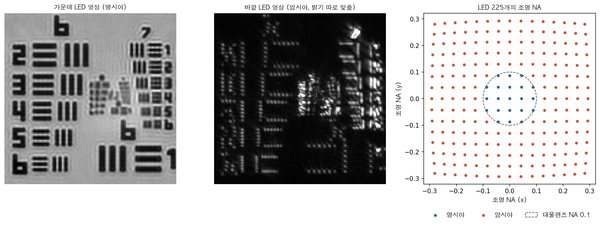
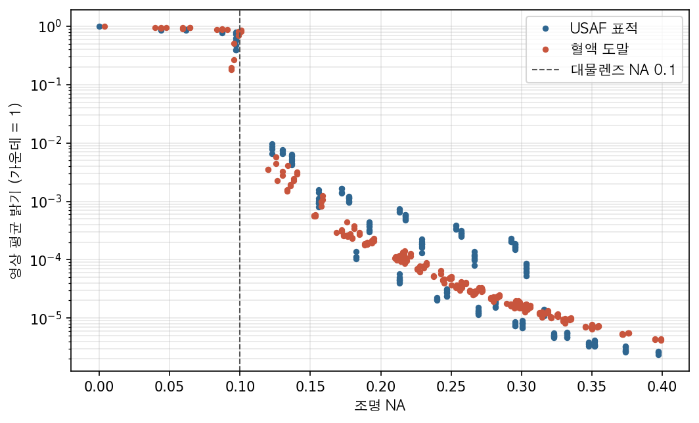
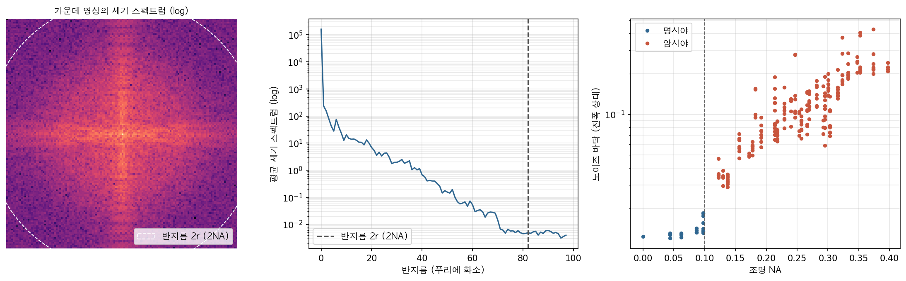
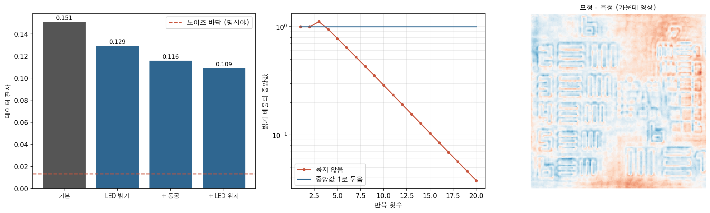
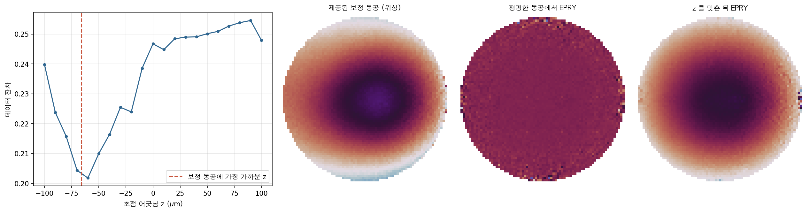
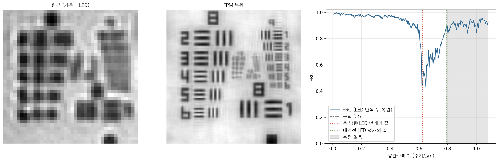

10편까지 이 시리즈의 계산은 모두 합성 데이터였다. 참 시편을 먼저 만들고, 그 시편에서 회절 패턴을 계산하고, 복원한 결과를 참 시편과 견주어 오차를 쟀다. 오차가 0.01이면 좋은 복원이고 0.3이면 실패였다. 이 방식은 알고리즘의 성질을 가르는 데 더할 나위가 없다. 그러나 실험실에서 찍은 영상에는 참 시편이 딸려 오지 않는다.

실측 데이터로 넘어가면 무엇이 새로 생기는가? 첫째, 모형에 넣을 숫자를 모른다. LED가 정확히 어디 있는지, 렌즈의 수차가 얼마인지, LED마다 밝기가 얼마나 다른지를 장치가 알려 주지 않는다. 둘째, 그 숫자가 틀려도 복원은 멈추지 않는다. 틀린 모형으로도 알고리즘은 어떤 영상을 내놓는다. 셋째, 결과가 맞는지를 견줄 정답이 없다. 이번 편은 세 번째 문제를 중심에 둔다. 정답 없이 복원을 믿으려면 무엇을 재야 하는가?

재료는 공개 데이터 두 벌이다. 하나는 코네티컷대학 Zheng 연구실이 공개한 푸리에 타이코그래피(Fourier ptychography, FP) 데이터다. 2배 대물렌즈(개구수 0.1)와 32×32 LED 배열로 USAF 해상도 표적과 혈액 도말을 찍었다. 다른 하나는 PtyLab 공개 데이터의 USAF 표적이다. 원리는 [8편](/posts/ptycho-fourier-ptychography/)에서 다뤘으므로 여기서는 실측에서 새로 부딪히는 것만 본다.

## 1. 파일은 무엇을 알려 주고 무엇을 알려 주지 않는가?

UConn 데이터 파일에는 영상 225장, 파장(USAF는 630 nm), LED 배열의 회전각과 어긋남, 그리고 알려진 초점 어긋남 $z$ 가 들어 있다. 설명 문서에는 LED 간격 4 mm, LED와 시편 사이 90.88 mm, 시편면 화소 1.845 µm, 시편 밑 유리 두께 1 mm(굴절률 1.52)가 적혀 있고, LED를 가운데에서 바깥으로 나선형으로 켰다고 되어 있다. 영상은 노출을 여러 번 바꿔 찍어 합친 HDR이다.

파일이 알려 주지 않는 것도 있다. 저장된 값이 세기인지 진폭인지가 문서에 없다. 이런 것은 데이터에 물어서 정한다. 두 해석으로 각각 복원하고, 복원 결과로 다시 계산한 영상이 측정과 얼마나 맞는지를 본다. 이 맞음의 척도를 이 글에서는 데이터 잔차라 부른다.

$$
\varepsilon = \sqrt{\frac{\sum_j \sum_{\mathbf{r}} \left( s_j\, m_j(\mathbf{r}) - a_j(\mathbf{r}) \right)^2}{\sum_j \sum_{\mathbf{r}} a_j(\mathbf{r})^2}}
$$

$$a_j$$ 는 $j$ 번째 측정 영상의 진폭, $$m_j$$ 는 모형 영상의 진폭이다. $$s_j$$ 는 영상마다 하나씩 주는 척도로, LED 밝기가 조금씩 달라도 잔차가 그 차이를 벌로 받지 않게 한다. 정답을 모를 때 쓸 수 있는 척도는 결국 이것뿐이다. 저장값을 진폭으로 읽으면 잔차가 0.151, 세기로 읽으면 0.210이다. 진폭이다. 실제로 UConn의 복원 코드도 이 값을 진폭처럼 쓴다.

## 2. LED는 어디에 있는가?

FP에서 LED 하나는 시편을 비스듬히 비추는 평면파다. 조명 방향이 광축과 이루는 각을 $\theta$ 라 하면 그 사인값이 조명 개구수(illumination NA) $$\mathrm{NA_{ill}} = \sin\theta$$ 이고, 시편 스펙트럼은 $$\mathrm{NA_{ill}}/\lambda$$ 만큼 옮겨진 채 대물렌즈의 동공을 지난다. 영상 한 변의 시편면 길이를 $L$ 이라 하면, 옮겨지는 양은 푸리에 화소로

$$
k = \frac{\mathrm{NA_{ill}}\, L}{\lambda}
$$

이다. 대물렌즈 동공의 반지름도 같은 단위로 $\mathrm{NA}\,L/\lambda$ 다. USAF 영상(140×140, $L$ = 258 µm)에서 동공 반지름 $r$ 은 41화소, 가장 바깥 LED의 옮김은 120화소다.

LED의 좌표에서 $$\mathrm{NA_{ill}}$$ 을 구하는 데는 두 가지가 끼어든다. 하나는 배열의 회전과 어긋남이고, 이 값은 파일에 있다. 다른 하나는 유리다. 시편은 1 mm 유리 위에 놓여 있어 LED에서 온 빛이 유리 밑면에서 꺾인다. 공기 속을 옆으로 $a$ 만큼, 유리 속을 $$t\tan\theta_g$$ 만큼 가서 시편에 닿아야 하므로

$$
a + t\tan\theta_g = l, \qquad \sin\theta_a = n_g \sin\theta_g
$$

를 함께 풀어 $$\mathrm{NA_{ill}} = \sin\theta_a$$ 를 얻는다. $l$ 은 LED가 광축에서 떨어진 거리다. 유리 구간에서도 광선이 옆으로 $$t\tan\theta_g$$ 만큼 가므로 공기 구간의 옆 이동 $a$ 는 $l$ 보다 짧다. 그만큼 공기 중 각과 조명 개구수가 조금 작아진다. 다만 이 장치에서는 효과가 작다. 광축에서 가장 먼 LED(39.6 mm)에서도 $$\mathrm{NA_{ill}}$$ 이 0.399에서 0.397로 0.0023 줄 뿐이고, 유리를 무시해도 잔차가 0.151에서 0.149로 오히려 조금 낮다. 파일의 어긋남 값이 이미 유리를 넣고 맞춘 값일 수도 있다. 작은 보정은 데이터가 그 효과를 느낄 만큼 클 때만 의미가 있다.

더 큰 문제는 방향이다. 나선이 시계 방향인지, 배열의 $x$ 축이 영상의 가로인지 세로인지는 장치를 보지 않고는 알 수 없다. 그래서 여덟 가지 조합(축 바꿈 2가지 × 두 축의 부호 4가지)을 모두 복원하고 잔차를 견주었다. 축을 바꾸면 0.229–0.231로 분명히 나빠진다. 부호는 사정이 다르다. 두 부호를 모두 뒤집은 것(0.151)과 둘 다 그대로인 것(0.154)이 거의 같다. 왜 가려지지 않는가? 동공이 실수이면 모든 조명 파수의 부호를 뒤집고 시편을 켤레로 바꾸어도 카메라 영상이 똑같다. [2편](/posts/ptycho-phase-problem-iterative-retrieval/)의 쌍둥이 상(twin image)과 같은 모호성이다. 이 둘을 가르는 것은 동공의 위상, 곧 초점 어긋남 같은 수차뿐이다. 알려진 초점 어긋남 5 µm가 아주 작아 차이가 0.003에 그친 것이다.

기하가 맞는지는 어떻게 확인하는가? 정답 없이도 쓸 수 있는 검증이 하나 있다. 조명 개구수가 대물렌즈 개구수보다 작으면 조명의 직진 성분이 렌즈를 통과해 밝은 배경 위에 영상이 맺힌다. 이것이 명시야(bright field)다. 조명 개구수가 렌즈의 개구수를 넘으면 직진 성분은 렌즈 밖으로 빠지고, 시편이 흩뜨린 빛만 들어와 어두운 배경의 암시야(dark field) 영상이 된다. 그러니 계산한 $$\mathrm{NA_{ill}}$$ 로 영상 밝기를 늘어놓으면 0.1에서 밝기가 뚝 떨어져야 한다.

_그림1. UConn USAF 데이터. 가운데 LED의 명시야 영상(왼쪽), 바깥 LED의 암시야 영상(가운데, 밝기 범위를 따로 맞춤), 계산한 LED 225개의 조명 개구수(오른쪽). 점선 원 안의 21개가 명시야다_

_그림2. 계산한 조명 개구수에 따른 영상의 평균 밝기(가운데 LED = 1). 대물렌즈 개구수 0.1에서 밝기가 두 자릿수 넘게 떨어진다_

그림2가 그 결과다. USAF 데이터에서 명시야 영상 21장의 조명 개구수는 0.097 이하이고, 암시야의 시작은 0.123이다. 가장 밝은 암시야 영상도 가장 어두운 명시야 영상의 2.5 %에 불과하다. 경계가 계산한 0.1에 정확히 놓인다. LED 지도가 대물렌즈 개구수와 같은 눈금으로 맞았다는 뜻이다. 혈액 도말 데이터에서는 경계 가까운 영상 몇 장이 반쯤 어둡다. LED가 점이 아니라 크기가 있어서 빛의 일부만 동공 안에 들어오는 영상일 것이다.

## 3. 잔차는 어디까지 내려가야 하는가?

잔차 0.151은 좋은가 나쁜가? 합성 데이터에서는 참 시편과의 오차로 판정했지만, 여기서는 기준이 필요하다. 가장 자연스러운 기준은 노이즈다. 모형이 완벽해도 잔차는 측정 노이즈만큼 남는다. 그러면 노이즈는 어떻게 재는가? 같은 LED로 두 번 찍은 영상이 있으면 그 차이에서 재겠지만, 이 데이터에는 없다.

다행히 FP 영상에는 노이즈를 스스로 드러내는 성질이 있다. 카메라 영상은 동공을 지난 장 $u$ 의 세기 $\lvert u \rvert^2$ 다. $u$ 의 스펙트럼은 반지름 $\mathrm{NA}/\lambda$ 의 원 안에 있으므로, $\lvert u \rvert^2$ 의 스펙트럼은 그 원끼리의 자기상관, 곧 반지름 $2\mathrm{NA}/\lambda$ 의 원 안에만 있다. [파동광학 배경이론 4편](/posts/wave-optics-fourier-imaging/)에서 본, 결맞은 결상과 결맞지 않은 결상의 차단 주파수 관계와 같다. 그러니 세기 스펙트럼에서 반지름 $2r$ 바깥에 남은 에너지는 빛이 만들 수 없는 것, 곧 노이즈다. 노이즈가 주파수에 고르게 퍼져 있다고 보면 바깥의 평균으로 전체 노이즈 에너지를 짐작할 수 있다. 세기 노이즈 $$\sigma_I$$ 는 진폭 노이즈로 $$\sigma_a \approx \sigma_I / (2\sqrt{I})$$ 만큼 옮겨진다.

_그림3. 가운데 영상의 세기 스펙트럼(왼쪽)과 반지름별 평균(가운데). 반지름 2r 밖에서 스펙트럼이 평평해진다. 오른쪽은 그 평평한 바닥에서 잰 영상별 진폭 노이즈다_

그림3 가운데에서 세기 스펙트럼은 반지름 2r(82화소) 근처까지 내려가다 그 밖에서 평평해진다. 그 바닥에서 잰 진폭 노이즈는 명시야에서 1.3 %, 암시야에서 중앙값 11 %다. 암시야는 빛이 적어 상대 노이즈가 크고, 가장 바깥 LED에서는 30 % 안팎에 이른다. 이 측정을 믿을 수 있는지는 합성 영상에 알려진 노이즈를 넣어 확인했다. 명시야 영상 다섯 장에서 넣은 노이즈 크기를 2 % 안으로 되찾았다.

그러니 명시야가 지배하는 이 잔차의 바닥은 0.013 근처다. 0.151은 그 열 배가 넘는다. 남은 차이는 노이즈가 아니라 모형이 데이터를 설명하지 못하는 몫이다.

## 4. 무엇을 보정하면 잔차가 얼마나 줄어드는가?

모형의 어디가 틀렸는가? 의심 가는 것을 하나씩 모형에 넣고 잔차가 얼마나 주는지 본다. 결과는 아래 표와 같다(USAF, 20회).

| 모형 | 잔차 |
|---|---|
| 기본 (LED 기하, 이상 동공 + 알려진 초점 어긋남) | 0.151 |
| 유리 굴절을 뺌 | 0.149 |
| 초점 어긋남을 뺌 | 0.152 |
| LED 밝기 보정 | 0.129 |
| LED 밝기 + 동공 복원 | 0.116 |
| LED 밝기 + 동공 + LED 위치 보정 | 0.109 |
| (같은 모형, 가장자리 35화소 빼고 잼) | 0.096 |

가장 큰 몫은 LED 밝기다. LED는 같은 전류에서도 밝기가 다르고, 비스듬한 LED일수록 시편에 닿는 빛이 줄어든다. 보정은 간단하다. 복원 중에 영상마다 배율 $$c_j$$ 를 두고, 측정 진폭에 곱해 모형의 크기에 맞춘다.

$$
c_j = \frac{\sum_{\mathbf{r}} \lvert u_j(\mathbf{r}) \rvert\, a_j(\mathbf{r})}{\sum_{\mathbf{r}} a_j(\mathbf{r})^2}
$$

이렇게만 하면 실패한다. 배율의 중앙값이 반복마다 줄어 20회 만에 0.046이 된다(그림4 가운데). 무슨 일인가? [4편](/posts/ptycho-probe-ambiguity-raster-rpie/)의 척도 모호성이 모양을 바꿔 나타난 것이다. 모든 배율을 $\gamma$ 배 하고 스펙트럼을 $\gamma$ 배 하면 측정과의 관계가 그대로이니, 비용이 평평한 이 방향을 따라 둘이 척도를 주고받으며 흘러간다. 해법도 4편과 같다. 반복마다 배율의 중앙값을 1로 묶는다. 묶은 뒤 배율은 0.40–1.56에 퍼진다. 진폭에 곱하는 배율이니 세기로는 열 배 넘게 차이 나는 셈이다. 다만 빛이 적은 암시야 영상의 배율에는 LED 밝기뿐 아니라 모형의 불일치도 섞여 들어갈 것이다.

동공 복원은 [8편](/posts/ptycho-fourier-ptychography/)의 EPRY(embedded pupil function recovery)를 그대로 썼다. 잔차를 0.013 더 줄인다. LED 위치 보정은 [7편](/posts/ptycho-position-correction-mixed-states/)의 어닐링을 푸리에 쪽으로 옮긴 것이다. LED마다 지금 조명 파수 주변 5×5 정수 화소를 후보로 두고 그 영상의 잔차가 가장 작은 곳으로 옮긴다. 모든 LED가 함께 옮겨 가는 것은 되돌린다. 평균 1.3화소 옮기고 잔차를 0.007 줄인다.

_그림4. 보정 단계별 잔차와 노이즈 바닥(왼쪽), 밝기 배율을 묶지 않으면 중앙값이 0으로 흘러가는 모습(가운데), 모든 보정 뒤 가운데 영상에서 모형과 측정의 차이(오른쪽)_

그래도 0.109다. 노이즈 바닥의 여덟 배다. 그림4 오른쪽의 차이 영상이 남은 몫을 보여 준다. 표적의 막대 테두리를 따라 무늬가 남고, 영상 전체에 큰 기울기가 있다. 테두리 무늬는 모형의 동공이 실제 렌즈를 다 담지 못한 흔적일 수 있고, 큰 기울기는 영상 안에서 조명 각이 위치마다 달라지는 효과일 수 있다. LED가 시편에서 9 cm 떨어져 있으니 258 µm 시야의 한쪽 끝과 다른 끝에서 조명 각이 0.003 rad 다르다. LED가 점광원이 아니어서 생기는 부분 결맞음(7편)도 후보다. 이 글은 여기서 멈추지만, 잔차가 바닥까지 내려가지 않는다는 사실 자체가 정보다. 모형이 아직 무엇인가를 빠뜨렸다는 것을 정답 없이도 안다.

대물렌즈 개구수를 모형에서 바꿔 보는 것도 같은 방식의 검증이다. 0.08, 0.09, 0.10, 0.11, 0.12에서 잔차가 0.315, 0.317, 0.116, 0.149, 0.212다. 공칭값 0.1에서 뚜렷한 최소가 난다. 같은 사다리를 PtyLab의 USAF 데이터에 적용하면 바닥값(어두운 화소의 오프셋 16)을 뺀 뒤 잔차가 0.239에서 0.183으로 준다. 노이즈 바닥은 0.7 %로 UConn보다 낮으니 남은 불일치는 더 크다.

## 5. 수차가 크면 동공 복원이 찾아 주는가?

혈액 데이터 하나(blood_aberration)에는 제작자가 따로 측정해 둔 보정 동공이 함께 실려 있다. 정답은 아니지만 독립적인 기준이다. 이 동공의 위상은 가운데가 깊은 사발 모양이고, 가장자리까지 몇 라디안이 바뀐다. 이 정도 수차가 있을 때 EPRY는 그것을 찾아내는가?

| 출발 동공 | 잔차 (30회) | 보정 동공과의 위상 차 (rms) |
|---|---|---|
| 이상 동공 (원) | 0.336 | 1.04 rad |
| 이상 동공 + EPRY | 0.321 | 1.14 rad |
| 보정 동공 | 0.192 | — |
| 보정 동공 + EPRY | 0.175 | 0.18 rad (보정 동공에서 움직인 양) |
| 초점 어긋남 −60 µm + EPRY (60회) | 0.189 | 0.34 rad |

평평한 동공에서 시작한 EPRY는 거의 움직이지 않는다. 잔차가 0.336에서 0.321로 줄 뿐이고, 동공 위상은 보정 동공에서 오히려 멀어진다. 8편의 계산과 견주면 이상한 일이 아니다. 이웃 동공 원의 겹침이 이 데이터에서는 73 %인데, 8편에서는 80 % 가까이 겹쳐야 EPRY가 수차를 찾았고, 69 %에 수차가 1.3 rad rms이면 시편 오차가 0.48에 머물렀다. 여기서는 겹침이 모자라고 수차도 크다. 출발점이 정답에서 너무 멀면 알고리즘은 이상 동공 근처의 얕은 골에서 빠져나오지 못한다.

실무의 순서는 이렇다. 먼저 수차의 큰 줄기를 매개변수 하나로 잡는다. 사발 모양의 대부분은 초점 어긋남이다. 동공에 초점 어긋남 위상

$$
P(\mathbf{q}) = \mathrm{circ}\!\left(\frac{\lvert\mathbf{q}\rvert}{\mathrm{NA}/\lambda}\right) \exp\!\left( i 2\pi z \sqrt{1/\lambda^2 - \lvert\mathbf{q}\rvert^2} \right)
$$

을 넣고, $z$ 를 −100 µm에서 100 µm까지 10 µm 간격으로 바꾸며 짧게(15회) 복원해 잔차를 본다. 잔차는 −60 µm에서 0.202로 가장 작고, $z = 0$ 에서는 0.247이다.

_그림5. 초점 어긋남 z에 따른 잔차(왼쪽)와 보정 동공에 가장 가까운 z(빨간 점선). 오른쪽 셋은 동공 위상이다. 제공된 보정 동공, 평평한 동공에서 시작한 EPRY, z를 맞춘 뒤 EPRY_

이 −60 µm는 맞는가? 확인할 길이 있다. 보정 동공의 위상에 초점 어긋남 위상을 맞춰 보면 −66 µm에서 가장 가깝고, 그래도 0.41 rad가 남는다. 하나는 측정 영상의 잔차에서, 다른 하나는 따로 측정한 동공에서 얻었는데 6 µm 안에서 일치한다. 이 출발점에서 EPRY를 돌리면 잔차가 0.189로 보정 동공을 쓸 때(0.192)와 같아지고, 동공 위상은 보정 동공과 0.34 rad 차이로 다가간다. 그림5의 맨 오른쪽 동공이 제공된 동공과 같은 사발 모양이다. 매개변수 몇 개로 큰 줄기를 잡고, 화소 단위의 세부는 그다음에 맡기는 것이다. 즉, 자유도가 큰 보정일수록 좋은 출발점이 필요하다.

## 6. 분해능은 정답 없이 어떻게 읽는가?

합성 데이터에서는 분해능을 따로 물을 필요가 없었다. 참 시편과의 오차가 모든 것을 말했다. 실측에서는 두 가지 길이 있다. 하나는 구조를 아는 표적을 찍는 것이다. USAF 표적은 막대 셋이 한 묶음인 원소가 군(group)과 번호(element)로 정리되어 있고, 원소마다 막대 주기가 정해져 있다. 9군 1번은 주기 1.95 µm, 2번 1.74 µm, 3번 1.55 µm, 4번 1.38 µm다.

다른 하나는 같은 시편을 독립적으로 두 번 복원해 서로 견주는 것이다. 푸리에 고리 상관(Fourier ring correlation, FRC)은 두 영상의 스펙트럼을 반지름별 고리로 나눠 상관을 잰다. 두 복원이 노이즈만 다르면 신호가 큰 낮은 주파수에서는 1에 가깝고, 노이즈가 지배하는 높은 주파수에서는 0으로 떨어진다. 떨어지는 지점을 분해능으로 읽는다. 여기서는 암시야 LED를 바둑판처럼 둘로 나누고 명시야는 양쪽이 함께 쓰게 하여 두 복원을 만들었다.

_그림6. 8·9군 영역의 원본(왼쪽)과 FP 복원(가운데). 오른쪽은 LED를 둘로 나눈 두 복원의 FRC다. 빨간 점선은 축 방향 LED 덮개의 끝, 초록 점선은 대각선 덮개의 끝이고, 회색 영역은 측정이 없는 주파수다_

원본 영상의 한계는 결맞은 결상의 차단 주기 $\lambda/\mathrm{NA}$ = 6.3 µm다. 그림6 왼쪽에서 8군과 9군은 덩어리로 뭉개진다. 복원에서는 9군 막대가 갈라진다. 세로 막대의 단면 대비(밝은 곳과 어두운 곳의 차를 합으로 나눈 값)를 재면 9군 1번 0.29, 2번 0.21, 3번 0.09, 4번 0.03이다. 2번은 분명하고, 3번은 겨우 보이고, 4번은 갈리지 않는다.

이론 한계는 무엇인가? FP의 합성 개구수는 대물 개구수와 가장 큰 조명 개구수의 합이다. 가장 바깥 LED의 조명 개구수가 0.397이니 $\lambda/(0.1 + 0.397)$ = 1.27 µm라고 말하기 쉽다. 그러나 LED 배열은 정사각형이다. 0.397은 모서리 LED의 값이고, 가로나 세로 방향의 끝 LED는 0.293이다. 세로 막대의 분해능을 정하는 것은 가로 방향의 덮개이니 한계 주기는 $\lambda/(0.1 + 0.293)$ = 1.61 µm다. 대비가 9군 2번(1.74 µm)과 3번(1.55 µm) 사이에서 무너진 것과 맞는다.

FRC 곡선도 같은 이야기를 한다. 0.55 주기/µm 근처까지 0.9 이상을 유지하다가 축 방향 덮개의 끝(0.62)에서 0.44까지 떨어진다. 문턱 0.5를 처음 넘는 곳의 주기는 1.61 µm로, 축 방향 한계와 같다. 그런데 곡선은 그 뒤로 다시 올라가 측정이 전혀 없는 주파수(회색)에서 0.9를 넘는다. 두 복원이 독립적이라면 일어날 수 없는 일이다. 측정이 없는 주파수의 스펙트럼은 두 복원이 같은 초기값과 같은 명시야 영상에서 물려받은 것으로 보이며, 그래서 서로 닮는다. FRC는 두 결과가 독립일 때만 분해능을 말한다. 독립이 아닌 부분이 있으면 높은 상관이 신뢰가 아니라 공통의 편향일 수 있다. 문턱 하나로 숫자를 읽기 전에 곡선 전체를 보아야 하는 까닭이다.

## 정리

실측 FP 데이터를 정답 없이 다룬 순서를 되짚으면 이렇다. 저장 형식과 LED의 방향처럼 문서가 알려 주지 않는 것은 잔차로 정했다. LED 기하는 명·암시야 경계가 대물 개구수 0.1에 놓이는지로 검증했다. 잔차가 얼마까지 내려가야 하는지는 세기 스펙트럼의 2NA 원 밖에서 잰 노이즈 바닥(명시야 1.3 %)이 말해 주었다. LED 밝기, 동공, LED 위치를 보정하자 잔차가 0.151에서 0.109로 줄었지만, 바닥의 여덟 배가 남아 모형이 아직 무엇을 빠뜨렸음을 알려 주었다.

밝기 보정은 척도를 묶지 않으면 0으로 흘러갔다. 4편의 모호성이 실측에서 다시 나타난 것이다. 큰 수차는 EPRY 혼자 찾지 못했고, 초점 어긋남 하나를 잔차로 먼저 맞추자(−60 µm, 독립 보정의 −66 µm와 일치) 보정 동공에 다가갔다. 분해능은 USAF 막대 대비와 FRC가 모두 1.6 µm 근처를 가리켰고, 이는 정사각형 LED 배열의 축 방향 덮개로 설명되었다. FRC가 측정이 없는 주파수에서 다시 오르는 것은 두 복원이 완전히 독립이 아니라는 경고였다.

즉, 정답 없는 실측에서 믿을 근거는 셋이다. 데이터 잔차와 그 바닥, 장치가 정하는 물리적 경계(명·암시야, LED 덮개), 그리고 독립적인 두 번째 측정(보정 동공, 표적의 알려진 구조)이다.

## 다음 편

12편은 실공간 타이코그래피의 실측 데이터로 간다. 렌즈가 없으니 기하는 더 단순할 것 같지만, 실제로는 시편과 프로브가 역할을 맞바꾼 엉뚱한 해에 쉽게 빠진다. 프로브의 초기값과 배경, 그리고 원시야 가정이 어디서 깨지는지를 본다.

## 참고자료

- G. Zheng, R. Horstmeyer, C. Yang, "[Wide-field, high-resolution Fourier ptychographic microscopy](https://doi.org/10.1038/nphoton.2013.187)," *Nature Photonics* 7(9), 739–745 (2013). FP의 원 논문. LED 배열 현미경과 조명 각도별 스펙트럼 이어 붙이기.
- X. Ou, G. Zheng, C. Yang, "[Embedded pupil function recovery for Fourier ptychographic microscopy](https://doi.org/10.1364/OE.22.004960)," *Optics Express* 22(5), 4960 (2014). 동공을 함께 복원하는 EPRY.
- R. Eckert, Z. F. Phillips, L. Waller, "[Efficient illumination angle self-calibration in Fourier ptychography](https://doi.org/10.1364/AO.57.005434)," *Applied Optics* 57(19), 5434 (2018). 명·암시야 경계와 영상 스펙트럼으로 조명 각을 스스로 보정하는 방법.
- J. Sun, Q. Chen, Y. Zhang, C. Zuo, "[Sampling criteria for Fourier ptychographic microscopy in object space and frequency space](https://doi.org/10.1364/OE.24.015765)," *Optics Express* 24(14), 15765 (2016). FP의 표본화와 동공 원 겹침 조건.
- L. Loetgering 외, "[PtyLab.m/py/jl: a cross-platform, open-source inverse modeling toolbox for conventional and Fourier ptychography](https://doi.org/10.1364/OE.485370)," *Optics Express* 31(9), 13763 (2023). 실공간·푸리에 타이코그래피의 공통 툴박스와 공개 데이터, 배경 빼기와 보정 알고리즘.
- 데이터: [Smart Imaging Lab (UConn) Fourier-Ptychography](https://github.com/SmartImagingLabUConn/Fourier-Ptychography) (P. Song, G. Zheng), [PtyLab FPM data](https://doi.org/10.6084/m9.figshare.19111472) (CC BY 4.0).
