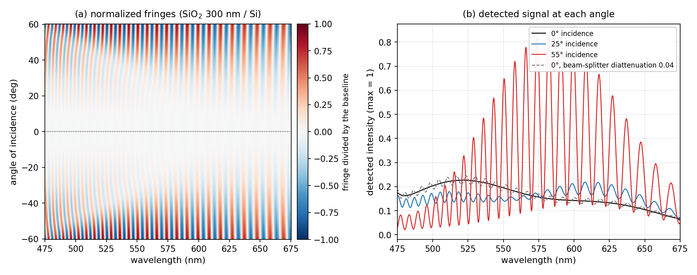
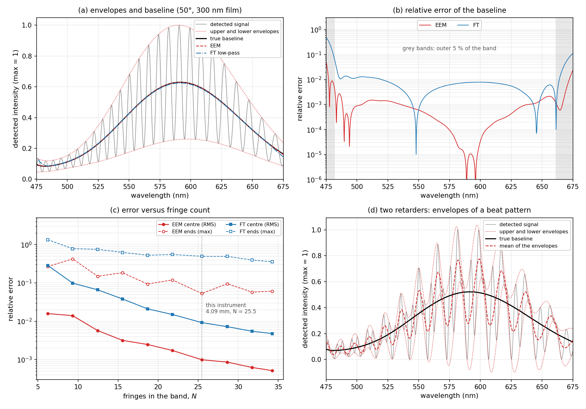
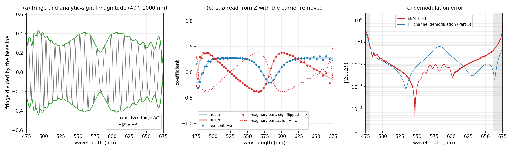
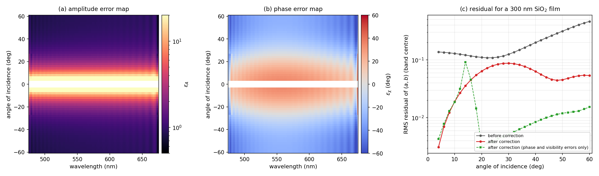
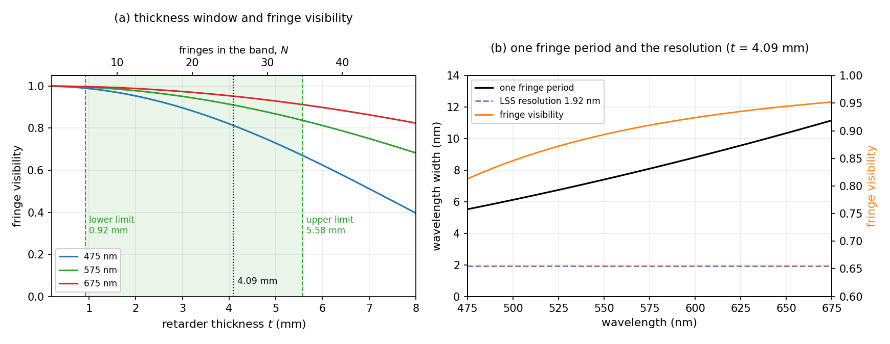

[Post 5](/en/posts/ellipsometer-channeled-spectroscopic/) put the polarization modulation on the wavelength axis. A thick birefringent plate became a variable retarder once it met a spectrometer, and $\Psi$ and $\Delta$ were read from a single spectrum with nothing rotating. The price was a single angle of incidence. [Post 6](/en/posts/ellipsometer-back-focal-plane-micro/) spread the angles of incidence across the back focal plane of a high-NA objective. The price there was that radius and azimuth used up both camera axes, leaving none for wavelength.

The summary of Post 6 ended by noting that what each method gives up and what it keeps fit together. This post actually puts the two in one instrument. It is the author's doctoral work, and the journal version appeared in *Applied Optics*.

The question is a single one. **Can one camera frame hold both the angle of incidence and the wavelength?** It can. But the azimuthal modulation has to be given up, and the joint between the two halves creates errors that neither half had on its own. This post follows what those errors look like and how they are removed.

## 1. What did Posts 5 and 6 give up, and what did they keep?

Start by placing the two halves side by side.

| | Axis carrying the modulation | Kept | Given up |
| --- | --- | --- | --- |
| Post 5, channeled spectroscopy | Fringes along wavelength | Spectral data, snapshot | Only one angle of incidence |
| Post 6, back focal plane | Azimuth in the back focal plane | Angular resolution, microspot | The wavelength axis |

Recall why Post 6 lost the wavelength axis. One axis of the back-focal-plane camera is radius and the other is azimuth. Radius carries the angle of incidence. Azimuth carries the polarization modulation: going around in azimuth rotates the plane of incidence, so in the sample's frame the fixed polarizer and analyzer rotate together. In other words, in Post 6 the azimuthal axis **was doing the job of a modulator**.

That is where one axis can be traded. If the retarder of Post 5 takes over the polarization modulation, azimuth has nothing left to do. Drop the azimuthal modulation, keep only one diameter of the back focal plane, and one camera axis is freed for the dispersion of a spectrograph. The other axis still carries the angle of incidence.

| Camera axis | Post 6 | This instrument |
| --- | --- | --- |
| First axis | Radius → angle of incidence | Position along a diameter → angle of incidence |
| Second axis | Azimuth → polarization modulation | Dispersion → wavelength |
| Polarization modulation | Carried by azimuth | Carried by fringes along wavenumber (Post 5) |

The principle Post 6 relied on, that azimuth rotates the polarization axes, is deliberately switched off here. One principle is set aside and its axis is handed back to wavelength.

## 2. How does one diameter of the back focal plane get into a spectrograph?

The optical path runs as follows. A white LED is collimated and passes a polarizer ($0°$) and a multi-order quartz retarder ($45°$). A beam splitter reflects the light into a $100\times$ objective with NA 0.95, which focuses it on the sample. The returning light goes back through the objective and the beam splitter and then through the analyzer. A relay lens images the back focal plane onto a slit, and the light passing the slit enters a line-scan spectrograph (LSS).

The spectrograph consists of an adjustable slit, a collimating lens, a transmission grating, a focusing lens and a CCD. The slit is $40\ \mu m$ wide and the grating has 830 grooves/mm. The spectral resolution is 1.92 nm over a band of 475–675 nm. The retarder is $t = 4092.3\ \mu m$ thick. The diffraction-limited illumination spot is about $0.8\ \mu m$, and a CCD exposure of 6.5 ms is enough. Nothing moves.

The slit accepts only one diameter of the back focal plane, so the two axes of a single CCD frame divide as follows.

- **Along the slit:** position on that diameter, that is, the angle of incidence $\theta$, from $-60°$ to $60°$. The mapping from position to angle follows the sine condition of Post 6, Section 3, and the scale is set at the Brewster angle as in Post 6, Section 8.
- **Along the dispersion:** the wavelength spread by the grating, that is, the wavenumber $\sigma = 1/\lambda$.
- **Fringes within the dispersion axis:** the retardance $$\phi(\sigma) = 2\pi B_{\rm eff}\,t\,\sigma = 2\pi L\sigma$$ acts as a carrier for $a$ and $b$ (Post 5, Section 1).

The slit lies along the diameter at azimuth $\Omega = 90°$. Post 6 wrote the azimuth of the back focal plane as $\phi$; here $\phi$ is reserved for the retardance and the azimuth is written $\Omega$, following the journal paper. The spectrum detected along this line is

$$I(\sigma, \theta) = \frac{I_{in}(\sigma)\,R(\sigma, \theta)}{4}\Big[1 + a\cos\phi(\sigma) + b\sin\phi(\sigma)\Big],
\qquad a = \cos 2\Psi,\quad b = \sin 2\Psi\,\sin\Delta$$

where $R$ is the unpolarized reflectance of the sample and $\Psi$ and $\Delta$ vary with $(\sigma, \theta)$. Compared with the equation in Post 5, Section 1, both terms in the bracket have the opposite sign. As Post 6, Section 8 showed, on the $\Omega = 90°$ line the polarizer along the laboratory $x$ axis becomes s-polarized, so p and s swap roles. The analyzer angle needs a note too. The journal paper gives it as $45°$, but that notation rotates the output frame by $90°$; in this series' rotation convention it is $-45°$. The author recomputed the equation as a product of component Mueller matrices to confirm it.

Because the slit takes the whole diameter, the $\theta < 0$ half ($\Omega = 270°$) also comes in. Mueller-matrix rotation has a period of $180°$, so ideally the two halves give the same signal. The $\pm\theta$ symmetry therefore serves as a check on the centre of the back focal plane and the slit alignment.

The retarder sits at $45°$ for a reason. Polarizer $0°$, retarder $45°$ and analyzer $-45°$ is the combination Lee and co-workers identified as theoretically minimizing the error. Equation 5 of the journal paper shows that when the retarder azimuth $$\Omega_C$$ is $45°$, the normalizing denominator becomes 1 and the baseline signal carries no trace of $\Psi$ or $\Delta$. Only the source intensity and the reflectance remain in it.

_Figure 1. Calculation for a 300 nm SiO₂ film on silicon in this configuration. (a) The detected image divided by the baseline signal, with angle of incidence vertical and wavelength horizontal. (b) Detected intensity along the $0°$, $25°$ and $55°$ lines; the grey dashed curve is the $0°$ line when the beam splitter is given a diattenuation of 0.04._

Two things stand out in Figure 1(a). The top and bottom halves mirror each other, and **the fringes vanish on the central $0°$ line alone.** Fringe amplitude grows with angle of incidence. In (b) the $55°$ line swings strongly, the $25°$ line weakly, and the $0°$ line simply follows the shape of the source.

The reason fringes vanish at normal incidence is in [Post 1](/en/posts/ellipsometer-oblique-rotating-element/), Section 1. At normal incidence the plane of incidence is undefined, p and s cannot be told apart, and $\Psi = 45°$, $\Delta = 180°$ are fixed. Then $a = \cos 90° = 0$ and $b = \sin 90°\sin 180° = 0$, whatever the film thickness.

This empty line is useful. Ideally the $0°$ line carries no fringes, so **any fringes left on it belong to the instrument, not the sample.** The grey dashed curve in Figure 1(b) is an example. A beam-splitter diattenuation of $D = 0.04$, meaning the transmittances of its two axes differ by about 8%, leaves fringes of amplitude $2D/(1 + D^2) \approx 0.08$ on the $0°$ line after the light passes twice. In Post 5, Section 8, a redundant channel watched for retardance drift; here a line that ought to be empty watches the instrument.

## 3. Why must the baseline signal be separated?

The equation of Section 2 can be grouped into amplitude and phase:

$$I(\sigma, \theta) = I_{DC}(\sigma, \theta)\Big[1 + A\cos\big(\phi(\sigma) - \chi\big)\Big],
\qquad A = \sqrt{a^2 + b^2},\quad \tan\chi = \frac{b}{a}$$

Here $$I_{DC} = I_{in}R/4$$ is the baseline signal. The journal paper writes the amplitude and phase offset as $$A'$$ and $$B'$$; since Post 5 used $B$ for birefringence, this post uses $A$ and $\chi$.

To get $a$ and $b$, the fringes must be divided by the baseline signal:

$$u(\sigma, \theta) = \frac{I}{I_{DC}} - 1 = A\cos(\phi - \chi)$$

The division is needed because neither the source spectrum $$I_{in}(\sigma)$$ nor the reflectance $R(\sigma, \theta)$ is known, and both multiply the baseline and the fringes alike. Dividing cancels both. So normalization works only if $$I_{DC}$$ is known accurately at every $(\sigma, \theta)$. An error in the baseline becomes an error in fringe amplitude, and from there an error in $a$ and $b$.

Post 5 did this in the Fourier domain. Move the spectrum into the optical-path-difference domain, keep only the peak near zero, transform back, and that is the baseline. But as Post 5, Section 7 showed, windowing is low-pass filtering. It shaves off fast changes in the baseline, and if the signal does not join smoothly at the two ends of the window, Gibbs oscillations appear at the band edges. The journal paper also names these edge errors, and an overall scale error, as limits of the Fourier approach.

## 4. How does the extrema envelope build the baseline signal?

Post 5 only mentioned the extrema envelope method (EEM) at the end of Section 7. Here it gets a full look.

The idea comes from the shape of the fringes. $1 + A\cos(\phi - \chi)$ reaches a maximum of $$I_{DC}(1 + A)$$ where $\phi - \chi = 2n\pi$ and a minimum of $$I_{DC}(1 - A)$$ where it equals $(2n+1)\pi$. Average the upper envelope through the maxima with the lower envelope through the minima, and the oscillating term cancels, leaving only the baseline:

$$I_{DC}(\sigma) = \frac{I_{max}(\sigma) + I_{min}(\sigma)}{2}$$

The procedure has three steps. Differentiate the signal numerically and locate extrema where the sign changes. Fit a polynomial around each extremum to refine its position and height. Join the maxima, and separately the minima, with cubic splines to form the two envelopes. There is no Fourier transform and therefore no window.

Two assumptions sit underneath. One is that the fringe is **a single harmonic**. The other is that the baseline and the amplitude stay nearly constant between neighbouring extrema.

_Figure 2. Calculated comparison of baseline extraction. The source is a hypothetical spectrum imitating a white LED, with a spectral resolution of 1.92 nm included. (a) Detected signal and envelopes at $50°$ for a 300 nm SiO₂ film. (b) Relative error of the baseline on the same line; the grey bands are the outer 5% at each end of the band. (c) Error as the retarder thickness, and so the fringe count $N$ in the band, is varied. Solid lines are the root-mean-square error over the band centre, dashed lines the maximum at the ends. (d) Beat fringes from a configuration with two retarders ($t$ and $t/2$), and the mean of their envelopes._

In Figure 2(b) the EEM baseline error at the band centre is $1.0 \times 10^{-3}$, an order of magnitude smaller than the $9.2 \times 10^{-3}$ of Fourier low-pass filtering (FT). At the ends EEM reaches at most 5% and FT 49%. Without a window there is no Gibbs oscillation.

Panel (c) shows the effect of fringe count. The number of fringes in the band is

$$N = L(\sigma_{max} - \sigma_{min})$$

and with $L = 40.8\ \mu m$ this instrument has $N \approx 25.5$. More fringes put the extrema closer together, so the envelopes track the baseline better, and the low-pass window widens too. Both methods therefore improve as $N$ grows, and across the whole range EEM stays roughly an order of magnitude ahead of FT. There is a limit to how far the fringe count can be raised; Section 8 takes that up.

When its assumptions fail, EEM fails as well. Two cases were checked by calculation.

The first is fringes that are too weak. For an extremum of the signal to remain an extremum of the fringe, the slope of the fringe must beat the slope of the baseline. Differentiating gives roughly

$$A > \frac{1}{2\pi L}\,\left\lvert\frac{d\ln I_{DC}}{d\sigma}\right\rvert$$

For the source in this calculation the right-hand side is 0.01–0.05. But as Section 2 showed, $A$ is zero at normal incidence and grows as the square of the angle at small angles. Near normal incidence the extrema are therefore dragged by the curvature of the baseline and land in the wrong places. For a 300 nm film, EEM's error was 2–30 times larger than FT's at $6°$–$10°$, and 6–13 times smaller again from $12°$ upward. Inside $4°$ almost no extrema survive, so the author's code falls back to Fourier low-pass filtering on those lines. **EEM breaks down near the centre of the back focal plane.** Those lines carry little sample information anyway, but they are also where the calibration map of Section 7 is least stable.

The second is fringes that are not a single harmonic. Figure 2(d) adds a second retarder to the polarization generator. As Post 5, Section 4 saw in the Fourier domain, two retarders produce several channels, and in the wavelength domain the result is a beat pattern. Chapter 1 of the author's dissertation showed measured fringes with one retarder and with two; this figure redraws that comparison by calculation. The maxima and minima no longer sit on $$I_{DC}(1 \pm A)$$, so the mean of the two envelopes departs from the baseline. Here the relative error over the band centre was 34% root-mean-square and 52% at most, against 0.1% with one retarder. This is why the instrument uses a single retarder. One retarder is enough to measure $\Psi$ and $\Delta$, and with one retarder the envelope mean is the baseline.

## 5. How does the Hilbert transform read a and b from the fringes?

Next, $a$ and $b$ have to be extracted from the normalized fringe $u = A\cos(\phi - \chi)$. Post 5 used a Fourier window here as well. Cutting out the $+L$ channel and transforming back yields $a$ and $b$, but as Post 5, Section 7 showed, the window blurs them ($$a \to a * w$$).

This instrument uses the Hilbert transform (HT). The Hilbert transform $\mathcal{H}$ is a linear operation that turns a cosine into a sine of the same amplitude. With it the fringe becomes a complex analytic signal:

$$Z = u + j\,\mathcal{H}[u] = A\,e^{\,j(\phi - \chi)}$$

The magnitude of the analytic signal is the fringe envelope $A$, and its phase is the carrier plus the sample phase, $\phi - \chi$. The retardance $\phi(\sigma)$ is known, so the carrier is removed by multiplication:

$$Z\,e^{-j\phi} = A\,e^{-j\chi} = A\cos\chi - jA\sin\chi = a - j\,b$$

The real part is $a$, and **$b$ is the imaginary part with its sign flipped.** Equation 11 of the author's journal paper gives the sign in this second line wrongly as $+$. Figure 3(b) plots both signs.

$Z = A e^{j(\phi - \chi)}$ holds only under a condition. The amplitude $A(\sigma)$ and phase $\chi(\sigma)$ must change slowly enough compared with the carrier $\phi(\sigma)$ that their spectra do not overlap. This is Bedrosian's theorem. It is effectively the same condition as Post 5, Section 2, where $L$ had to be large enough for the channels to separate. So a thick retarder separates the channels in Fourier demodulation and keeps the Bedrosian condition in Hilbert demodulation.

_Figure 3. Calculation at $40°$ for a 1000 nm SiO₂ film. Spectral-resolution blur is left out so that only the error of demodulation itself appears. (a) The normalized fringe and the magnitude of the analytic signal. (b) Values read from $Z$ after carrier removal, against the true values; the red dashed curve uses the imaginary part with its sign unchanged and comes out as the exact opposite of $b$. (c) Error in $(a, b)$ read with EEM and the Hilbert transform, against the error of the Fourier channel demodulation of Post 5._

Figure 3(c) compares the two demodulations. At the band centre the Hilbert approach is better, with a root-mean-square error of $1.4 \times 10^{-2}$ against $2.4 \times 10^{-2}$ for Fourier channel demodulation. For a 1000 nm film, $a$ and $b$ change quickly with wavelength (570–600 nm in Figure 3(b)); the windowed Fourier approach shaves that change off, while the Hilbert approach reads point by point.

At the band edges the picture changes. In the outer 5% the Hilbert approach reaches at most 0.61 and the Fourier approach 0.29, and at the long-wavelength end the Hilbert approach is clearly worse. The cause is not the baseline but the discrete Hilbert transform itself. A Hilbert transform computed by FFT over a finite band assumes the signal repeats periodically outside the window. Where that assumption fails at the ends, the error falls off inward roughly in inverse proportion to the distance from the edge. In the author's calculation it was 20–29% at 1% from the band edge, 1–3% at 10%, and 0.02% at the centre. EEM solves the edge problem of the baseline, but the edge problem of demodulation remains.

## 6. What new errors appear when the two halves are joined?

So far the instrument has been treated as ideal. Real components are not. The journal paper lists these sources of error.

- **Retarder:** the dispersion of birefringence is not exactly linear, so the retardance bends slightly with wavenumber (Hagen and co-workers). Decomposing the retarder's Mueller matrix also reveals a depolarizing part that lowers fringe visibility.
- **Beam splitter and lenses:** the beam splitter and the various lenses alter the phase and amplitude of the polarization. The polarization effects of the focusing lens pair seen in Post 6, Section 7 belong here too.

What makes this new in the combined instrument is that the error becomes **a map**. Post 5's instrument had one angle of incidence and no objective; its retardance error was a single constant $\delta\phi$ set by temperature. Post 6's instrument had an objective but a single wavelength. In this instrument each radius of the back focal plane corresponds to a ray crossing the objective at a different height and tilt, and the light crosses that objective twice. Each wavenumber sees a different bend in the retardance. The error therefore becomes a function of $(\sigma, \theta)$.

With the errors included, the measured fringe reads

$$u_M(\sigma, \theta) = A\,\varepsilon_A(\sigma, \theta)\,\cos\big(\phi - \chi - \varepsilon_\chi(\sigma, \theta)\big)$$

where $$\varepsilon_A$$ is the amplitude error map and $$\varepsilon_\chi$$ the phase error map. Set beside Post 5, Section 8, their meaning is clear. There, a retardance drift of $\delta\phi$ rotated the $(a, b)$ plane by $\delta\phi$. Here every point $(\sigma, \theta)$ gets its own rotation $$\varepsilon_\chi$$ and scaling $$\varepsilon_A$$ in that plane. If the retardance departs from its nominal value by $\Delta\phi(\sigma)$, then $$\varepsilon_\chi = -\Delta\phi$$; the author confirmed this relation by calculation. In other words, **the constant $\delta\phi$ of Post 5 becomes a map in this instrument.**

## 7. How does one reference sample erase the error maps?

One route is to model the error of each component. But writing a full model for polarization effects that vary with radius inside an objective is hard. The journal paper takes another route: **measure a reference sample with known optical constants once, and keep the difference between measurement and theory as a map.**

$$\varepsilon_A = \frac{A_M}{A_{ref}}, \qquad \varepsilon_\chi = \chi_M - \chi_{ref}$$

Here $$A_{ref}$$ and $$\chi_{ref}$$ are the theoretical values for the reference sample, and $$A_M$$ and $$\chi_M$$ are read from a measurement of that sample with the Hilbert demodulation of Section 5. The calculation is done directly at each $(\sigma, \theta)$ point, with no nonlinear fitting and each angle of incidence independent of the others. For a test sample the amplitude is divided by $$\varepsilon_A$$ and $$\varepsilon_\chi$$ is subtracted from the phase.

The residual on a reference sample is normally something to get rid of. This method keeps it and uses it as the calibration map. The series' recurring idea of turning a defect into a principle shows up again.

Whether the map carries over to other samples was checked by calculation, with hypothetical component errors put in.

| Error put in | Value | Kind |
| --- | --- | --- |
| Constant retardance offset | $25°$ | Phase |
| Quadratic bend in retardance | $4(\sigma - \bar\sigma)^2$ rad | Phase |
| Visibility loss on the illumination side | 0.97 | Amplitude |
| Spectral resolution | 1.92 nm | Amplitude |
| Beam-splitter diattenuation and retardance | 0.04, $4°$ | Mixes with the sample |
| Objective retardance and diattenuation | $6°$ and 0.03 at the largest angle | Mixes with the sample |

The values were chosen to make the effects easy to see; they are not those of the real instrument. The reference sample is bare silicon and the test samples are SiO₂ films.

_Figure 4. Calculation with hypothetical component errors. (a) Amplitude error map $$\varepsilon_A$$ built from bare silicon. (b) Phase error map $$\varepsilon_\chi$$. Both maps leave out angles of incidence inside $3°$. (c) Residual in $(a, b)$ for a 300 nm SiO₂ film, by angle of incidence, excluding the outer 5% at each end of the band. Grey is before correction, red after correction, and the green dashed curve is after correction when only the phase and visibility errors are present._

The phase map in (b) is, at large angles, a parabola bending along wavelength: the retardance error put in, $25° + 4(\sigma - \bar\sigma)^2$, with its sign reversed. The numbers should not be taken at face value, though. The centre value on the $50°$ line is $-27.5°$, close to the $-25°$ put in. Removing components one at a time shows that the objective contributes about $-20°$ and the beam splitter about $+17°$, almost cancelling. Remove both and the value is exactly $-25.0°$. So one map mixes the contributions of several components, and the map alone cannot separate their causes.

Inside the central $\pm 20°$ even the sign changes. On the $15°$ line the fringe amplitude of bare silicon is about 0.04, while the instrument's own fringe from the beam splitter is twice that, 0.08. The phase on that line is set by the beam splitter, not by the sample. Removing just the beam-splitter error moves the centre value of that line from $+22°$ to $-59°$.

The amplitude map in (a) shoots up at the centre. Towards normal incidence the theoretical amplitude of the reference sample, $$A_{ref}$$, goes to zero, so the ratio $$A_M/A_{ref}$$ grows and becomes unstable. The EEM breakdown of Section 4 overlaps at the same place. In the journal paper's measured amplitude map (its Figure 3(d)) the values near $0°$ were also the largest. The empty line of Section 2 becomes, here, the weak point of the calibration.

Panel (c) shows what the calibration achieves. From $8°$ upward the root-mean-square residual in $(a, b)$ drops from 0.24 before calibration to 0.062 after. The effect grows with angle, nearly tenfold at $60°$. The spike in the green dashed curve near $14°$ is the EEM breakdown of Section 4, occurring on the weak fringes of the reference sample, bare silicon. Thickness makes the difference plainer. With film thickness as the only unknown, the full $(a, b)$ data were fitted.

| Test sample | Before calibration | After calibration | After calibration (phase and visibility errors only) |
| --- | --- | --- | --- |
| SiO₂ 100 nm | −7.95 nm | +0.47 nm | +0.01 nm |
| SiO₂ 300 nm | −12.82 nm | +0.13 nm | +0.04 nm |
| SiO₂ 1000 nm | −13.38 nm | +0.79 nm | +0.04 nm |

Some error is beyond the map. It is the gap between the green dashed curve and the red line in (c). Retardance error and visibility loss only scale and shift the fringes, so a map measured on the reference sample fits any sample. In the author's calculation, with only those two present, the map captured the error exactly. The retardance and diattenuation of the objective and the beam splitter are different. They mix with the sample's $\Psi$ and $\Delta$, so the same component moves $(a, b)$ differently on different samples, and more remains the more the reference and test samples differ. The calculation suggests a remedy: use a reference sample similar to the samples to be measured.

This calibration also breaks with the lineage of scales in the series. [Post 4](/en/posts/ellipsometer-calibration/) set component angle scales from a single minimum of $R(P)$, and Post 6 set the angle-of-incidence scale from a single minimum of $\tan^2\Psi$. In both, the position of one point was the absolute reference. This time the scale is a $(\sigma, \theta)$ map of amplitude and phase, and a map cannot be pinned by one point. What is needed is not a reference point but **a whole reference sample**.

## 8. How does spectrograph resolution limit the retarder thickness?

Section 4 said EEM improves with more fringes. So should the retarder simply be made thicker?

Post 5, Sections 2 and 3 set up a thickness window. Its lower bound keeps the baseline peak and the channel from overlapping; its upper bound keeps the carrier within the spectrometer's sampling limit. Recomputed with this instrument's numbers (475–675 nm, resolution 1.92 nm, $$B_{\rm eff} = 0.00998$$), the window is 0.92–5.58 mm. The journal paper's 4.09 mm retarder sits inside the window, toward its upper end.

Even inside the window there is a cost. One spectrograph pixel integrates over a wavelength width of 1.92 nm. One fringe period is $\lambda^2/L$ in wavelength and shortens as the retarder thickens. As the period approaches the resolution, the fringe averages out within a pixel and its amplitude drops. Integrating over a box window gives a visibility of

$$V(\lambda) = \left\lvert\operatorname{sinc}\!\left(\frac{L\,\Delta\lambda}{\lambda^2}\right)\right\rvert$$

with $\operatorname{sinc} x = \sin(\pi x)/\pi x$.

_Figure 5. (a) Fringe visibility against retarder thickness. The green band is the thickness window recomputed in the manner of Post 5, and the dotted line is the journal paper's retarder; the top scale gives the number of fringes in the band. (b) One fringe period (black) of the 4.09 mm retarder, the spectral resolution (purple), and the visibility (orange)._

Figure 5(b) shows where this instrument stands. One fringe period is 5.5 nm at 475 nm, 8.1 nm at 575 nm and 11.2 nm at 675 nm, with visibilities of 0.81, 0.91 and 0.95. Depending on wavelength, fringe amplitude is cut by up to nearly 20%. That loss feeds straight into the wavenumber dependence of $$\varepsilon_A$$. In the author's calculation for a 100 nm film at $50°$, the $(a, b)$ error was 0.004 without the resolution limit and 0.052 with it. Using the true baseline gave the same 0.052. In other words, most of the error here comes from visibility, not from the baseline.

Thickness is pulled from both sides, then. A thicker retarder gives more fringes, which helps the baseline and the Bedrosian condition; a thinner one helps visibility and sampling. The journal paper gives the same prescription: raise the resolution with a higher groove density or a change of focal length, or use a thicker retarder within a given resolution.

Visibility can also depend on the sample. In a thick film $\chi(\sigma)$ changes quickly and alters the local period of the fringes. The same spectrometer averaging then acts differently than it did on the reference sample, and the $$\varepsilon_A$$ built from the reference cannot remove all of it. This is the same place where the journal paper names thick films as a hard case. The remedy is the one from Okabe in Post 5, Section 7: what the instrument averages, the model must average too. The journal paper's theoretical signal is in fact computed with the component Mueller matrices and the spectral response included.

## 9. How well did the real instrument agree?

Here are the journal paper's results. Ten single-layer SiO₂ films on silicon, about 10–1500 nm thick, were measured. Reference values came from a commercial spectroscopic ellipsometer (Horiba UVISEL), with the refractive index described by a two-term Cauchy model. The same measured data were analyzed two ways for comparison: a conventional Fourier approach, and EEM with Hilbert demodulation and error-map calibration. Three of the samples are shown below.

| Sample (reference value) | Thickness error, Fourier | Thickness error, proposed | NMSE, Fourier | NMSE, proposed |
| --- | --- | --- | --- | --- |
| 10 nm (13.49 nm) | 1.60 nm | 0.02 nm | 0.1564 | 0.0003 |
| 100 nm (105.73 nm) | 2.79 nm | 1.38 nm | 0.2243 | 0.0690 |
| 1500 nm (1572.43 nm) | 4.54 nm | 2.84 nm | 0.1860 | 0.0448 |

NMSE is the normalized mean squared error between the measured signal and the fitted theoretical signal. Across all ten samples, thickness correlated with the commercial instrument at $R^2 = 0.9999$, with relative differences of 0.13–1.31%. Repeatability over 20 repeated measurements was at most 0.39 nm at three standard deviations.

One thing should be stated precisely. The main text of the journal paper says the proposed method is consistently better in accuracy, repeatability and NMSE. Reading the supplementary table row by row tells a slightly different story. NMSE fell by a factor of 3 to 500 on all ten samples. Thickness error fell on eight of ten and actually grew on the 500 nm and 1100 nm samples. Repeatability improved on seven. A smaller signal residual does not always mean a more accurate thickness.

The journal paper also records the remaining limits. Theory and measurement disagreed near the largest angles and at the band edges, especially at 674.95 nm, which is where the Hilbert edge error of Section 5 and the visibility loss of Section 8 pile up together. The refractive-index error of thin films may come from a low-density layer formed early in deposition, which an effective-medium model could improve. Adding retarders to obtain more Mueller elements per angle was left for future work. That will mean getting past the beat problem of Section 4.

## Summary

Post 5 put the polarization on the wavelength axis, and Post 6 spread the angles of incidence across the back focal plane. This instrument drops Post 6's azimuthal modulation and gives that camera axis to wavelength. With a slit feeding one diameter of the back focal plane into a line-scan spectrograph, a single CCD frame holds both angle of incidence and wavelength, and the fringes along the wavelength axis carry $a$ and $b$.

The analysis has three steps. The extrema envelope builds the baseline without a window, the Hilbert transform reads $a$ and $b$ point by point, and amplitude and phase maps from one reference sample remove the instrument's errors. Each step has a weakness confirmed by calculation. EEM breaks down near normal incidence, where the fringes are weak, and on the beat pattern of two retarders. The Hilbert transform leaves a tail at the band edges that falls off inversely with distance. And the error maps cannot fully remove errors that mix with the sample.

The ideas that carried this series all come together in this post.

- **A place that ought to be empty watches the instrument.** The normal-incidence line should carry no fringes, so whatever is left on it belongs to the instrument. In Post 5 a redundant channel did that job.
- **A defect turns into a principle.** The wavelength dependence of retardance, a defect in Post 2, became the principle of Post 5. This time the residual on a reference sample became the calibration map. And the azimuthal modulation that was Post 6's principle was deliberately switched off to win the wavelength axis.
- **What the instrument averages, the model must average too.** After the window function of Post 5 and the focusing of Post 6, the resolution of the line-scan spectrograph is the third case.

In the lineage of scales, the pattern broke. Posts 4 and 6 set their scales from a single minimum, but this scale is a $(\sigma, \theta)$ map and needed a whole reference sample.

The question followed over seven posts is the one written at the end of Post 6. **What cannot be measured, and how do you work with that once you know it?** This post's answer has the same form. The price of capturing angle and wavelength in one frame was a set of new errors at the joint between the two halves, and those errors are handled by drawing them as maps.

## References

- Y. J. Kim, S. J. Lee, H. J. Pahk, "Snapshot angle-resolved channeled spectroscopic micro-ellipsometry for thin-film characterization," *Appl. Opt.* **64**, 3391 (2025), [doi:10.1364/AO.558576](https://doi.org/10.1364/AO.558576) — the instrument, EEM, Hilbert demodulation, amplitude and phase calibration, the measured results, and Table S1 of the supplement.
- Young Joon Kim, "Development of snapshot angle-resolved ellipsometry using a line-scan spectrograph and back focal plane spectral interference," Ph.D. dissertation, Seoul National University, 2025, Ch. 1 and Ch. 3.
- S. W. Lee et al., "Co-axial spectroscopic snapshot ellipsometry for real-time thickness measurements with a small spot size," *Opt. Express* **28**, 25879 (2020) — the azimuth combination of polarizer, retarder and analyzer.
- N. Hagen, P. Buranasiri, Y. Otani, "Compensating for nonlinear dispersion in channeled spectropolarimetry," *Appl. Opt.* **59**, 5032 (2020) — nonlinear dispersion of the retardance.
- E. Bedrosian, "A product theorem for Hilbert transforms," *Proc. IEEE* **51**, 868 (1963) — the condition under which the analytic signal holds.
- P. Hlubina, D. Ciprian, J. Luňáček, "Spectral interferometric technique to measure the ellipsometric phase of a thin-film structure," *Opt. Lett.* **34**, 2661 (2009) — visibility in spectral interferometry.
- J. Liu, Z. Jiang, S. Zhang, T. Huang, H. Jiang, S. Liu, "Calibration of polarization effects for the focusing lens pair in a micro-spot Mueller matrix ellipsometer," *Thin Solid Films* **766**, 139656 (2023) — polarization effects of the focusing lens pair.
- N. E. Huang et al., "[The empirical mode decomposition and the Hilbert spectrum for nonlinear and non-stationary time series analysis](https://doi.org/10.1098/rspa.1998.0193)," *Proc. R. Soc. Lond. A* **454**, 903 (1998) — the idea of averaging envelopes.
