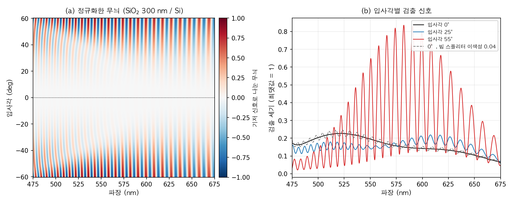
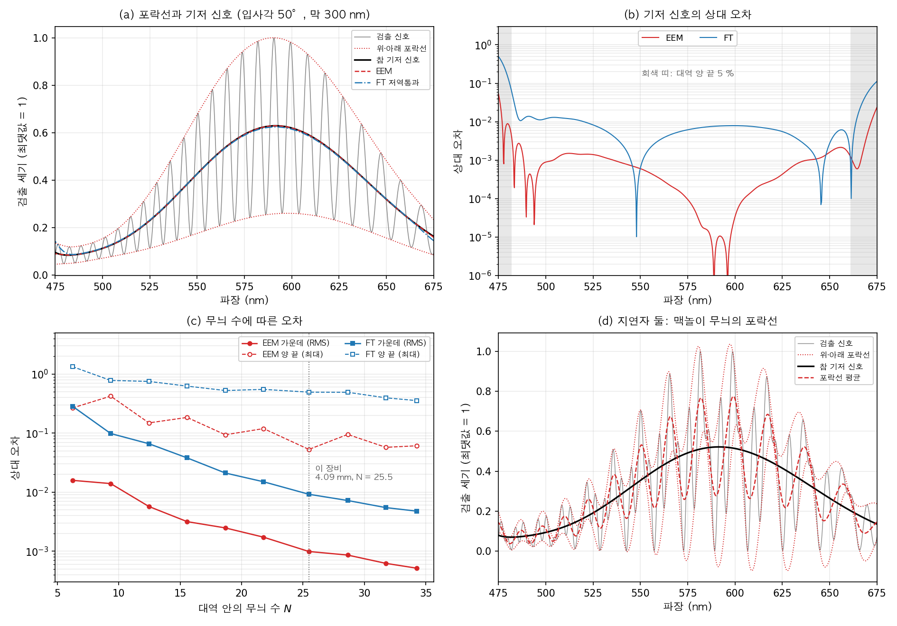
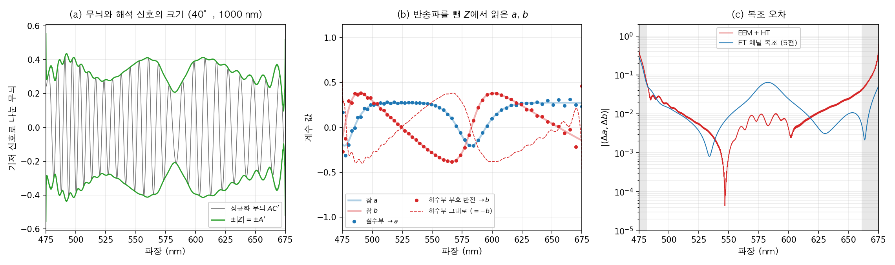
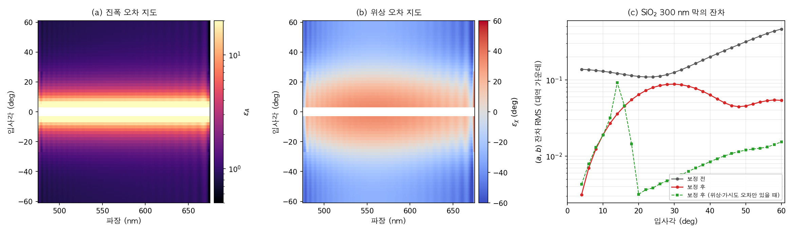
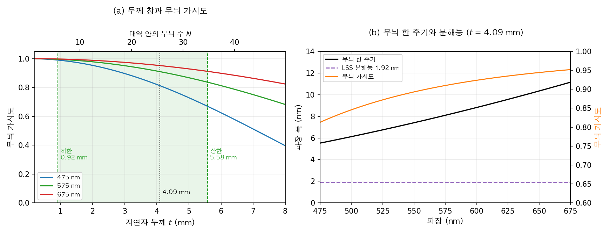

[5편](/posts/ellipsometer-channeled-spectroscopic/)은 편광 변조를 파장축에 실었다. 두꺼운 복굴절판이 분광기와 만나 가변 지연자가 되었고, 아무것도 돌리지 않고 한 장의 스펙트럼에서 $\Psi$와 $\Delta$를 읽었다. 대신 입사각은 하나였다. [6편](/posts/ellipsometer-back-focal-plane-micro/)은 고개구수 대물렌즈의 후초점면에서 입사각을 펼쳤다. 대신 카메라의 두 축을 반경과 방위각이 다 써서 파장을 담을 축이 남지 않았다.

6편의 정리 절은 두 방식이 잃는 것과 남기는 것이 서로 맞물린다고 적고 끝났다. 이번 편은 그 둘을 실제로 한 장비에 묶는다. 필자의 박사학위 연구이고, 저널판은 *Applied Optics*에 실렸다.

물음은 하나다. **카메라 사진 한 장에 입사각과 파장을 함께 담을 수 있는가.** 답은 "담을 수 있다"이다. 다만 방위각 변조를 버려야 하고, 두 반쪽에는 없던 오차가 결합 자리에서 새로 생긴다. 이 편은 그 오차가 어떤 모양이고 어떻게 지우는지를 따라간다.

## 1. 5편과 6편은 무엇을 잃고 무엇을 남겼는가

먼저 두 반쪽을 나란히 놓는다.

| | 변조를 실은 축 | 남긴 것 | 잃은 것 |
| --- | --- | --- | --- |
| 5편 채널 분광 | 파장축의 간섭무늬 | 분광, 스냅샷 | 입사각은 하나 |
| 6편 후초점면 | 후초점면의 방위각 | 입사각 분해, 마이크로스팟 | 파장축 |

6편이 파장축을 잃은 이유를 다시 보자. 후초점면 카메라의 한 축은 반경이고 다른 축은 방위각이다. 반경은 입사각을 싣는다. 방위각은 편광 변조를 싣는다. 방위각을 따라 돌면 입사면이 돌아가므로, 고정된 편광자와 분석기가 시편 좌표계에서는 함께 도는 셈이었다. 즉, 6편에서 방위각 축은 **변조기 노릇**을 하고 있었다.

여기서 축 하나를 바꿀 수 있다. 편광 변조를 5편의 지연자에 맡기면 방위각이 할 일이 없어진다. 방위각 변조를 버리고 후초점면의 지름 한 줄만 남기면, 카메라 한 축이 비고 그 축을 분광기의 파장 분산에 내줄 수 있다. 반경 축은 그대로 입사각을 싣는다.

| 카메라 축 | 6편 | 이번 장비 |
| --- | --- | --- |
| 첫째 축 | 반경 → 입사각 | 지름 위 위치 → 입사각 |
| 둘째 축 | 방위각 → 편광 변조 | 분산 → 파장 |
| 편광 변조 | 방위각이 맡는다 | 파수축의 간섭무늬가 맡는다(5편) |

6편이 원리로 삼았던 "방위각이 편광축을 돌린다"를 여기서는 일부러 끈다. 원리 하나를 내려놓고 그 자리를 파장에 돌려주는 것이다.

## 2. 후초점면의 지름 한 줄을 어떻게 분광기에 넣는가

광경로는 이렇다. 백색 LED를 시준해 편광자($0°$)와 다중차 석영 지연자($45°$)를 지나게 한다. 빔 스플리터에서 반사된 빛이 개구수 0.95, 배율 100배 대물렌즈를 거쳐 시편에 모인다. 시편에서 돌아온 빛은 대물렌즈와 빔 스플리터를 지나 분석기를 통과한다. 그 뒤의 릴레이 렌즈가 후초점면을 슬릿 위에 맺는다. 슬릿을 지난 빛은 라인 스캔 분광기(line-scan spectrograph, LSS)로 들어간다.

라인 스캔 분광기는 가변 슬릿, 시준 렌즈, 투과 격자, 집속 렌즈, CCD로 이뤄진다. 슬릿 폭은 $40\ \mu m$이고 격자는 830 grooves/mm다. 분광 해상도는 1.92 nm이고, 대역은 475~675 nm다. 지연자의 두께는 $t = 4092.3\ \mu m$다. 회절 한계로 계산한 조명 스팟은 약 $0.8\ \mu m$이고, CCD 노출은 6.5 ms로 충분했다. 움직이는 부품은 하나도 없다.

슬릿은 후초점면의 지름 한 줄만 받는다. 그래서 CCD 한 장의 두 축이 이렇게 갈린다.

- **슬릿 길이 방향:** 후초점면 지름 위의 위치, 곧 입사각 $\theta$다. 범위는 $-60°$에서 $60°$다. 위치와 입사각의 대응은 6편 3절의 사인 조건으로 정해지고, 눈금은 6편 8절처럼 브루스터각에서 세운다.
- **분산 방향:** 격자가 펼친 파장, 곧 파수 $\sigma = 1/\lambda$다.
- **분산 방향 안의 무늬:** 지연자의 지연량 $$\phi(\sigma) = 2\pi B_{\rm eff}\,t\,\sigma = 2\pi L\sigma$$가 반송파가 되어 $a$와 $b$를 싣는다(5편 1절).

슬릿은 방위각 $\Omega = 90°$ 방향의 지름에 놓인다. 6편에서는 후초점면의 방위각을 $\phi$로 적었지만, 이 편에서는 $\phi$를 지연량에만 쓰고 방위각은 저널판을 따라 $\Omega$로 적는다. 이 줄에서 검출되는 스펙트럼은 다음과 같다.

$$I(\sigma, \theta) = \frac{I_{in}(\sigma)\,R(\sigma, \theta)}{4}\Big[1 + a\cos\phi(\sigma) + b\sin\phi(\sigma)\Big],
\qquad a = \cos 2\Psi,\quad b = \sin 2\Psi\,\sin\Delta$$

$R$은 시편의 비편광 반사율이고 $\Psi$, $\Delta$는 $(\sigma, \theta)$마다 다르다. 5편 1절의 식과 비교하면 괄호 안 두 항의 부호가 반대다. 6편 8절에서 본 대로 $\Omega = 90°$ 줄에서는 실험실 $x$축의 편광자가 s편광이 되어, p와 s의 역할이 뒤바뀌기 때문이다. 분석기 각도 짚어 둔다. 저널판은 분석기를 $45°$로 적었지만, 출력 쪽 좌표를 $90°$ 돌린 표기이고 이 시리즈의 회전 규약으로는 $-45°$다. 필자는 이 식을 부품 뮬러 행렬의 곱으로 다시 계산해 확인했다.

슬릿이 지름을 통째로 받으므로 $\theta < 0$ 쪽 반쪽($\Omega = 270°$)도 들어온다. 뮬러 행렬의 회전은 주기가 $180°$라 두 반쪽은 이상적으로 같은 신호를 준다. 그래서 $\pm\theta$ 대칭이 후초점면의 중심과 슬릿 정렬을 확인하는 기준이 된다.

지연자를 $45°$에 두는 것도 이유가 있다. 편광자 $0°$, 지연자 $45°$, 분석기 $-45°$는 이승우 등이 오차를 이론적으로 가장 작게 하는 조합으로 제시한 것이다. 저널판의 식 5를 보면, 지연자 방위각 $$\Omega_C$$가 $45°$일 때 정규화 분모가 1이 되어 기저 신호에 $\Psi$와 $\Delta$가 남지 않는다. 기저 신호에는 광원 세기와 반사율만 남는다.

_그림1. 실리콘 기판 위 SiO₂ 300 nm 막을 이 배치로 본 계산이다. (a)는 검출 영상을 기저 신호로 나눈 무늬로, 세로축이 입사각, 가로축이 파장이다. (b)는 입사각 $0°$, $25°$, $55°$ 줄의 검출 세기이고, 회색 점선은 빔 스플리터에 이색성 0.04를 넣었을 때의 $0°$ 줄이다._

그림1(a)에서 두 가지가 눈에 띈다. 위아래가 거울처럼 같고, **가운데 $0°$ 줄만 무늬가 사라진다.** 무늬의 진폭은 입사각이 커질수록 커져서, (b)에서 $55°$ 줄은 크게 출렁이고 $25°$ 줄은 약하며 $0°$ 줄은 광원 모양 그대로다.

수직 입사에서 무늬가 사라지는 이유는 [1편](/posts/ellipsometer-oblique-rotating-element/) 1절에 있다. 수직으로 쏘면 입사면이 정의되지 않아 p와 s를 가를 수 없고, $\Psi = 45°$, $\Delta = 180°$로 고정된다. 그러면 $a = \cos 90° = 0$, $b = \sin 90°\sin 180° = 0$이다. 막의 두께와 상관없이 그렇다.

이 빈 자리가 쓸모가 있다. 이상적이면 $0°$ 줄에 무늬가 없어야 하므로, **그 줄에 남은 무늬는 시편이 아니라 장비의 몫이다.** 그림1(b)의 회색 점선이 그 예다. 빔 스플리터의 이색성이 $D = 0.04$이면, 곧 두 축의 투과율이 8%쯤 다르면 빛이 두 번 지나며 $0°$ 줄에 진폭 $2D/(1 + D^2) \approx 0.08$의 무늬를 남긴다. 5편 8절에서 잉여 채널이 지연량 표류를 감시했다면, 여기서는 비어 있어야 할 줄 하나가 장비를 감시한다.

## 3. 기저 신호는 왜 따로 떼어야 하는가

2절의 식을 진폭과 위상으로 묶으면 이렇게 된다.

$$I(\sigma, \theta) = I_{DC}(\sigma, \theta)\Big[1 + A\cos\big(\phi(\sigma) - \chi\big)\Big],
\qquad A = \sqrt{a^2 + b^2},\quad \tan\chi = \frac{b}{a}$$

$$I_{DC} = I_{in}R/4$$가 기저 신호(baseline signal)다. 저널판은 진폭과 위상 오프셋을 $$A'$$, $$B'$$로 적는데, 5편이 $B$를 복굴절에 썼으므로 여기서는 $A$, $\chi$로 적는다.

$a$와 $b$를 얻으려면 무늬를 기저 신호로 나눠야 한다.

$$u(\sigma, \theta) = \frac{I}{I_{DC}} - 1 = A\cos(\phi - \chi)$$

나누는 이유는 광원 스펙트럼 $$I_{in}(\sigma)$$와 반사율 $R(\sigma, \theta)$가 둘 다 모르는 양이고, 둘 다 기저 신호와 무늬에 똑같이 곱해져 있기 때문이다. 나누면 함께 지워진다. 즉, $$I_{DC}$$를 $(\sigma, \theta)$마다 정확히 알아야 정규화가 된다. 기저 신호의 오차는 곧 무늬 진폭의 오차가 되고, 그대로 $a$, $b$의 오차가 된다.

5편은 이 일을 푸리에 영역에서 했다. 스펙트럼을 광로차 영역으로 옮겨 0 근처의 봉우리만 남기고 되돌리면 기저 신호가 된다. 그런데 5편 7절에서 본 대로 창을 씌우는 일은 저역통과 필터다. 기저 신호의 빠른 변화를 깎고, 신호가 창의 양 끝에서 이어지지 않으면 깁스(Gibbs) 진동이 대역 끝에 생긴다. 저널판도 이 경계 오차와 전체 스케일 오차를 푸리에 방식의 한계로 꼽았다.

## 4. 극값 포락선은 어떻게 기저 신호를 세우는가

5편 7절 끝에서 소개만 하고 넘어간 극값 포락선 방법(extrema envelope method, EEM)을 여기서 자세히 본다.

착상은 무늬의 모양에서 나온다. $1 + A\cos(\phi - \chi)$는 $\phi - \chi$가 $2n\pi$일 때 최대 $$I_{DC}(1 + A)$$, $(2n+1)\pi$일 때 최소 $$I_{DC}(1 - A)$$다. 극대를 이은 위 포락선과 극소를 이은 아래 포락선을 평균하면 진동 항이 상쇄되고 기저 신호만 남는다.

$$I_{DC}(\sigma) = \frac{I_{max}(\sigma) + I_{min}(\sigma)}{2}$$

절차는 셋이다. 신호를 수치 미분해 부호가 바뀌는 자리에서 극값을 찾는다. 극값 주변에 다항식을 맞춰 위치와 세기를 다듬는다. 극대끼리, 극소끼리 3차 스플라인으로 이어 두 포락선을 만든다. 푸리에 변환이 없으니 창도 없다.

전제가 둘 있다. 하나는 무늬가 **조화함수 하나**라는 것이다. 다른 하나는 기저 신호와 진폭이 이웃한 극값 사이에서 거의 일정하다는 것이다.

_그림2. 기저 신호 추출의 계산 비교. 광원은 백색 LED를 흉내 낸 가상 스펙트럼이고 분광 해상도 1.92 nm를 넣었다. (a) 입사각 $50°$, SiO₂ 300 nm 막의 검출 신호와 포락선. (b) 같은 줄에서 기저 신호의 상대 오차. 회색 띠는 대역 양 끝 5%다. (c) 지연자 두께를 바꿔 대역 안 무늬 수 $N$을 바꿨을 때의 오차. 실선은 대역 가운데의 제곱평균제곱근, 점선은 양 끝의 최댓값이다. (d) 지연자를 두 장($t$와 $t/2$) 둔 배치의 맥놀이 무늬와 포락선 평균._

그림2(b)를 보면 EEM의 기저 신호 오차가 대역 가운데에서 $1.0 \times 10^{-3}$로, 푸리에 저역통과(FT)의 $9.2 \times 10^{-3}$보다 한 자릿수 작다. 양 끝에서도 EEM이 최대 5%, FT가 최대 49%다. 창이 없으니 깁스 진동도 없다.

(c)는 무늬 수의 효과다. 대역 안의 무늬 수는

$$N = L(\sigma_{max} - \sigma_{min})$$

이고, 이 장비는 $L = 40.8\ \mu m$로 $N \approx 25.5$다. 무늬가 많을수록 극값이 촘촘해져 포락선이 기저 신호를 잘 따라가고, 저역통과의 창도 넓어진다. 그래서 두 방법 모두 $N$이 커질수록 좋아진다. 그러면서도 EEM은 전 범위에서 FT보다 대략 한 자릿수 앞선다. 무늬 수를 늘리는 데에도 한계가 있는데, 이것은 8절에서 다룬다.

전제가 깨지면 EEM도 무너진다. 두 경우를 계산으로 확인했다.

첫째는 무늬가 너무 약할 때다. 극값이 무늬의 극값으로 남으려면 무늬의 기울기가 기저 신호의 기울기를 이겨야 한다. 미분해 보면 대략

$$A > \frac{1}{2\pi L}\,\left\lvert\frac{d\ln I_{DC}}{d\sigma}\right\rvert$$

여야 한다. 이 계산의 광원에서는 우변이 0.01~0.05다. 그런데 2절에서 본 대로 $A$는 수직 입사에서 0이고, 작은 입사각에서는 입사각의 제곱에 비례해 커진다. 그래서 수직 입사 근처에서는 극값이 기저 신호의 굴곡에 끌려가 엉뚱한 자리에 선다. 300 nm 막에서 입사각별로 보면 $6°$~$10°$에서 EEM의 오차가 FT보다 2~30배 컸고, $12°$ 이상에서는 다시 FT보다 6~13배 작아졌다. $4°$ 안쪽은 극값이 거의 남지 않아, 필자의 코드는 그런 줄에서 푸리에 저역통과로 넘어가게 했다. **EEM은 후초점면의 가운데 부근에서 무너진다.** 그 줄들은 어차피 시편 정보가 거의 없는 줄이지만, 7절의 보정 지도가 가장 불안해지는 자리도 여기다.

둘째는 무늬가 조화함수 하나가 아닐 때다. 그림2(d)는 편광 생성단에 지연자를 한 장 더 둔 배치다. 5편 4절이 푸리에 영역에서 본 대로, 지연자가 둘이면 채널이 여럿 생기고 파장 영역에서는 맥놀이 무늬가 된다. 필자의 학위논문 1장이 지연자 한 장과 두 장의 실측 무늬로 보인 것을 여기서는 계산으로 다시 그렸다. 극대와 극소가 더는 $$I_{DC}(1 \pm A)$$에 놓이지 않으므로 두 포락선의 평균이 기저 신호에서 벗어난다. 이 계산에서는 대역 가운데에서 상대 오차가 제곱평균제곱근으로 34%, 최대 52%였다. 한 장일 때의 0.1%와 비교가 되지 않는다. 이 장비가 지연자를 한 장만 쓰는 이유가 여기 있다. $\Psi$와 $\Delta$만 재려면 지연자 하나로 족하고, 그래야 포락선의 평균이 기저 신호가 된다.

## 5. 힐베르트 변환은 무늬에서 a와 b를 어떻게 읽는가

기저 신호로 나눈 무늬 $u = A\cos(\phi - \chi)$에서 $a$와 $b$를 꺼낼 차례다. 5편은 여기서도 푸리에 창을 썼다. $+L$ 채널을 잘라 되돌리면 $a$와 $b$가 나오지만, 5편 7절에서 본 대로 창이 $a$, $b$를 함께 흐린다($$a \to a * w$$).

이 장비는 힐베르트 변환(Hilbert transform, HT)을 쓴다. 힐베르트 변환 $\mathcal{H}$는 코사인을 같은 진폭의 사인으로 바꾸는 선형 연산이다. 그러면 무늬로 복소수 해석 신호(analytic signal)를 만들 수 있다.

$$Z = u + j\,\mathcal{H}[u] = A\,e^{\,j(\phi - \chi)}$$

해석 신호의 크기는 무늬의 포락선 $A$이고, 위상은 반송파와 시편의 위상을 합친 $\phi - \chi$다. 지연자의 지연량 $\phi(\sigma)$는 알고 있으므로 반송파를 곱해서 뺀다.

$$Z\,e^{-j\phi} = A\,e^{-j\chi} = A\cos\chi - jA\sin\chi = a - j\,b$$

실수부가 $a$이고, **허수부의 부호를 뒤집은 것이 $b$다.** 필자의 저널판 식 11은 이 둘째 줄의 부호를 $+$로 잘못 적었다. 그림3(b)에 두 부호를 함께 그렸다.

$Z = A e^{j(\phi - \chi)}$가 성립하려면 조건이 있다. 진폭 $A(\sigma)$와 위상 $\chi(\sigma)$의 변화가 반송파 $\phi(\sigma)$보다 충분히 느려서, 둘의 스펙트럼이 겹치지 않아야 한다. 이것을 베드로시안(Bedrosian) 정리라 한다. 5편 2절에서 채널이 갈라지려면 $L$이 충분히 커야 했던 것과 사실상 같은 조건이다. 즉, 두꺼운 지연자는 푸리에 복조에서는 채널을 가르고, 힐베르트 복조에서는 베드로시안 조건을 지킨다.

_그림3. 입사각 $40°$, SiO₂ 1000 nm 막의 계산이다. 분광 해상도의 흐림은 넣지 않아 복조 자체의 오차만 보인다. (a) 정규화 무늬와 해석 신호의 크기. (b) 반송파를 뺀 $Z$에서 읽은 값과 참값. 붉은 점선은 허수부를 부호 그대로 쓴 것으로, $b$와 정반대다. (c) EEM과 힐베르트 변환으로 읽은 $(a, b)$의 오차와 5편의 푸리에 채널 복조의 오차._

그림3(c)가 두 복조를 비교한다. 대역 가운데에서는 힐베르트 쪽이 낫다. 제곱평균제곱근 오차가 $1.4 \times 10^{-2}$로, 푸리에 채널 복조의 $2.4 \times 10^{-2}$보다 작다. 1000 nm 막은 $a$와 $b$가 파장에 따라 빨리 변하는데(그림3(b)의 570~600 nm), 창을 쓰는 푸리에 쪽은 그 변화를 깎고 힐베르트 쪽은 점마다 읽기 때문이다.

대역 끝에서는 사정이 다르다. 양 끝 5%에서 힐베르트 쪽은 최대 0.61, 푸리에 쪽은 최대 0.29이고, 장파장 끝에서는 힐베르트 쪽이 확연히 나쁘다. 원인은 기저 신호가 아니라 이산 힐베르트 변환 자체에 있다. 유한한 대역에서 FFT로 구한 힐베르트 변환은 신호가 창 밖으로 주기적으로 이어진다고 가정한다. 그 가정이 끝에서 깨지면 오차가 끝에서 안쪽으로 거리에 반비례하며 줄어든다. 필자의 계산에서 대역 끝 1% 지점은 20~29%, 10% 지점은 1~3%, 가운데는 0.02%였다. EEM이 기저 신호의 경계 문제를 풀어도, 복조의 경계 문제는 남는다.

## 6. 두 반쪽을 붙이면 어떤 오차가 새로 생기는가

여기까지는 장비가 이상적이라고 두었다. 실제 부품은 그렇지 않다. 저널판은 오차의 출처를 다음과 같이 꼽는다.

- **지연자:** 복굴절의 분산이 정확히 1차가 아니어서 지연량이 파수에 대해 조금 휜다(하겐 등). 지연자의 뮬러 행렬을 분해하면 편광 소멸 성분이 있어 무늬의 가시도를 낮춘다.
- **빔 스플리터와 렌즈:** 빔 스플리터와 여러 렌즈가 편광의 위상과 진폭을 바꾼다. 6편 7절에서 본 집속 렌즈쌍의 편광 효과도 여기 든다.

이것이 결합 장비에서 새로운 이유는 오차가 **지도**가 되기 때문이다. 5편의 장비는 입사각이 하나였고 대물렌즈가 없었다. 지연량 오차는 온도가 만드는 상수 $\delta\phi$ 하나였다. 6편의 장비는 대물렌즈가 있었지만 파장이 하나였다. 이 장비에서는 후초점면의 반경마다 대물렌즈를 지나는 광선의 높이와 기울기가 다르고, 빛은 그 렌즈를 두 번 지난다. 파수마다 지연량의 휨이 다르다. 그래서 오차가 $(\sigma, \theta)$의 함수가 된다.

측정되는 무늬를 오차까지 넣어 적으면 이렇다.

$$u_M(\sigma, \theta) = A\,\varepsilon_A(\sigma, \theta)\,\cos\big(\phi - \chi - \varepsilon_\chi(\sigma, \theta)\big)$$

$$\varepsilon_A$$는 진폭 오차 지도이고 $$\varepsilon_\chi$$는 위상 오차 지도다. 5편 8절과 견주면 뜻이 분명해진다. 5편에서 지연량이 $\delta\phi$만큼 표류하면 $(a, b)$ 평면에서 각 $\delta\phi$의 회전이 일어났다. 여기서는 $(\sigma, \theta)$ 점마다 그 평면에서 회전 $$\varepsilon_\chi$$와 축척 $$\varepsilon_A$$가 일어난다. 지연량이 공칭값에서 $\Delta\phi(\sigma)$만큼 어긋나면 $$\varepsilon_\chi = -\Delta\phi$$가 된다. 필자는 이 관계를 계산으로 확인했다. 즉, **5편의 상수 $\delta\phi$가 이 장비에서는 지도가 된다.**

## 7. 기준 시편 하나로 오차 지도를 어떻게 지우는가

부품마다 오차를 모형으로 세우는 길이 있다. 그러나 대물렌즈 안에서 반경마다 다른 편광 효과를 모형으로 다 적기는 어렵다. 저널판은 다른 길을 택했다. **광학 상수를 아는 기준 시편을 한 번 재서, 측정과 이론의 차이를 그대로 지도로 남긴다.**

$$\varepsilon_A = \frac{A_M}{A_{ref}}, \qquad \varepsilon_\chi = \chi_M - \chi_{ref}$$

$$A_{ref}$$와 $$\chi_{ref}$$는 기준 시편의 이론값이고, $$A_M$$과 $$\chi_M$$은 같은 시편을 재서 5절의 힐베르트 복조로 읽은 값이다. 계산은 $(\sigma, \theta)$ 점마다 바로 한다. 비선형 맞춤도 없고 입사각마다 독립이다. 측정 시편에는 진폭을 $$\varepsilon_A$$로 나누고 위상에서 $$\varepsilon_\chi$$를 빼서 적용한다.

보통 기준 시편의 잔차는 지워야 할 것이다. 이 방법은 그 잔차를 지우지 않고 그대로 보정 지도로 쓴다. 결함을 원리로 뒤집는다는 이 시리즈의 착상이 여기서 다시 나온다.

이 지도가 다른 시편으로 옮겨 가는지 계산으로 확인했다. 가상의 부품 오차를 넣었다.

| 넣은 오차 | 값 | 성격 |
| --- | --- | --- |
| 지연량 상수 오프셋 | $25°$ | 위상 |
| 지연량의 2차 휨 | $4(\sigma - \bar\sigma)^2$ rad | 위상 |
| 조명 쪽 가시도 저하 | 0.97 | 진폭 |
| 분광 해상도 | 1.92 nm | 진폭 |
| 빔 스플리터 이색성·지연 | 0.04, $4°$ | 시편과 섞임 |
| 대물렌즈 지연·이색성 | 최대 입사각에서 $6°$, 0.03 | 시편과 섞임 |

값은 효과가 잘 보이도록 고른 예시이고, 실제 장비의 값이 아니다. 기준 시편은 맨 실리콘, 측정 시편은 SiO₂ 막이다.

_그림4. 가상 부품 오차를 넣은 계산이다. (a) 맨 실리콘으로 만든 진폭 오차 지도 $$\varepsilon_A$$. (b) 위상 오차 지도 $$\varepsilon_\chi$$. 두 지도 모두 입사각 $3°$ 안쪽은 비웠다. (c) SiO₂ 300 nm 막의 $(a, b)$ 잔차를 입사각별로 본 것이다. 대역 양 끝 5%는 뺐다. 회색은 보정 전, 빨강은 보정 후, 초록 점선은 위상·가시도 오차만 넣었을 때의 보정 후다._

(b)의 위상 지도는 입사각이 큰 쪽에서 파장 방향으로 휜 포물선이다. 넣어 준 지연량 오차 $25° + 4(\sigma - \bar\sigma)^2$의 부호를 바꾼 꼴이다. 다만 숫자를 그대로 읽으면 안 된다. 입사각 $50°$ 줄의 가운데 값은 $-27.5°$로 넣어 준 $-25°$에 가깝다. 그런데 부품을 하나씩 빼 보면, 대물렌즈가 약 $-20°$, 빔 스플리터가 약 $+17°$를 보태 거의 상쇄한 결과였다. 둘을 함께 빼면 정확히 $-25.0°$가 된다. 즉, 지도 한 장에는 여러 부품의 몫이 섞여 있고, 지도만 보고 원인을 가를 수는 없다.

가운데 $\pm 20°$ 안쪽은 부호까지 달라진다. $15°$ 줄에서 맨 실리콘의 무늬 진폭은 0.04쯤인데, 빔 스플리터가 만드는 장비의 무늬는 그 두 배인 0.08이다. 그 줄의 위상은 시편이 아니라 빔 스플리터가 정한다. 빔 스플리터 오차만 빼면 그 줄 가운데 값이 $+22°$에서 $-59°$로 바뀐다.

(a)의 진폭 지도는 가운데에서 치솟는다. 수직 입사 쪽으로 갈수록 기준 시편의 이론 진폭 $$A_{ref}$$가 0으로 가므로 비율 $$A_M/A_{ref}$$가 커지고 불안해진다. 4절에서 본 EEM의 붕괴도 같은 자리에서 겹친다. 저널판의 실측 진폭 지도(그림 3(d))에서도 입사각 $0°$ 부근의 값이 가장 컸다. 2절의 빈 자리가 여기서는 보정의 약점이 된다.

(c)가 보정의 효과다. 입사각 $8°$ 이상에서 $(a, b)$ 잔차의 제곱평균제곱근이 보정 전 0.24에서 보정 후 0.062로 줄었다. 큰 입사각일수록 효과가 커서 $60°$에서는 열 배 가까이 줄었다. 초록 점선이 $14°$ 부근에서 튀는 것은 4절에서 본 EEM의 붕괴가 기준 시편, 곧 맨 실리콘의 약한 무늬에서 일어난 것이다. 두께로 보면 차이가 더 분명하다. 막 두께 하나만 미지수로 두고 $(a, b)$ 전체를 맞췄다.

| 측정 시편 | 보정 전 | 보정 후 | 보정 후 (위상·가시도 오차만) |
| --- | --- | --- | --- |
| SiO₂ 100 nm | −7.95 nm | +0.47 nm | +0.01 nm |
| SiO₂ 300 nm | −12.82 nm | +0.13 nm | +0.04 nm |
| SiO₂ 1000 nm | −13.38 nm | +0.79 nm | +0.04 nm |

보정 지도가 다 지우지 못하는 오차도 있다. (c)의 초록 점선과 빨간 실선의 차이가 그것이다. 지연량 오차와 가시도 저하는 무늬를 축척하고 미는 일만 하므로, 기준 시편에서 잰 지도가 어떤 시편에도 그대로 맞는다. 필자의 계산에서도 이 둘만 넣으면 지도가 정확히 오차를 담았다. 대물렌즈와 빔 스플리터의 지연·이색성은 다르다. 이것들은 시편의 $\Psi$, $\Delta$와 섞여서, 같은 부품이라도 시편에 따라 $(a, b)$를 다르게 옮긴다. 그래서 기준 시편과 측정 시편이 다를수록 많이 남는다. 계산이 시사하는 처방은 측정할 시편과 비슷한 기준 시편을 쓰는 것이다.

이 보정은 눈금의 계보에서도 다르다. [4편](/posts/ellipsometer-calibration/)은 $R(P)$의 최소점 하나에서 부품 각도 눈금을 세웠고, 6편은 $\tan^2\Psi$의 최소점 하나에서 입사각 눈금을 세웠다. 둘 다 점 하나의 위치가 절대 기준이었다. 이번 눈금은 진폭과 위상의 $(\sigma, \theta)$ 지도다. 지도는 점 하나로 고정할 수 없다. 그래서 기준점이 아니라 **기준 시편 전체**가 필요하다.

## 8. 분광기 해상도는 지연자 두께를 어떻게 묶는가

4절에서 무늬가 많을수록 EEM이 좋아진다고 했다. 그러면 지연자를 더 두껍게 하면 되는가.

5편 2·3절이 두께 창을 세웠다. 아래쪽은 기저 봉우리와 채널이 겹치지 않을 조건이고, 위쪽은 반송파가 분광기의 표본화 한계를 넘지 않을 조건이다. 이 장비의 수치(475~675 nm, 분해능 1.92 nm, $$B_{\rm eff} = 0.00998$$)로 다시 계산하면 창은 0.92~5.58 mm다. 저널판의 지연자 4.09 mm는 창 안에서 위쪽 한계 쪽에 있다.

창 안이라도 대가가 있다. 분광기의 한 화소는 파장 폭 1.92 nm를 적분한다. 무늬 한 주기는 파장으로 $\lambda^2/L$이고, 지연자가 두꺼울수록 짧아진다. 한 주기가 분해능에 가까워지면 화소 안에서 무늬가 평균되어 진폭이 준다. 사각 창으로 적분하면 가시도는

$$V(\lambda) = \left\lvert\operatorname{sinc}\!\left(\frac{L\,\Delta\lambda}{\lambda^2}\right)\right\rvert$$

다($\operatorname{sinc} x = \sin(\pi x)/\pi x$).

_그림5. (a) 지연자 두께에 따른 무늬 가시도. 초록 띠가 5편 방식으로 다시 계산한 두께 창이고 점선이 저널판의 지연자다. 위 눈금은 대역 안의 무늬 수다. (b) 4.09 mm 지연자의 무늬 한 주기(검정)와 분광 해상도(보라), 그리고 가시도(주황)._

그림5(b)가 이 장비의 상황이다. 무늬 한 주기가 475 nm에서 5.5 nm, 575 nm에서 8.1 nm, 675 nm에서 11.2 nm이고, 가시도는 각각 0.81, 0.91, 0.95다. 파장에 따라 무늬 진폭이 최대 20% 가까이 깎인다. 이 깎임은 $$\varepsilon_A$$의 파수 의존에 그대로 섞여 들어간다. 필자의 계산에서 입사각 $50°$, 100 nm 막의 $(a, b)$ 오차는 분해능을 빼면 0.004였는데, 넣으면 0.052로 커졌다. 참 기저 신호를 써도 0.052로 같았다. 즉, 이때 오차의 대부분은 기저 신호가 아니라 가시도에서 온다.

그러니 두께는 양쪽에서 당겨진다. 두꺼우면 무늬가 많아 기저 신호와 베드로시안 조건에 유리하고, 얇으면 가시도와 표본화에 유리하다. 저널판도 같은 처방을 적었다. 홈 밀도가 높은 격자나 초점거리 조정으로 분해능을 올리거나, 주어진 분해능 안에서 더 두꺼운 지연자를 쓴다.

가시도가 시편에 따라 달라지는 경우도 있다. 두꺼운 막은 $\chi(\sigma)$가 빨리 변해 무늬의 국소 주기를 바꾼다. 그러면 같은 분광기 평균이 기준 시편과 다르게 작용해, 기준 시편으로 만든 $$\varepsilon_A$$가 다 지우지 못한다. 저널판이 두꺼운 막을 어려운 경우로 꼽은 것과 같은 자리다. 처방은 5편 7절의 오카베(Okabe)와 같다. 장비가 평균낸 것은 모형도 함께 평균해야 한다. 저널판의 이론 신호는 실제로 부품 뮬러 행렬과 분광 응답을 함께 넣어 계산한다.

## 9. 실제 장비는 얼마나 맞았는가

저널판의 결과를 옮긴다. 실리콘 위에 SiO₂를 약 10~1500 nm로 올린 단층막 10장을 쟀다. 기준값은 상용 분광 엘립소미터(호리바 UVISEL)로 얻었고, 굴절률은 2항 코시 모형으로 두었다. 같은 측정 데이터를 두 방식으로 해석해 비교했다. 하나는 통상의 푸리에 방식이고 다른 하나는 EEM, 힐베르트 변환, 오차 지도 보정이다. 아래는 그중 세 시편이다.

| 시편(기준값) | 두께 오차, 푸리에 | 두께 오차, 제안법 | NMSE, 푸리에 | NMSE, 제안법 |
| --- | --- | --- | --- | --- |
| 10 nm (13.49 nm) | 1.60 nm | 0.02 nm | 0.1564 | 0.0003 |
| 100 nm (105.73 nm) | 2.79 nm | 1.38 nm | 0.2243 | 0.0690 |
| 1500 nm (1572.43 nm) | 4.54 nm | 2.84 nm | 0.1860 | 0.0448 |

NMSE는 측정 신호와 맞춘 이론 신호 사이의 정규화 평균제곱오차다. 10장 전체로는 상용 장비와의 두께 상관이 $R^2 = 0.9999$였고, 상대 차이는 0.13~1.31%였다. 20회 반복 측정의 반복도는 표준편차의 세 배 기준으로 최대 0.39 nm였다.

정확히 적어 둘 것이 있다. 저널판 본문은 제안법이 정확도, 반복도, NMSE 모두에서 일관되게 낫다고 썼다. 보충 자료의 표를 줄마다 보면 조금 다르다. NMSE는 10장 모두에서 3배에서 500배 작아졌다. 두께 오차는 10장 가운데 8장에서 줄었고, 500 nm와 1100 nm 시편에서는 오히려 커졌다. 반복도는 7장에서 나아졌다. 신호 잔차가 줄었다고 두께가 언제나 더 맞는 것은 아니다.

남은 한계도 저널판이 적었다. 최대 입사각 부근과 대역 끝, 특히 674.95 nm에서 이론과 측정이 어긋났다. 5절의 힐베르트 경계 오차와 8절의 가시도 저하가 함께 몰리는 자리다. 얇은 막의 굴절률 오차는 증착 초기의 저밀도 층 때문일 수 있어 유효 매질 모형으로 개선할 여지가 있다. 지연자를 늘려 입사각별 뮬러 원소를 더 얻는 것은 다음 과제로 남겼다. 4절의 맥놀이 문제를 넘어야 하는 일이다.

## 정리

5편은 편광을 파장축에 실었고, 6편은 후초점면에서 입사각을 펼쳤다. 이번 장비는 6편의 방위각 변조를 버리고 그 카메라 축을 파장에 내줬다. 슬릿이 후초점면의 지름 한 줄을 라인 스캔 분광기에 넣으면, CCD 한 장이 입사각과 파장을 함께 담고 파장축의 무늬가 $a$와 $b$를 싣는다.

해석은 세 단계다. 극값 포락선으로 창 없이 기저 신호를 세우고, 힐베르트 변환으로 점마다 $a$와 $b$를 읽고, 기준 시편 하나로 만든 진폭·위상 지도로 장비의 오차를 지운다. 각 단계에 계산으로 확인한 약점이 있다. EEM은 무늬가 약한 수직 입사 근처와 지연자가 둘인 맥놀이에서 무너진다. 힐베르트 변환은 대역 끝에 거리에 반비례하는 꼬리를 남긴다. 오차 지도는 시편과 섞이는 오차를 다 지우지 못한다.

이 시리즈를 끌고 온 착상이 이 편에 모두 모였다.

- **비어 있어야 할 자리가 장비를 감시한다.** 수직 입사 줄에는 무늬가 없어야 하므로, 거기 남은 무늬는 장비의 몫이다. 5편에서는 잉여 채널이 그 일을 했다.
- **결함을 원리로 뒤집는다.** 2편의 결함이던 지연량의 파장 의존이 5편의 원리가 되었다. 이번에는 기준 시편의 잔차가 보정 지도가 되었다. 그리고 6편의 원리였던 방위각 변조를 일부러 꺼서 파장축을 얻었다.
- **장비가 평균낸 것은 모형도 평균해야 한다.** 5편의 창 함수, 6편의 집속에 이어 라인 스캔 분광기의 분해능이 셋째 사례다.

눈금의 계보에서는 패턴이 깨졌다. 4편과 6편은 최소점 하나로 눈금을 세웠는데, 이번 눈금은 $(\sigma, \theta)$ 지도라서 기준 시편 전체가 필요했다.

일곱 편에 걸쳐 따라온 질문은 6편 끝에 적은 그대로다. **무엇을 못 재는가, 그리고 그것을 알고 어떻게 다루는가.** 이번 편의 답도 같은 꼴이다. 한 장으로 각도와 파장을 함께 담는 대가는 결합 자리에서 새로 생기는 오차였고, 그 오차는 지도로 그려서 다룬다.

## 참고자료

- Y. J. Kim, S. J. Lee, H. J. Pahk, "Snapshot angle-resolved channeled spectroscopic micro-ellipsometry for thin-film characterization," *Appl. Opt.* **64**, 3391 (2025), [doi:10.1364/AO.558576](https://doi.org/10.1364/AO.558576) — 이 편의 장비, EEM, 힐베르트 복조, 진폭·위상 보정, 측정 결과와 보충 자료의 표 S1.
- 김영준, "라인 스캔 분광기와 후초점면 분광 간섭을 이용한 스냅샷 각도 분해 엘립소메트리 개발," 서울대학교 대학원 박사학위논문, 2025, 1장과 3장.
- S. W. Lee et al., "Co-axial spectroscopic snapshot ellipsometry for real-time thickness measurements with a small spot size," *Opt. Express* **28**, 25879 (2020) — 편광자·지연자·분석기의 방위각 조합.
- N. Hagen, P. Buranasiri, Y. Otani, "Compensating for nonlinear dispersion in channeled spectropolarimetry," *Appl. Opt.* **59**, 5032 (2020) — 지연량의 비선형 분산.
- E. Bedrosian, "A product theorem for Hilbert transforms," *Proc. IEEE* **51**, 868 (1963) — 해석 신호가 성립할 조건.
- P. Hlubina, D. Ciprian, J. Luňáček, "Spectral interferometric technique to measure the ellipsometric phase of a thin-film structure," *Opt. Lett.* **34**, 2661 (2009) — 분광 간섭의 가시도.
- J. Liu, Z. Jiang, S. Zhang, T. Huang, H. Jiang, S. Liu, "Calibration of polarization effects for the focusing lens pair in a micro-spot Mueller matrix ellipsometer," *Thin Solid Films* **766**, 139656 (2023) — 집속 렌즈쌍의 편광 효과.
- N. E. Huang et al., "[The empirical mode decomposition and the Hilbert spectrum for nonlinear and non-stationary time series analysis](https://doi.org/10.1098/rspa.1998.0193)," *Proc. R. Soc. Lond. A* **454**, 903 (1998) — 포락선 평균의 착상.
