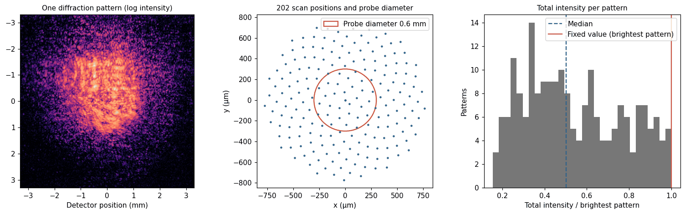
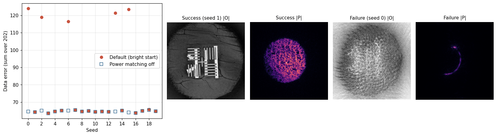
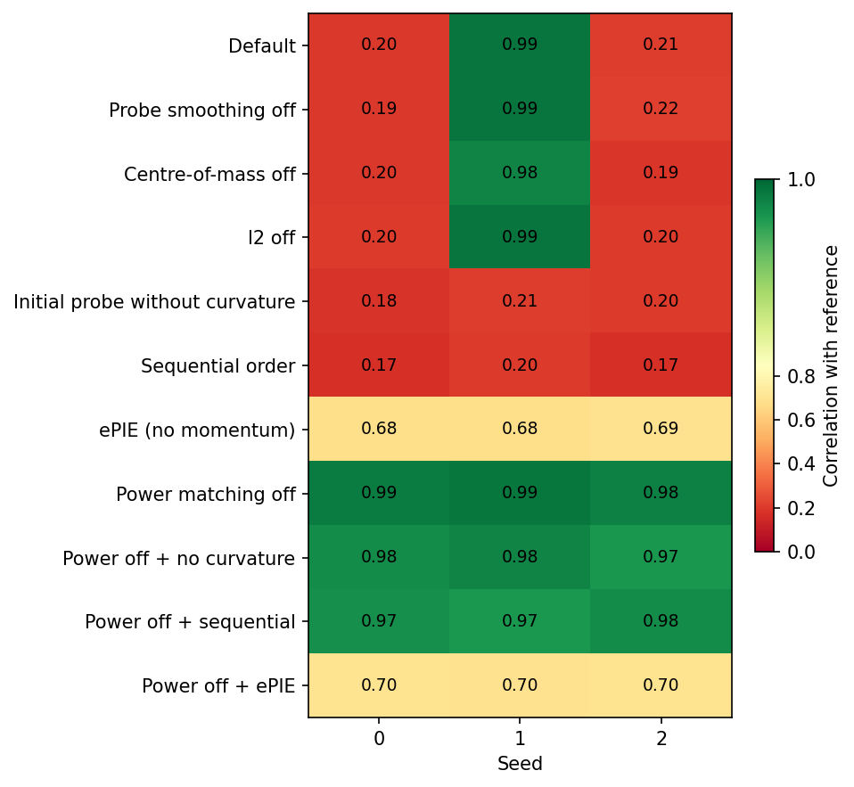
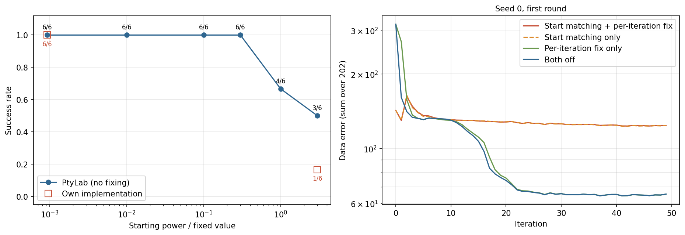
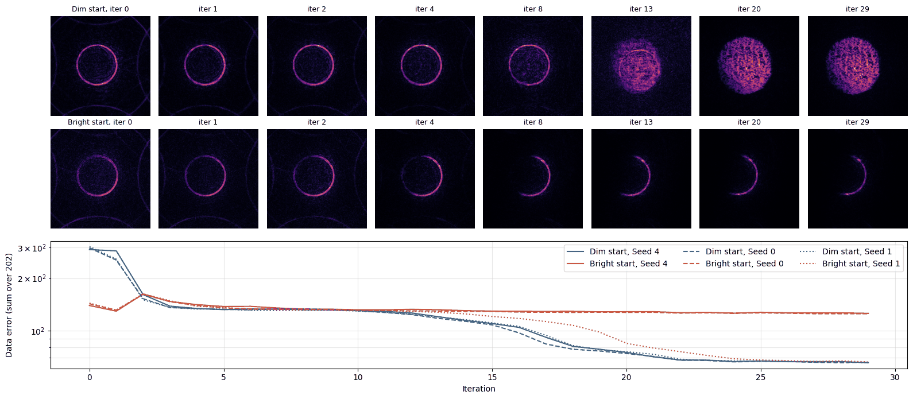
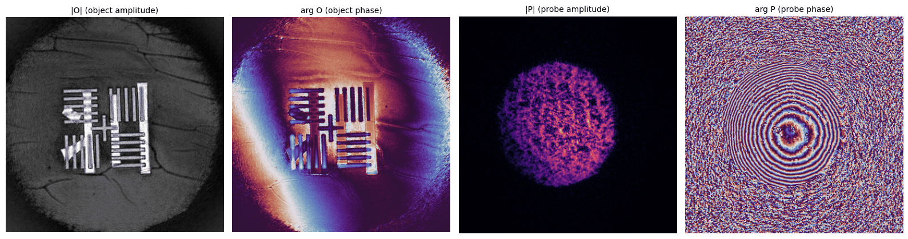

[Post 11](/posts/ptycho-experimental-fpm/) dealt with experimental data for Fourier ptychography. The main job there was to pin down the illumination geometry. We asked the data where the LEDs were, how much their brightness differed, and how much aberration the pupil carried. Real-space ptychography changes the situation. There is no lens, so there is no pupil to worry about. Instead, the light that illuminates the sample, the probe, is entirely unknown. As we have seen since [post 3](/posts/ptycho-overlap-pie-epie/), the probe is an unknown to be recovered together with the sample.

This post follows one public experimental data set from start to finish. The reference implementation is the open-source toolbox PtyLab. With PtyLab's example settings this data set reconstructs well. Yet if we change only the seed of the random order in which patterns are processed, roughly one run in four gives a completely different result. Why does the same data with the same settings collapse for some seeds? And how do we find the cause in experimental data, where there is no ground truth? These are the two questions of this post.

At the end of post 11 we anticipated solutions in which the sample and the probe swap roles. Our first own implementation did produce such a solution. Once the position convention, the initial probe and the details of the update were matched to the reference implementation, however, that solution disappeared. The failure that remained looked different, and its cause lay somewhere less expected.

## 1. What Does the Data Tell Us?

The data come from the ptychographic optical coherence tomography experiment of Du et al. and are distributed as PtyLab example data. A two-layer sample was illuminated with 708.8 nm light, and 202 diffraction patterns were recorded by a camera 38.6 mm from the sample. The patterns are binned 4×4 to 364×364, and one binned pixel is 18.16 µm wide. The light passes through a 0.6 mm circular aperture before reaching the sample.

The first thing these numbers give is the pixel size in the sample plane. If propagation from the sample to the camera is treated as far-field (Fraunhofer), a camera position $$x_d$$ corresponds to the spatial frequency $$x_d/(\lambda z)$$. The inverse of the frequency range covered by the full camera width $$N\Delta_d$$ is the width of the computational window in the sample plane. Dividing it by $N$ gives

$$
\Delta_o = \frac{\lambda z}{N \Delta_d} = \frac{708.8\ \mathrm{nm} \times 38.6\ \mathrm{mm}}{364 \times 18.16\ \mu\mathrm{m}} = 4.14\ \mu\mathrm{m}.
$$

One window is 1.51 mm wide, and the 0.6 mm probe occupies 145 pixels of it. More than half of the window around the probe is empty, so the sampling has room to spare.

The 202 scan positions are spread in concentric rings within a circle of about 1.5 mm, and the median distance to the nearest neighbour is 92.7 µm. The scan steps by 15 % of the probe diameter, so neighbouring positions overlap by 85 % in diameter and 80 % in area. This is well beyond the overlap condition from post 3 (around 60 % in diameter).

_Fig 1. One diffraction pattern (left, log intensity), the scan positions and probe diameter (middle), and the distribution of total intensity per pattern (right), normalized by the brightest pattern_

Does the far-field assumption hold? With an aperture radius $a$ = 0.3 mm, the Fresnel number is

$$
N_F = \frac{a^2}{\lambda z} = 3.3.
$$

For far-field conditions this should be much smaller than 1, so the experiment is not in the far field. There is still a reason the far-field model works. Expanding the Fresnel diffraction integral, it becomes a Fourier transform of the exit wave multiplied by a quadratic phase $$\exp(i\pi r^2/\lambda z)$$. The exit wave is the product of the sample and the probe, so if this quadratic phase is attached to the probe, the expression is identical to the far-field one. In other words, the probe the algorithm finds is not the actual beam but the beam multiplied by the quadratic phase. We checked this identity against a direct sum of the Fresnel integral (relative difference $$10^{-14}$$). This is also why PtyLab puts a curvature phase into the initial probe.

The right panel of Fig 1 shows the total intensity measured in each pattern. The darkest pattern is 16 % of the brightest, and the median is 50 %. The sample absorbs light differently at each position. This distribution returns in section 4.

## 2. Why Do the Same Settings Give Different Results?

PtyLab's example setting is mPIE. At each position it applies the rPIE update of [post 4](/posts/ptycho-probe-ambiguity-raster-rpie/) ($\alpha$ = 0.1 on the sample side, step 0.25), and with 5 % probability per position it adds the momentum step of [post 5](/posts/ptycho-momentum-difference-map/) (friction 0.7, feedback 0.3). The patterns are taken in order for the first two iterations and shuffled every iteration afterwards. Several constraints are applied at the end of each iteration. The probe amplitude is smoothed slightly, the probe's centre of mass is moved to the window centre every 10 iterations, and the total probe power $$\sum \lvert P \rvert^2$$ is fixed to the total intensity of the brightest pattern. Two rounds of 50 iterations are run, and the second round adds l2 regularization, which multiplies the sample and the probe by 0.99.

We ran this setting with only the random seed changed, from 0 to 19. The shuffled order and the moments at which momentum is applied follow the seed. How do we judge the result? As in post 11, the measure available without ground truth is the data error. Here we follow PtyLab's definition: for each pattern, the difference between the measured and modelled intensities divided by the measured total intensity, summed over the 202 patterns.

$$
E = \sum_{j=1}^{202} \frac{\sum_{\mathbf{q}} \lvert I_j(\mathbf{q}) - \lvert \Psi_j(\mathbf{q}) \rvert^2 \rvert}{\sum_{\mathbf{q}} I_j(\mathbf{q})}
$$

$$I_j$$ is the $j$-th measured pattern, and $$\Psi_j$$ is the diffracted wave computed from the reconstructed sample and probe. If each pattern is off by a little over 30 % on average, $E$ comes to about 64. That is the level of noise and model imperfection in this data set.

_Fig 2. Data error per seed (left), and the sample and probe amplitudes of a successful and a failed reconstruction with the default setting (four panels on the right)_

The red dots in the left panel of Fig 2 are the default setting. Fifteen of the twenty runs cluster at errors of 63.7–65.8, and five (seeds 0, 2, 6, 13 and 15) cluster at 116.6–124.0. Nothing falls in between. The outcomes split into two peaks, so the error alone is enough to judge them. Comparing the sample amplitude with a reference reconstruction from our own implementation (section 6) gives the same verdict. Successful reconstructions correlate with it at 0.97 or above, failed ones at 0.27 or below.

What does a failed solution look like? In the right panels of Fig 2, the successful sample shows the bars of the test target clearly, and the probe is a mottled disc. In the failed reconstruction the probe has shrunk to a thin arc along the aperture edge or a few points, and the sample is filled with a pattern resembling the scan grid. The sample and probe have not swapped roles. Instead, the probe has collapsed and the sample has been forced to take over its share.

Our own mPIE behaves the same way. With the same default setting, seeds 0–11 give seven successes and five collapses of the same form. The collapsing seeds differ from PtyLab's because the random sequences differ. The failure is therefore a property of the setting, not a bug in one implementation.

## 3. What Can Be Switched Off to Prevent the Collapse?

The simplest way to find a cause is to switch settings off one at a time. We changed one thing at a time, ran it with seeds 0–2, and compared with the default. Using several seeds matters. The default setting also succeeds with seed 1, so a variant that succeeds on a single seed cannot be said to have fixed the cause.

_Fig 3. Variants with one setting changed (rows) against seeds (columns). The colour and number in each cell are the correlation with the reference reconstruction. Green is success, red is failure_

Fig 3 shows the result. Switching off probe smoothing, centre-of-mass alignment or l2 regularization leaves the collapse in place, on the same seeds and in the same form as the default. An initial probe without curvature, or a sequential order, makes all three seeds collapse. Only one switch changed the outcome: the one that fixes the total probe power. Turning it off alone makes all three seeds succeed, and with 20 seeds all twenty succeed (blue squares in Fig 2).

The interactions are interesting. With power correction off, removing the curvature or using a sequential order now succeeds. Curvature and random order are not needed in themselves. They lowered the chance of collapse while power correction was on. Experiments that switch off one thing at a time easily miss interactions like this. Once a suspicious knob is found, the other settings should be switched off again with that knob off.

There is one exception. Switching the engine to ePIE, which has no momentum, leaves the error near 100 regardless of power correction. The target is visible in the sample, but round ring marks overlap it. The probe in this data set is mottled like the diffuser probe that rPIE could not solve in post 4. In post 5 it was the small early steps that solved such a probe, and here the bundle of mPIE settings plays that role. We do not pursue this branch further in this post.

## 4. What Does Power Correction Do Twice?

Power correction is the guard against the scale exchange of post 4. Multiplying the sample by $c$ and dividing the probe by $c$ leaves the product unchanged, so the data cannot fix the scale of either. The total probe power is therefore tied to a single value. Which value? PtyLab uses the total intensity of the brightest pattern. Far-field propagation conserves energy, so the total intensity of a pattern equals the total intensity of the exit wave, $$\sum \lvert O P \rvert^2$$. If the sample does not add light ($$\lvert O \rvert \le 1$$), this cannot exceed $$\sum \lvert P \rvert^2$$. The brightest pattern is thus a position where the sample lost almost no light, and it is a natural estimate of the probe power. For this data set the value is $$1.77\times 10^7$$.

This switch, however, acts in two places. It sets the probe power to that value at the start of a round, and it sets it again at the end of every iteration. The initial probe is a circle of amplitude 1, so its total power is $$1.64\times 10^4$$, which is 0.00093 times the fixed value. Turning the switch on fixes the power every iteration, and it also starts the reconstruction a thousand times brighter. Which of the two is the problem?

We separated them on the same seeds. Correcting only at the start, without fixing every iteration, makes seeds 0 and 6 collapse exactly as in the default setting. The error curves over iterations almost coincide with the default as well. Conversely, starting from the dim circle and fixing the power every iteration makes both seeds succeed. With the same seed, the shuffled order and the momentum timing are also the same. The only difference is the starting power.

_Fig 4. Success rate against starting power (left, seeds 0–5, no per-iteration fixing) and the data error over iterations for seed 0 (right). Correction at the start only (dashed) nearly coincides with the default setting_

Varying the starting power more finely shows the trend (left panel of Fig 4). Starting at 0.00093, 0.01, 0.1 or 0.3 times the fixed value, all 24 runs on seeds 0–5 succeed. At 1 times, four of six succeed, and at 3 times, three of six. The seeds that collapse at 1 times (0 and 2) also collapse at 3 times. In other words, the brighter the start, the more likely the collapse. Our own mPIE shows the same trend. Starting dim with per-iteration fixing, all twelve runs succeed; starting dim without fixing, all six succeed; starting at 3 times, only one of six succeeds.

Fixing the power every iteration did no harm. With fixing switched off entirely, the total probe power drifts to a little over 30 times the fixed value during the two rounds, and the sample darkens accordingly, but the data error stays at 64–65. The scale exchange that post 4 called harmless actually happens here. The problem was not tying down the scale but where the reconstruction started.

## 5. Why Does a Bright Start Collapse?

If the data cannot fix the scale, why does the starting scale change the result? The update rule holds a clue. At one position, rPIE replaces the intensity of the computed diffracted wave with the measured one, keeps the phase, and forms the exit wave $$\psi'$$. It then distributes the difference from the current exit wave $\psi = O P$ to the sample.

$$
O' = O + \beta \frac{P^*\,(\psi' - \psi)}{\alpha \max\lvert P \rvert^2 + (1-\alpha)\lvert P \rvert^2}
$$

What happens if the probe is multiplied by $s$? $\psi$ is multiplied by $s$, but $$\psi'$$ is not, because the measured amplitude is substituted in. The denominator scales by $s^2$ and the $$P^*$$ in the numerator by $s$, so

$$
O' = O + \beta \frac{P^*\,(\psi'/s - \psi)}{\alpha \max\lvert P \rvert^2 + (1-\alpha)\lvert P \rvert^2}.
$$

The probe scale survives only in the measured term, as $1/s$. Changing the scale changes the form of the update. The solution does not know the scale, but the path to the solution does.

Starting from the plain circle probe in this data set, the amplitude scale is $$s \approx \sqrt{0.00093} = 0.03$$. The first sweep of sample updates then writes the measured amplitude into the sample magnified more than thirty times. Measured on synthetic data, the sample update at the first position is 37 times larger than with $s$ = 1. With a dim start, the first sweep effectively redraws the sample from the measurements. With a bright start, $$\psi'$$ and $\psi$ are of similar size, so the sample is corrected only a little, and the probe absorbs the difference between the circle and the real probe. The experimental data show the same. After the first iteration, the coefficient of variation of the sample amplitude (standard deviation over mean) is 1.2–1.3 for a dim start, a large fluctuation that settles to 0.3 by iteration 4. For a bright start it is about 0.2 from the beginning, nearly flat.

_Fig 5. Probe amplitude of our own implementation with seed 4, starting dim (top) and bright (middle). Both fix the power every iteration, so the only difference is the starting power of the first sweep. Bottom: data error over iterations for seeds 0, 1 and 4_

Fig 5 shows the process. In both cases the probe after the first iteration is a bright ring along the aperture edge. With a dim start this ring stays as one ring in the centre and fills into a mottled disc between iterations 13 and 20. With a bright start the ring appears doubled and offset from the first iteration, its left side begins to fade around iteration 4, and from iteration 8 only the right arc remains. The probe has collapsed. The error curves tell the same story. With a dim start the error jumps to around 300 in the first two iterations and comes down to about 65 by iteration 30. In the bright-start runs that collapse (seeds 0 and 4) it stays around 130 from the start and stops at 125. Seed 1, despite a bright start, comes down late, after iteration 15, and succeeds.

From here on is interpretation. If the sample stays nearly flat after a bright start, the probe update is close to the sum of the corrections at every position. Corrections that are slightly offset at each position can accumulate into overlapping rings. Then, depending on when momentum is applied (5 % probability per position), the overlapping rings may merge back into one or tip to one side and collapse. This is where the seed decides the outcome. Confirming this interpretation would require matching, over many more seeds, the moment the rings double with the moment momentum is applied. What is certain is the observation itself: on the same seed, with only the starting power of the first sweep differing, the outcomes diverged.

In post 5, too, it was the first few small steps that solved the diffuser probe. Here again, the first sweep decided the result. In a reconstruction with an unknown probe, the first few iterations decide which valley the solution enters, and the iterations after that only descend it.

## 6. What Had to Be Matched in Our Own Implementation?

Our own mPIE matches the details of PtyLab one by one: the Fresnel pixel size, the convention for rounding positions to pixels, the circle probe with curvature, the denominator and step of rPIE, momentum with 5 % probability per position, and the order of the end-of-iteration constraints. The setting this post recommends is to start dim from the plain circle probe and fix the power every iteration. This setting succeeded in all twelve runs on seeds 0–11, with errors of 63.9–65.1. That is the same range as PtyLab's successful reconstructions.

_Fig 6. Reconstruction from our own implementation (dim start, power fixed every iteration, seed 0): sample amplitude and phase, probe amplitude and phase_

The sample amplitude in Fig 6 shows the bars of the test target, with thin crack-like lines overlaid behind them. The two-layer sample was approximated by a single transmission function, so structure from the other layer may have leaked in. The sample phase carries a large tilt. Because of the phase-ramp ambiguity of post 4, the measurements cannot decide whether this tilt belongs to the sample or the probe. The probe is a mottled disc, and its phase shows concentric fringes. This is the quadratic phase from section 1, taken on by the probe.

There was one trap along the way. Centre-of-mass alignment is the constraint that moves the probe to the window centre. At first we moved only the probe and its momentum. But moving only the probe changes its position relative to the sample, which is the same as deliberately adding a position error to every pattern. The sample, its momentum, and the previous values that the momentum refers to must all be moved by the same amount for the product to stay unchanged. On synthetic data, moving them together leaves the error unchanged, while moving only the probe raises the error by 29 over 169 patterns.

This mistake did not show while the power was fixed every iteration. When fixing was switched off, the total probe power grew to 20,000 times the fixed value and the second-round error rose to 96. Three of the six runs started at 3 times diverged. After the fix, even without fixing the power, the total power stops at a little over 30 times and the error stays at 64–65. This matches PtyLab. Fixing the power can thus hide other defects. Running once with the binding constraint switched off is a good way to check an implementation.

## Summary

With the same data and the same settings, changing only the seed made the reconstruction collapse about one time in four. The collapsed solutions had data errors near 120, clearly separated from the 64 of the successful ones. Even without ground truth, judging them was easy. Switching settings off one at a time showed that a single switch, the one that fixes the probe power, decided the outcome. Splitting that switch in two showed that the cause was not the per-iteration fixing but the starting power. Starting at 0.3 times the fixed value or below, every run on seeds 0–5 succeeded. At 1 and 3 times, close to half collapsed.

The reason lies in the update rule. The product of sample and probe does not know the scale, but the rPIE update uses the measured amplitude directly, so changing the probe scale $s$ changes its form. With a dim start, the first sweep redraws the sample from the measurements. With a bright start, the sample is left almost as it is and the probe absorbs the mismatch. On the same seed, this one difference made the probe either a disc or a collapsed arc along the edge.

In other words, the scale ambiguity is harmless to the solution but not to the path toward it. When an experimental reconstruction wavers with the seed, the starting point is worth suspecting before the update rule.

## Next

Post 13 reconstructs the two layers of this data set separately. It applies the multislice model of post 9 to experimental data and also covers data taken at several wavelengths and finding the distance to the sample from the data.

## References

- M. Du, L. Loetgering, K. S. E. Eikema, S. Witte, "[Ptychographic optical coherence tomography](https://doi.org/10.1364/OL.416144)," *Optics Letters* 46(6), 1337 (2021). The experiment that recorded the data used here.
- L. Loetgering et al., "[PtyLab.m/py/jl: a cross-platform, open-source inverse modeling toolbox for conventional and Fourier ptychography](https://doi.org/10.1364/OE.485370)," *Optics Express* 31(9), 13763 (2023). The toolbox and example settings used as the reference implementation, including absorbing the Fresnel quadratic phase into the probe.
- A. M. Maiden, J. M. Rodenburg, "[An improved ptychographical phase retrieval algorithm for diffractive imaging](https://doi.org/10.1016/j.ultramic.2009.05.012)," *Ultramicroscopy* 109(10), 1256–1262 (2009). ePIE.
- A. Maiden, D. Johnson, P. Li, "[Further improvements to the ptychographical iterative engine](https://doi.org/10.1364/OPTICA.4.000736)," *Optica* 4(7), 736–745 (2017). rPIE and mPIE.
- Data: M. Du, [ptyLab example data](https://doi.org/10.6084/m9.figshare.14915628) (figshare, CC BY 4.0), TwoLayer_bin4.hdf5.
