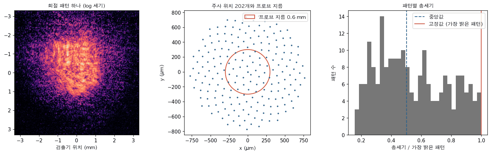
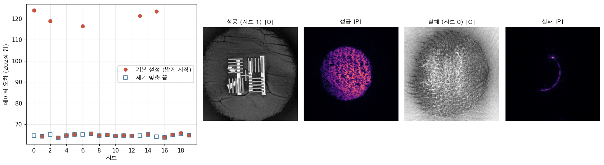
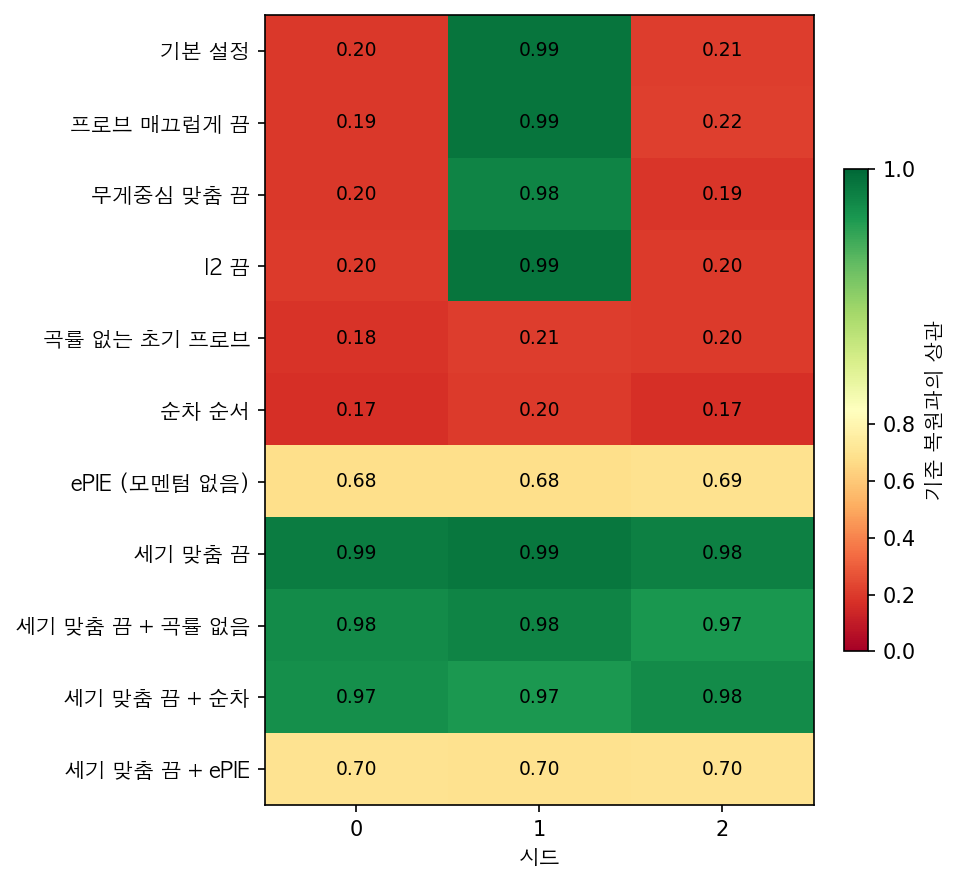
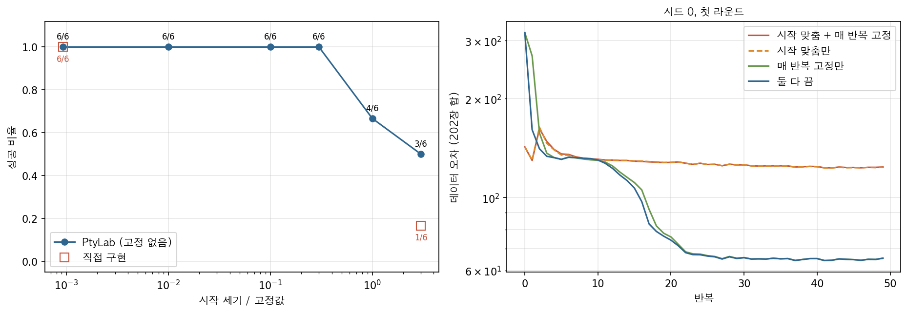
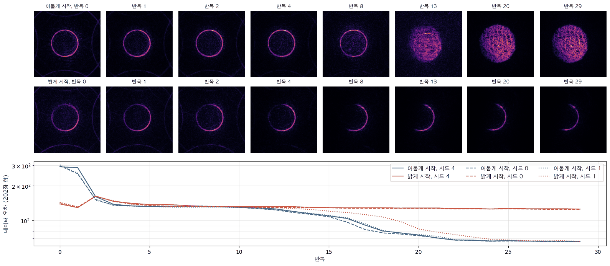
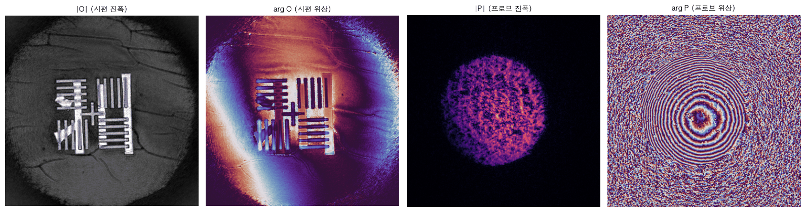

[11편](/posts/ptycho-experimental-fpm/)은 푸리에 타이코그래피의 실측 데이터를 다뤘다. 거기서 할 일은 주로 조명 기하를 맞추는 것이었다. LED가 어디 있는지, 밝기가 얼마나 다른지, 동공에 수차가 얼마나 있는지를 데이터에 물었다. 실공간 타이코그래피로 오면 사정이 달라진다. 렌즈가 없으니 동공을 따질 일은 없다. 대신 시편을 비추는 빛, 곧 프로브(probe)를 통째로 모른다. [3편](/posts/ptycho-overlap-pie-epie/)부터 다룬 대로 프로브는 시편과 함께 복원해야 하는 미지수다.

이번 편은 공개된 실측 데이터 한 벌을 끝까지 따라간다. 참고 구현으로는 공개 도구 PtyLab을 썼다. PtyLab의 예제 설정을 그대로 쓰면 이 데이터는 잘 풀린다. 그런데 패턴을 처리하는 무작위 순서의 시드만 바꿔 다시 돌리면 네 번에 한 번꼴로 전혀 다른 결과가 나온다. 같은 데이터, 같은 설정인데 왜 어떤 시드에서는 무너지는가? 정답 영상이 없는 실측에서 그 원인을 어떻게 찾는가? 이번 편의 질문은 이 두 가지다.

11편 끝에서는 시편과 프로브가 역할을 맞바꾼 해를 예고했다. 처음 짠 직접 구현에서 실제로 그런 해가 나왔다. 하지만 위치 규약, 초기 프로브, 갱신식의 세부를 참고 구현에 맞추자 그 해는 사라졌다. 남은 실패는 모양이 달랐고, 원인은 더 뜻밖의 곳에 있었다.

## 1. 데이터는 무엇을 알려 주는가?

데이터는 Du 등이 타이코그래피 광간섭 단층촬영(ptychographic optical coherence tomography) 실험에서 찍은 것 가운데 하나로, PtyLab의 예제 데이터로 공개되어 있다. 두 층으로 된 시편을 708.8 nm 빛으로 비추고, 시편에서 38.6 mm 떨어진 카메라로 회절 패턴 202장을 찍었다. 패턴은 4×4 화소를 묶어 364×364이고, 묶은 화소 하나의 크기는 18.16 µm다. 빛은 지름 0.6 mm의 원형 조리개를 지나 시편에 닿는다.

이 숫자들에서 먼저 시편면의 화소 크기가 나온다. 시편과 카메라 사이를 원시야(Fraunhofer) 전파로 보면 카메라 위의 위치 $$x_d$$ 는 공간주파수 $$x_d/(\lambda z)$$ 에 대응한다. 카메라 전체 폭 $$N\Delta_d$$ 가 담는 주파수 범위의 역수가 시편면에서 계산하는 창의 폭이고, 이것을 $N$ 으로 나누면

$$
\Delta_o = \frac{\lambda z}{N \Delta_d} = \frac{708.8\ \mathrm{nm} \times 38.6\ \mathrm{mm}}{364 \times 18.16\ \mu\mathrm{m}} = 4.14\ \mu\mathrm{m}
$$

이다. 창 하나는 1.51 mm이고, 지름 0.6 mm의 프로브는 그 안에서 145화소를 차지한다. 프로브 둘레에 창의 절반 이상이 비어 있으니 표본화에 여유가 있다.

주사 위치 202개는 지름 약 1.5 mm의 원 안에 동심원처럼 퍼져 있고, 가장 가까운 이웃까지 거리는 중앙값 92.7 µm다. 프로브 지름의 15 %만큼 옮겨 가며 찍었으니 이웃한 두 위치의 겹침은 지름으로 85 %, 넓이로 80 %다. 3편에서 본 겹침 조건(지름으로 60 % 안팎)을 넉넉히 넘는다.

_그림1. 회절 패턴 하나(왼쪽, 로그 세기), 주사 위치와 프로브 지름(가운데), 패턴별 총세기의 분포(오른쪽). 총세기는 가장 밝은 패턴으로 나눈 값이다_

원시야 가정은 맞는가? 조리개 반지름 $a$ = 0.3 mm로 프레넬 수(Fresnel number)를 재면

$$
N_F = \frac{a^2}{\lambda z} = 3.3
$$

이다. 원시야라고 부르려면 이 값이 1보다 한참 작아야 하니 이 실험은 원시야가 아니다. 그런데도 원시야 모형으로 풀어도 되는 까닭이 있다. 프레넬 회절 적분을 펼치면 출사파에 이차 위상 $$\exp(i\pi r^2/\lambda z)$$ 를 곱한 뒤 푸리에 변환하는 꼴이 된다. 출사파는 시편과 프로브의 곱이므로 이 이차 위상을 프로브에 붙여 두면 식이 원시야와 똑같아진다. 즉, 알고리즘이 찾는 프로브는 실제 빔이 아니라 빔에 이차 위상을 곱한 것이다. 이 항등식은 프레넬 적분을 직접 더한 값과 비교해 확인했다(상대 차 $$10^{-14}$$). PtyLab이 초기 프로브에 곡률 위상을 넣어 주는 것도 이 때문이다.

그림1 오른쪽은 패턴마다 잰 총세기다. 가장 어두운 패턴은 가장 밝은 패턴의 16 %이고 중앙값은 50 %다. 시편이 자리마다 빛을 다르게 흡수하기 때문이다. 이 분포는 4절에서 다시 쓰인다.

## 2. 같은 설정인데 왜 결과가 다른가?

PtyLab의 예제 설정은 mPIE다. 위치 하나마다 [4편](/posts/ptycho-probe-ambiguity-raster-rpie/)의 rPIE 갱신(시편 쪽 $\alpha$ = 0.1, 걸음 0.25)을 하고, 위치마다 5 % 확률로 [5편](/posts/ptycho-momentum-difference-map/)의 모멘텀 단계(마찰 0.7, 피드백 0.3)를 더한다. 패턴 순서는 처음 두 반복만 차례대로이고 그 뒤는 반복마다 섞는다. 반복이 끝날 때마다 몇 가지 제약을 건다. 프로브 진폭을 조금 매끄럽게 하고, 10반복마다 프로브의 무게중심을 창 가운데로 옮기고, 프로브의 총세기 $$\sum \lvert P \rvert^2$$ 를 가장 밝은 패턴의 총세기로 고정한다. 50반복을 두 라운드 돌리고, 둘째 라운드에는 시편과 프로브에 0.99를 곱하는 l2 정규화(regularization)를 더한다.

이 설정에서 무작위 수의 시드만 0부터 19까지 바꿔 돌렸다. 섞는 순서와 모멘텀을 거는 시점이 시드를 따른다. 결과를 무엇으로 판정하는가? 11편과 같이 정답 없이 쓸 수 있는 척도는 데이터 오차다. 여기서는 PtyLab의 정의를 따라, 패턴마다 측정과 모형 세기의 차이를 측정 총세기로 나눈 값을 202장에 걸쳐 더했다.

$$
E = \sum_{j=1}^{202} \frac{\sum_{\mathbf{q}} \lvert I_j(\mathbf{q}) - \lvert \Psi_j(\mathbf{q}) \rvert^2 \rvert}{\sum_{\mathbf{q}} I_j(\mathbf{q})}
$$

$$I_j$$ 는 $j$ 번째 측정 패턴, $$\Psi_j$$ 는 복원한 시편과 프로브로 계산한 회절파다. 패턴 하나가 평균 30 % 남짓 어긋나면 $E$ 는 64 근처가 된다. 이 데이터의 노이즈와 모형의 불완전함이 그만큼이다.

_그림2. 시드별 데이터 오차(왼쪽)와, 기본 설정에서 성공한 복원과 실패한 복원의 시편 진폭·프로브 진폭(오른쪽 넷)_

그림2 왼쪽의 빨간 점이 기본 설정이다. 스무 번 가운데 열다섯 번은 오차 63.7–65.8에 모이고, 다섯 번(시드 0, 2, 6, 13, 15)은 116.6–124.0에 모인다. 그 사이 값은 하나도 없다. 성패가 두 봉우리로 갈리니 오차 하나로 판정이 된다. 시편 진폭을 6절의 직접 구현으로 얻은 기준 복원과 견줘도 같다. 성공한 복원은 상관이 0.97 이상, 실패한 복원은 0.27 이하다.

실패한 해는 어떻게 생겼는가? 그림2 오른쪽에서 성공한 복원의 시편에는 시험 표적의 막대가 뚜렷하고, 프로브는 얼룩진 원판이다. 실패한 복원에서는 프로브가 조리개 가장자리의 가는 호나 점 몇 개로 오그라들었고, 시편은 주사 격자를 닮은 얼룩으로 채워졌다. 시편과 프로브가 역할을 맞바꾼 것이 아니라, 프로브가 무너지고 시편이 그 몫을 억지로 떠안은 해다.

직접 짠 mPIE도 같다. 같은 기본 설정으로 시드 0–11을 돌리면 일곱 번 성공하고 다섯 번 같은 모양으로 무너진다. 무너지는 시드가 PtyLab과 다른 것은 난수열이 달라서다. 실패가 특정 구현의 버그가 아니라 설정에 딸린 성질이라는 뜻이다.

## 3. 무엇을 끄면 무너지지 않는가?

원인을 찾는 가장 단순한 방법은 설정을 하나씩 끄는 것이다. 한 번에 하나만 바꾸고, 시드 0–2에서 각각 돌려 기본 설정과 견주었다. 시드를 여러 개 쓰는 것이 중요하다. 기본 설정도 시드 1에서는 성공하니, 시드 하나로 돌려 성공했다고 그 변형이 원인을 고쳤다고 말할 수는 없다.

_그림3. 설정을 하나씩 바꾼 변형(세로)과 시드(가로). 칸의 색과 숫자는 기준 복원과의 상관이다. 초록이 성공, 빨강이 실패다_

그림3이 결과다. 프로브 매끄럽게 하기, 무게중심 맞춤, l2 정규화를 꺼도 기본 설정과 같은 시드에서 같은 모양으로 무너진다. 곡률 없는 초기 프로브와 차례대로의 순서는 오히려 세 시드 모두 무너진다. 성패를 바꾼 것은 하나, 프로브의 총세기를 맞추는 스위치였다. 이것만 끄면 세 시드 모두 성공하고, 시드를 20개로 늘려도 스무 번 모두 성공한다(그림2의 파란 네모).

흥미로운 것은 상호작용이다. 세기 맞춤을 끈 채로 곡률을 없애거나 순서를 차례대로 바꾸면 이번에는 성공한다. 곡률과 무작위 순서는 그 자체로 필요한 것이 아니라, 세기 맞춤이 켜져 있을 때 무너질 확률을 낮춰 주던 것이다. 한 번에 하나씩만 끄는 실험은 이런 상호작용을 놓치기 쉽다. 그래서 의심 가는 손잡이를 찾은 뒤에는 그것을 끈 상태에서 다른 것을 다시 꺼 봐야 한다.

예외도 하나 있다. 엔진을 모멘텀이 없는 ePIE로 바꾸면 세기 맞춤과 상관없이 오차 100 근처에 머문다. 시편에 표적은 보이지만 둥근 고리 자국이 겹친다. 이 데이터의 프로브는 4편에서 rPIE가 풀지 못한 확산판(diffuser) 프로브처럼 얼룩져 있다. 5편에서 그런 프로브를 풀게 한 것은 초반의 작은 걸음이었고, 여기서는 mPIE의 설정 묶음이 그 역할을 한다. 이 갈래는 이번 편에서 더 따지지 않는다.

## 4. 세기 맞춤은 무엇을 두 번 하는가?

세기 맞춤은 4편의 척도 교환을 막는 장치다. 시편에 $c$ 를 곱하고 프로브를 $c$ 로 나누면 곱이 그대로라 데이터는 둘의 척도를 정하지 못한다. 그래서 프로브의 총세기를 하나로 묶어 둔다. 무슨 값으로 묶는가? PtyLab은 가장 밝은 패턴의 총세기를 쓴다. 원시야 전파는 에너지를 보존하므로 패턴의 총세기는 출사파의 총세기 $$\sum \lvert O P \rvert^2$$ 와 같다. 시편이 빛을 더하지 않는다면($$\lvert O \rvert \le 1$$) 이것은 $$\sum \lvert P \rvert^2$$ 보다 클 수 없다. 즉, 가장 밝은 패턴은 시편이 빛을 거의 잃지 않은 자리이고, 프로브 세기의 자연스러운 추정값이다. 이 데이터에서 그 값은 $$1.77\times 10^7$$ 이다.

그런데 이 스위치는 두 군데서 작동한다. 라운드를 시작할 때 프로브의 세기를 그 값에 맞추고, 반복이 끝날 때마다 다시 맞춘다. 그리고 초기 프로브는 진폭 1인 원이라 총세기가 $$1.64\times 10^4$$, 곧 고정값의 0.00093배다. 스위치를 켜는 것은 매 반복 고정하는 것인 동시에, 출발을 천 배 밝게 하는 것이다. 둘 가운데 무엇이 문제인가?

같은 시드에서 둘을 떼어 봤다. 시작 때만 맞추고 매 반복 고정은 하지 않으면 시드 0과 6이 기본 설정과 똑같이 무너진다. 반복별 오차 곡선도 기본 설정과 거의 겹친다. 반대로 출발은 어두운 원 그대로 두고 매 반복 고정만 하면 두 시드 모두 성공한다. 같은 시드이니 섞는 순서도 모멘텀을 거는 시점도 같다. 다른 것은 출발 세기뿐이다.

_그림4. 출발 세기에 따른 성공 비율(왼쪽, 시드 0–5, 매 반복 고정 없음)과 시드 0의 반복별 데이터 오차(오른쪽). 시작 때만 맞춘 경우(점선)는 기본 설정과 거의 겹친다_

출발 세기를 더 촘촘히 바꿔 보면 경향이 보인다(그림4 왼쪽). 고정값의 0.00093, 0.01, 0.1, 0.3배로 출발하면 시드 0–5에서 스물네 번 모두 성공한다. 1배에서는 여섯 번 중 네 번, 3배에서는 세 번 성공한다. 1배에서 무너진 시드(0, 2)는 3배에서도 무너진다. 즉, 출발이 밝을수록 무너질 확률이 오른다. 직접 짠 mPIE도 같은 경향이다. 어둡게 출발해 매 반복 고정하면 열두 번 모두, 고정 없이 어둡게 출발하면 여섯 번 모두 성공하고, 3배로 출발하면 여섯 번 중 한 번만 성공한다.

매 반복의 고정은 해를 끼치지 않았다. 고정을 아예 끄면 프로브 총세기가 두 라운드 동안 고정값의 30배 남짓까지 표류하고 시편은 그만큼 어두워지지만, 데이터 오차는 64–65에 머문다. 4편에서 무해하다고 했던 척도 교환이 실제로 일어나는 것이다. 문제는 척도를 묶는 일이 아니라 어디서 출발하느냐였다.

## 5. 왜 밝게 출발하면 무너지는가?

데이터는 척도를 정하지 못하는데 출발 척도가 왜 결과를 바꾸는가? 갱신식을 보면 답의 실마리가 있다. 위치 하나에서 rPIE는 계산한 회절파의 세기를 측정값으로 바꾸고 위상은 그대로 둔 출사파 $$\psi'$$ 를 만든다. 그리고 지금의 출사파 $\psi = O P$ 와의 차이를 시편에 나눠 준다.

$$
O' = O + \beta \frac{P^*\,(\psi' - \psi)}{\alpha \max\lvert P \rvert^2 + (1-\alpha)\lvert P \rvert^2}
$$

여기서 프로브를 $s$ 배 하면 어떻게 되는가? $\psi$ 는 $s$ 배가 되지만 $$\psi'$$ 는 그대로다. 측정 진폭으로 바꿔 넣기 때문이다. 분모는 $s^2$ 배, 분자의 $$P^*$$ 는 $s$ 배이므로 정리하면

$$
O' = O + \beta \frac{P^*\,(\psi'/s - \psi)}{\alpha \max\lvert P \rvert^2 + (1-\alpha)\lvert P \rvert^2}
$$

이다. 프로브의 척도가 측정 쪽 항에만 $1/s$ 로 남는다. 척도를 바꾸면 갱신식의 꼴이 달라진다. 해는 척도를 모르지만, 해에 이르는 길은 척도를 안다.

이 데이터에서 원 프로브 그대로 출발하면 진폭 척도는 $$s \approx \sqrt{0.00093} = 0.03$$ 이다. 그러면 첫 훑기의 시편 갱신은 측정 진폭을 30배 넘게 키워서 시편에 써 넣는 셈이 된다. 합성 데이터로 재면 첫 위치의 시편 갱신 크기가 $s$ = 1일 때보다 37배 크다. 어두운 출발에서 첫 훑기는 사실상 측정으로 시편을 새로 그리는 일이다. 반대로 밝게 출발하면 $$\psi'$$ 와 $\psi$ 의 크기가 비슷해 시편은 조금씩만 고쳐지고, 원 프로브와 실제 프로브의 차이를 프로브 쪽이 떠안는다. 실측에서도 그렇다. 첫 반복 뒤 시편 진폭의 변동계수(표준편차를 평균으로 나눈 값)는 어둡게 출발하면 1.2–1.3으로 크게 출렁이다가 4반복에 0.3으로 가라앉고, 밝게 출발하면 처음부터 0.2 안팎으로 거의 평평하다.

_그림5. 같은 시드(4)에서 어둡게 출발(위)과 밝게 출발(가운데)한 직접 구현의 프로브 진폭. 둘 다 매 반복 고정하므로 다른 것은 첫 훑기의 출발 세기뿐이다. 아래는 시드 0, 1, 4의 반복별 데이터 오차다_

그림5가 그 과정을 보여 준다. 두 경우 모두 첫 반복 뒤의 프로브는 조리개 가장자리를 따라 밝은 고리다. 어둡게 출발하면 이 고리가 가운데에 하나로 머물다가 13–20반복 사이에 얼룩진 원판으로 채워진다. 밝게 출발하면 첫 반복부터 고리가 두 겹으로 어긋나 보이고, 4반복 무렵 왼쪽이 흐려지기 시작해 8반복부터는 오른쪽 호만 남는다. 프로브가 무너진 것이다. 오차 곡선도 같은 이야기를 한다. 어둡게 출발하면 처음 두 반복에 오차가 300 안팎으로 튀었다가 30반복에 65 근처로 내려온다. 밝게 출발해 무너지는 경우(시드 0, 4)는 처음부터 130 언저리에 머물다 125에서 멈춘다. 시드 1은 밝게 출발하고도 15반복 뒤부터 늦게 내려와 성공한다.

여기서부터는 해석이다. 밝은 출발에서 시편이 거의 평평하게 남으면, 프로브 갱신은 모든 위치의 보정을 거의 그대로 더한 것이 된다. 위치마다 조금씩 어긋난 보정이 쌓이면 고리가 겹치는 모양이 될 수 있다. 그 뒤 모멘텀이 언제 걸리느냐(위치마다 5 % 확률)에 따라 겹친 고리가 다시 하나로 모이기도 하고, 한쪽으로 쏠려 무너지기도 한다. 시드가 성패를 가르는 것은 이 갈림길에서다. 이 해석을 확정하려면 더 많은 시드에서 고리가 겹치는 시점과 모멘텀이 걸린 시점을 맞춰 봐야 한다. 확실한 것은 관찰한 사실이다. 첫 훑기의 출발 세기만 다른 같은 시드에서 성패가 갈렸다.

5편에서도 확산판 프로브를 푼 것은 처음 몇 번의 작은 걸음이었다. 이번에도 첫 훑기가 결과를 정했다. 프로브를 모르는 복원에서는 초반 몇 반복이 어느 골짜기로 들어갈지를 정하고, 그 뒤의 반복은 그 골짜기를 내려갈 뿐이다.

## 6. 직접 구현에서는 무엇을 맞춰야 했는가?

직접 짠 mPIE는 PtyLab의 세부를 하나씩 맞춘 것이다. 프레넬 화소 크기, 위치를 화소로 반올림하는 규약, 곡률을 넣은 원 프로브, rPIE의 분모와 걸음, 위치마다 5 % 확률의 모멘텀, 반복 끝의 제약 순서까지 같게 했다. 글이 권하는 설정은 원 프로브 그대로 어둡게 출발하고 매 반복 세기를 고정하는 것이다. 이 설정은 시드 0–11에서 열두 번 모두 성공했고 오차는 63.9–65.1이다. PtyLab의 성공한 복원과 같은 범위다.

_그림6. 직접 구현(어둡게 출발, 매 반복 고정, 시드 0)의 복원. 시편 진폭과 위상, 프로브 진폭과 위상이다_

그림6의 시편 진폭에는 시험 표적의 막대가 보이고, 그 뒤로 금 같은 가는 선이 겹쳐 있다. 두 층 시편을 한 장의 투과 함수로 근사했으니 다른 층의 구조가 섞여 들어왔을 수 있다. 시편 위상에는 큰 기울기가 걸려 있다. 4편의 위상 기울기 모호성 때문에, 측정은 이 기울기를 시편과 프로브 가운데 어디에 둘지 정하지 못한다. 프로브는 얼룩진 원판이고, 위상에는 동심원 무늬가 있다. 1절에서 말한 이차 위상을 프로브가 떠안은 모습이다.

맞추는 도중에 함정이 하나 있었다. 무게중심 맞춤은 프로브를 창 가운데로 옮기는 제약이다. 처음에는 프로브와 프로브의 모멘텀만 옮겼다. 그런데 프로브만 옮기면 시편과의 상대 위치가 바뀌어, 모든 패턴에 위치 오차를 일부러 넣는 것과 같아진다. 시편과 시편의 모멘텀, 모멘텀이 기준으로 삼는 이전 값까지 같은 양만큼 함께 옮겨야 곱이 그대로다. 합성 데이터에서 함께 옮기면 오차가 그대로이고, 프로브만 옮기면 169장에서 오차가 29 늘어난다.

이 실수는 매 반복 세기를 고정하는 동안에는 드러나지 않았다. 고정을 끄자 프로브 총세기가 고정값의 2만 배까지 커지고 둘째 라운드의 오차가 96으로 올랐다. 3배로 출발한 실행은 여섯 번 중 세 번 발산했다. 고친 뒤에는 고정 없이도 총세기가 30배 남짓에서 멈추고 오차가 64–65에 머문다. PtyLab과 같은 모습이다. 세기 고정은 이렇게 다른 결함을 가려 주기도 한다. 그래서 묶는 장치를 끈 채로도 한 번 돌려 보는 것이 구현을 점검하는 좋은 방법이다.

## 정리

같은 데이터, 같은 설정에서 시드만 바꾸면 복원이 네 번에 한 번꼴로 무너졌다. 무너진 해는 데이터 오차가 120 근처로, 성공한 해의 64와 확연히 갈렸다. 정답이 없어도 판정은 쉬웠다. 설정을 하나씩 끄자 프로브 세기를 맞추는 스위치 하나가 성패를 갈랐다. 그 스위치를 다시 둘로 나누자 원인은 매 반복의 고정이 아니라 출발 세기였다. 고정값의 0.3배 이하로 출발하면 시드 0–5에서 모두 성공했고, 1배와 3배에서는 절반 가까이 무너졌다.

까닭은 갱신식에 있다. 시편과 프로브의 곱은 척도를 모르지만, rPIE 갱신은 측정 진폭을 그대로 쓰므로 프로브의 척도 $s$ 를 바꾸면 꼴이 달라진다. 어둡게 출발하면 첫 훑기가 측정으로 시편을 새로 그리고, 밝게 출발하면 시편은 그대로 두고 프로브가 어긋남을 떠안는다. 같은 시드에서 이 차이 하나로 프로브가 원판이 되기도 하고 가장자리 호로 무너지기도 했다.

즉, 척도 모호성은 해에는 무해하지만 해에 이르는 길에는 무해하지 않다. 실측 복원이 시드에 따라 흔들리면 갱신식이 아니라 출발점부터 의심해 볼 일이다.

## 다음 편

13편은 이 데이터의 두 층을 따로 복원한다. 9편의 다층 모형을 실측에 적용하고, 여러 파장으로 찍은 데이터와 시편까지 거리를 데이터에서 찾는 방법도 다룬다.

## 참고자료

- M. Du, L. Loetgering, K. S. E. Eikema, S. Witte, "[Ptychographic optical coherence tomography](https://doi.org/10.1364/OL.416144)," *Optics Letters* 46(6), 1337 (2021). 이번 편 데이터를 찍은 실험.
- L. Loetgering 외, "[PtyLab.m/py/jl: a cross-platform, open-source inverse modeling toolbox for conventional and Fourier ptychography](https://doi.org/10.1364/OE.485370)," *Optics Express* 31(9), 13763 (2023). 참고 구현으로 쓴 도구와 예제 설정, 프레넬 이차 위상을 프로브에 흡수하는 처리.
- A. M. Maiden, J. M. Rodenburg, "[An improved ptychographical phase retrieval algorithm for diffractive imaging](https://doi.org/10.1016/j.ultramic.2009.05.012)," *Ultramicroscopy* 109(10), 1256–1262 (2009). ePIE.
- A. Maiden, D. Johnson, P. Li, "[Further improvements to the ptychographical iterative engine](https://doi.org/10.1364/OPTICA.4.000736)," *Optica* 4(7), 736–745 (2017). rPIE와 mPIE.
- 데이터: M. Du, [ptyLab example data](https://doi.org/10.6084/m9.figshare.14915628) (figshare, CC BY 4.0), TwoLayer_bin4.hdf5.
