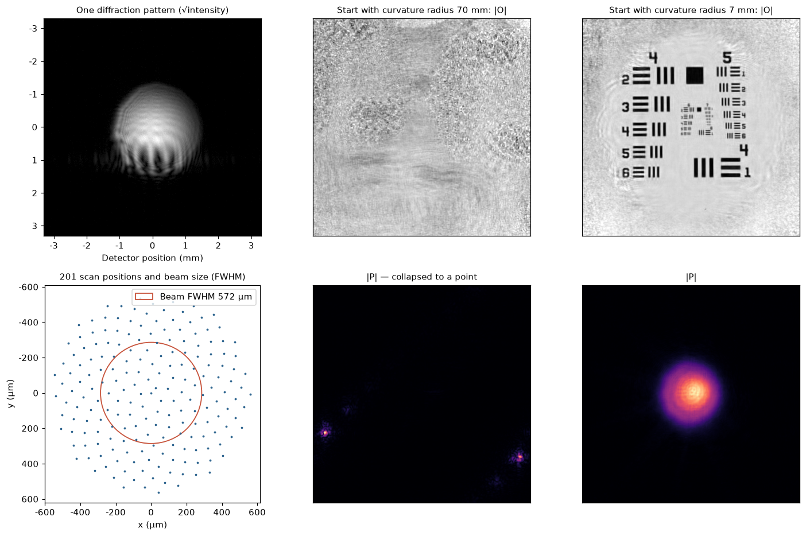
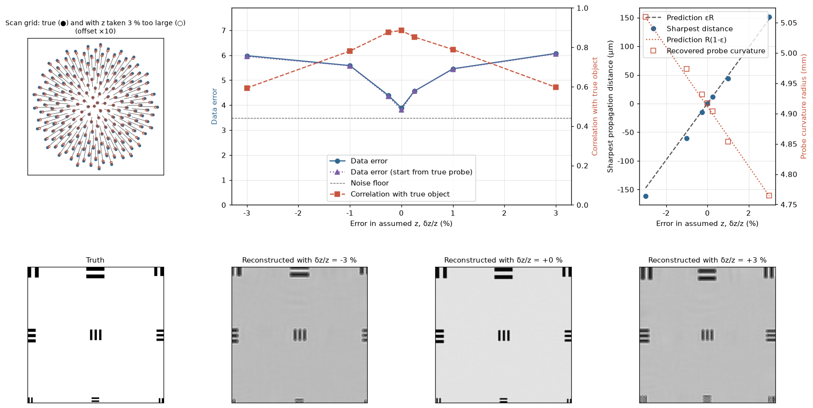
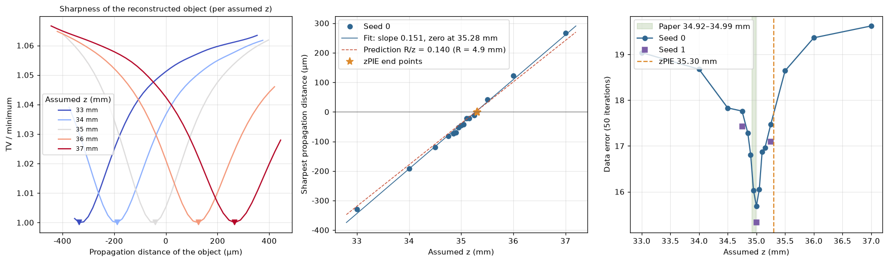
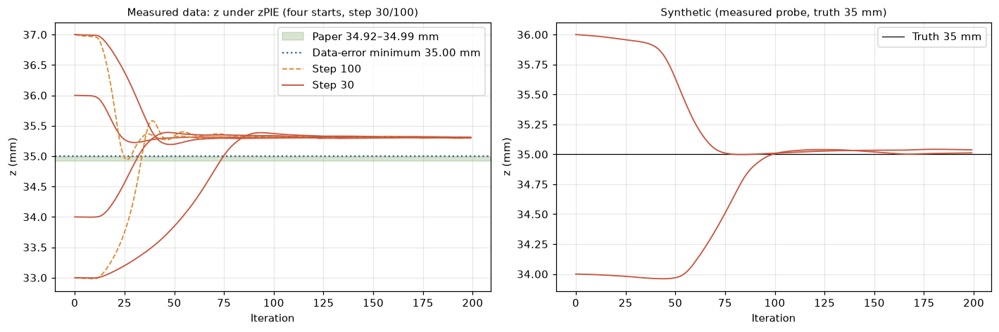
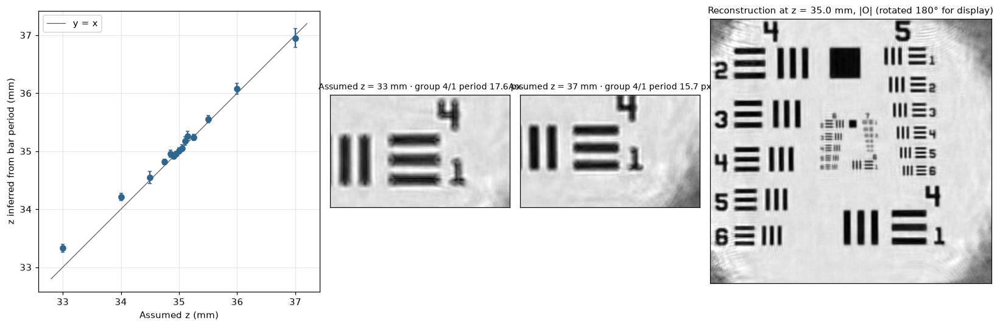
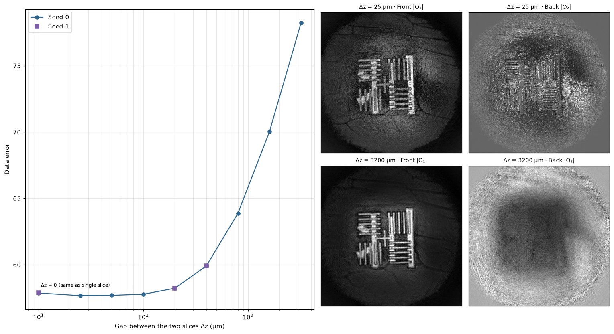

[Post 12](/posts/ptycho-experimental-cpm/) followed one experimental data set all the way through, down to the seed problem. One number was never questioned along the way: the distance $z$ from the sample to the camera. It enters the sample-plane pixel size $$\Delta_o = \lambda z/(N\Delta_d)$$, and we simply used the 38.6 mm written in the data file. Yet this distance is the hardest quantity to measure in the experiment. The camera sensor sits somewhere inside its housing, and the thickness of the sample holder is not precisely known either. With a ruler, an error of about 1 mm is easy to make.

The gap between layers is the same kind of question. The sample in post 12 had two layers, but we approximated it with a single transmission function. To separate the two layers, we need to know how far the light propagates between them. This post asks how well the data themselves fix these two distances.

We use two data sets. The distance is studied with the USAF target data that Loetgering et al. published together with their autofocus algorithm zPIE, and the layers with the two-layer data of post 12. The first was chosen because it contains bars of known size, which looked like a way to check the distance we find. That check did not work as expected. Why it did not is the core of this post.

## 1. What are the data, and why did they not reconstruct at first?

The sample is a USAF 1951 resolution target. It was illuminated at 708.8 nm and 201 diffraction patterns were recorded on a camera about 35 mm away. The patterns are 364×364 after 4×4 binning, a binned pixel is 18.16 µm, and the camera width is $$D = N\Delta_d$$ = 6.61 mm. With the recorded distance of 35 mm, the sample-plane pixel is

$$
\Delta_o = \frac{\lambda z}{D} = \frac{708.8\ \mathrm{nm} \times 35\ \mathrm{mm}}{6.61\ \mathrm{mm}} = 3.75\ \mu\mathrm{m}
$$

The scan positions follow a Fermat spiral, like the seeds of a sunflower. They span 1.1 mm, and the median distance to the nearest neighbor is 67.6 µm. Against the beam size of 572 µm (FWHM) given in the paper, two neighboring positions overlap by 88 % in diameter.

There is one yardstick for how precisely the distance needs to be known: the depth of field. The zPIE paper defines it as

$$
\Delta z_{\mathrm{DoF}} = \lambda \left(\frac{2z}{D}\right)^2 = 79.5\ \mu\mathrm{m}
$$

Written with the detection numerical aperture $$\mathrm{NA} = D/(2z)$$, this is $$\lambda/\mathrm{NA}^2$$, the same form we used in [post 9](/posts/ptycho-autodiff-multislice/) as the scale for separating two slices. Moving the sample back and forth by this much barely changes the image this setup can form.

Running these data with the settings of post 12 made the probe collapse into a single point. All that remained on the sample side was a dot pattern following the scan positions (Fig 1, middle). Looking at the patterns again showed the cause. As in the top left of Fig 1, a shadow of the bars appears inside the bright disc. The beam converges just before the sample and diverges from there, projecting a magnified image of the sample: a point-projection geometry. Two things differed from the data of post 12.

The first is the axis order of the position file. Matching the direction in which the shadow moves between 441 pairs of neighboring patterns against the difference of their positions shows that in the post 12 data the detector rows follow the first column of the position file, whereas in these data they follow the second. The axis convention differs from file to file. The second is the curvature of the initial probe. Post 12, like PtyLab's example, started from a quadratic phase with curvature radius $2z$. Starting from that value here (70 mm) still collapses, even with the axes corrected. Comparing curvature radii of 7, 13 and 25 mm, the opposite sign and no curvature, 20 iterations each, the target appeared only with 7 mm (data error 15.5, the others 60–83). The probe eventually reconstructed with a curvature radius of about 4.9 mm. That is more than twice as strongly curved as the probe of the post 12 data (reconstructed curvature radius about 11 mm).

_Fig 1. One diffraction pattern (top left) and the scan positions (bottom left). Starting with a curvature radius of 70 mm, the probe collapses to a point (middle); starting with 7 mm, the target appears (right). Both after correcting the axis order, 20 iterations. The sample is shown rotated by 180°_

Both clues were inside the patterns. The direction in which the shadow moves told us the axis convention, and the mere presence of a shadow told us the beam is strongly curved. The exact curvature had to be chosen by comparing a few values, because 13 mm, estimated from the size of the disc in the mean pattern, did not work. Look at the patterns before trusting the position file. And this strongly diverging beam decides the conclusions of the rest of the post.

## 2. What goes wrong when the distance is wrong?

The instrument records the scan positions $$\mathbf{r}_j$$ in meters. The algorithm converts them to sample-plane pixels:

$$
\mathbf{p}_j = \frac{\mathbf{r}_j}{\Delta_o} = \frac{D\,\mathbf{r}_j}{\lambda z}
$$

If the distance is taken as $$z(1+\epsilon)$$, all positions shrink by a factor $$1/(1+\epsilon)$$. The grid contracts about its center, so the misplacement is zero at the center and grows toward the edge. This is what Eq. 1 of the zPIE paper expresses. A scan radius of 0.55 mm is 147 pixels, so at $\epsilon$ = 1 % the outermost positions are off by 1.5 pixels. The top left of Fig 2 shows the grid for $\epsilon$ = 3 %, with the misplacements magnified tenfold.

This misplacement does not simply ruin the reconstruction. A diverging beam offers a way out that absorbs it: the Fresnel scaling theorem. It states that the intensity behind a thin sample illuminated by a spherical wave from a point source equals, up to a magnification, the intensity of the same sample illuminated by a plane wave and recorded at a shorter distance. Let us apply it to the exit wave. The far-field intensity does not change no matter how much further we propagate the exit wave, because angular-spectrum propagation only multiplies the diffracted wave by a phase. Propagating an exit wave formed with a probe of curvature radius $R$ by a further distance $L$ and then applying the theorem gives a different model that produces the same patterns. With the magnification $$M = 1 + L/R$$, in that model

1. the scan grid is scaled by $M$,
2. the sample is magnified by $M$ and propagated by $L/M$, that is, it is out of focus,
3. the probe has curvature radius $R + L$.

This rests on the approximation that the probe amplitude varies slowly, and to the extent that it holds, the two models are nearly indistinguishable in the data. For this model to match the grid error $$1-\epsilon$$ caused by the wrong distance, we need $$M = 1-\epsilon$$, that is, $$L = -\epsilon R$$. This makes three predictions. ① The size of the reconstructed sample changes in inverse proportion to the assumed distance. ② The sample has to be propagated by $$+\epsilon R$$ to come back into focus. ③ The reconstructed probe has curvature radius $$R(1-\epsilon)$$.

The probe in these data has a curvature radius of about 4.9 mm. An error of $\epsilon$ = 1 %, that is 0.35 mm in distance, shows up as only 49 µm of defocus. The distance error is scaled down by $$R/z \approx 0.14$$ and becomes a focus shift smaller than the depth of field (79.5 µm).

We checked this with synthetic data where the answer is known. The geometry is the same as the zPIE data. The sample is a bar target, and the probe is the one obtained by reconstructing the experimental data at 35 mm (curvature radius 4.91 mm). Poisson noise was added at the same total intensity as the measurement. With the true distance at 35 mm, we fixed seven distances from −3 % to +3 % and reconstructed each for 100 iterations. No l2 regularization was used in these reconstructions; the reason is given below.

_Fig 2. Synthetic data (truth 35 mm). Scan grid 3 % off (top left, misplacement ×10), data error and correlation with the true sample (top middle), sharpest propagation distance and probe curvature radius compared with the predictions of the Fresnel scaling theorem (top right), and the central part of the truth and of the samples reconstructed at −3 %, 0 % and +3 % (bottom)_

As the top right of Fig 2 shows, the three predictions hold. The sample reconstructed at −3 % is sharpest after moving it by 161 µm (predicted 147 µm), and the probe curvature radius is 5.06 mm (predicted 5.06 mm). At +3 % the values are 151 µm and 4.77 mm against predictions of 147 µm and 4.76 mm. The sample moves away from the truth. The correlation with the true sample drops from 0.89 to 0.59–0.60, and as the bottom row shows, fringes appear at the bar edges and the bars shift.

What about the data error? At 35 mm it is 3.89, close to the 3.48 obtained from the true sample and probe (the noise floor). It rises to 4.4–4.6 at ±0.25 % and to 6.0–6.1 at ±3 %. Starting from the true probe gives the same picture: 3.81, 4.3–4.6 and 6.0–6.1. The approximation is not perfect, so the data error keeps a valley, and the valley sits at the truth. But it is shallow. A reconstruction with the distance 3 % off loses a third of its correlation with the true sample, while its error stays below twice the noise floor.

This shallow valley is easily buried. The post 12 settings switch on l2 regularization in the second round, scaling the sample and the probe by 0.99 every iteration. Solving the same synthetic data with those settings raises the error to 13–14 at every distance alike, and the valley disappears. So this post compares distances using the error before l2 is applied.

With a gently diverging beam the situation is different. With a probe of curvature radius about 95 mm, absorbing a 1 % distance error requires a focus shift of nearly 1 mm. There the reconstruction followed only 16–61 % of the predicted focus shift. When the way out is long, the reconstruction does not go all the way. With a strongly diverging beam like this one the way out is short, and the distance error hides completely in the magnification and focus of the sample.

## 3. Can sharpness find the distance?

We fixed the distance at values from 33 mm to 37 mm and ran 100 iterations at each. We then propagated each reconstructed sample back and forth by up to ±400 µm (±5 depths of field) with the angular spectrum method and measured its sharpness. The sharpness is the total variation (TV) of the zPIE paper,

$$
S(\Delta) = \sum_{x,y} \sqrt{\lvert \partial_x O_\Delta \rvert^2 + \lvert \partial_y O_\Delta \rvert^2 + \epsilon}
$$

where $$O_\Delta$$ is the complex transmission function propagated by $\Delta$ and $\epsilon$ = 0.01. For this sample the TV is smallest in focus. Out of focus, fringes spread from the bar edges and the sum of gradients grows.

_Fig 3. TV curves of the sample reconstructed at each assumed distance (left, ▼ marks the minimum), the sharpest propagation distance (middle), and the data error (right)_

In the left of Fig 3, the TV minimum moves with the assumed distance. Reconstructed at 33 mm, the sample is sharpest after moving it by −329 µm; at 37 mm, at +266 µm. As the middle panel shows, the relation is a straight line with slope 0.151, crossing zero at 35.28 mm. Section 2 predicts a slope of $R/z$. With the probe curvature radius of 4.91 mm reconstructed at 35 mm, that is 0.140. Prediction and measurement agree within 8 %. The probe curvature itself follows the prediction too. The probes reconstructed at 33 mm and 37 mm have curvature radii of 5.20 mm and 4.59 mm, close to the 5.19 mm and 4.63 mm of $R(1-\epsilon)$.

zPIE uses this property inside the iterations. Every iteration it propagates the sample to 11 planes within ±1 depth of field, measures the TV, and corrects $z$ by how far the TV-weighted centroid departs from zero. A momentum term (friction 0.7) feeds back the drift toward the centroid. Starting from 33, 34, 36 and 37 mm and running 200 iterations, all six runs gathered near 35.30 mm (35.298–35.309 mm, Fig 4), regardless of starting point and step size. The sign of the feedback was chosen as the one that moves toward the truth on synthetic data where the answer is known. It is the same as in PtyLab's implementation and opposite to the formula in the paper. For the step size we used PtyLab's default of 100 and a smaller 30. Applied to the synthetic data of section 2, the same settings find the truth from starts at 34 mm and 36 mm, reaching 35.01 mm and 35.04 mm after 200 iterations (Fig 4, right).

_Fig 4. Distance per iteration under zPIE. On the measured data (left) it converges to 35.30 mm regardless of starting point and step size. The green band is the range reported in the paper, the dotted line the data-error minimum of Fig 3 (right). On synthetic data (right) it goes to the true 35 mm_

The paper, however, obtained 34.92–34.99 mm from the same data. That is a difference of 0.3 mm, close to four depths of field. Which is right? In experimental data without ground truth, the remaining criterion is the data error, as in [post 11](/posts/ptycho-experimental-fpm/) and post 12. The right panel of Fig 3 shows the data error for each fixed distance. As seen in section 2, l2 regularization raises the error at every distance alike (here by 2–3), so the comparison is made at the end of the first round (50 iterations), before l2 applies. The error is lowest at 35.00 mm (15.7, or 15.3 with another seed), rising to 16.0–16.1 at ±0.05 mm and 16.8–16.9 at ±0.1 mm. At 33 mm and 37 mm it is 19.0 and 19.6. The valley of the data error agrees with the paper's range, not with zPIE's answer.

Why do the two criteria disagree? The slope of 0.15 is the answer. A distance difference of 0.3 mm is only 0.3 × 0.15 ≈ 45 µm in focus, about half the depth of field. Because the diverging beam turns a distance error into a focus shift seven times smaller, getting the focus right to within the depth of field still leaves the distance uncertain by several depths of field. The data error, by contrast, does not go through the focus; it measures directly whether the grid and the patterns agree. Since zPIE found the truth on synthetic data, the algorithm itself is not biased. Rather, in the measured sample the plane of smallest TV is about 45 µm away from the plane the data error prefers, and we have not found out why. What is clear is that a mismatch of this size is enough to produce a 0.3 mm difference in distance. With a strongly diverging beam, the focus criterion is blunt.

## 4. Why can bar widths not serve as a check?

The bars of a USAF target have fixed sizes. Group $g$, element $e$ has $$2^{g+(e-1)/6}$$ line pairs per millimeter, and the line width of group 4, element 1 is 31.25 µm. Measuring the bar period in pixels in the reconstruction gives the pixel size, and the pixel size gives $$z = \Delta_o D/\lambda$$. We measured the period in 12 sets of horizontal and vertical bars from the six elements of group 4, fitting three rectangles with blurred edges to the profile across each set. In the sample reconstructed at 35.00 mm, the distance obtained this way is 35.01 ± 0.05 mm (standard error of the mean). The line widths of group 4, element 1 are 31.5 µm horizontally and 31.2 µm vertically, within 1 % of the nominal value. It is the same answer as the valley of the data error, so the check looks complete.

The picture changes when we apply the same measurement to samples reconstructed at other distances (Fig 5, left). The bars of the sample reconstructed at 33 mm point to 33.33 mm, and those reconstructed at 37 mm to 36.95 mm. The reconstruction at 35.30 mm chosen by zPIE points to 35.25 mm. The bars always return the distance that was put into the reconstruction. The period of group 4, element 1 is 17.6 pixels at 33 mm and 15.7 pixels at 37 mm, changing in inverse proportion to the assumed distance (Fig 5, middle). This is prediction ① of section 2 appearing as is. The reconstruction stretches and shrinks the sample to match the scan grid.

_Fig 5. The distance inferred from the bar period (left, error bars are standard errors) follows the assumed distance exactly. Group 4, element 1 seen through the same window (middle two) changes size with the assumed distance. On the right is the target reconstructed at 35.0 mm. All samples are shown rotated by 180°_

So the bar widths measured in a single reconstruction cannot pick out the distance. What the bars confirm is that the sample agrees with the scan grid, that is, the calibration of the scanning stage. The distance error is shared among the magnification, the focus and the probe curvature, and leaves nothing in the bars. The zPIE paper also reported that the line width of group 4, element 1 was 31.1 µm, within 1 % of the nominal 31.3 µm. In these data, such agreement cannot be the basis for choosing the distance. What distinguishes the distance is only the data error and the focus signal blunted by the diverging beam.

## 5. Can the two layers be separated?

Back to the data of post 12. According to the original paper (Du et al.), these data were taken in a reflection geometry that records the light returning from the sample. The sample consists of two layers of semi-transparent metal patterns about 50 nm thick, separated by a transparent polymer layer. The top layer carries a target of bars and a cross, the bottom layer a different pattern of long bands. Post 12 solved this sample as a single function. Looking at that reconstruction again, the long bands and slanted pieces of the bottom layer are clearly superimposed under the bar target (Fig 6, top right). It looks the same as the paper's microscope image, which shows both layers together. The light returning from the two layers came in superimposed in one plane.

Can the two layers be pulled apart? We tested the two-slice model of [post 9](/posts/ptycho-autodiff-multislice/). The light passes the front slice $$O_1$$, propagates over the gap $$\Delta z$$, then passes the back slice $$O_2$$:

$$
\psi_j = O_2(\mathbf{r}-\mathbf{r}_j)\cdot \mathcal{P}_{\Delta z}\!\left[ O_1(\mathbf{r}-\mathbf{r}_j)\, P(\mathbf{r}) \right]
$$

This is a transmission model in which light passes the two slices in turn. For a reflecting sample the light returning from the two layers should add instead, so the model does not fit this sample exactly. Still, if the two layers were far enough apart for this illumination to separate them, some difference from the single-slice model should show up in the data.

One thing in the model needs adjusting. Post 12 absorbed the quadratic phase $$\exp(i\pi r^2/\lambda z)$$ of Fresnel diffraction into the probe and solved a far-field model. With two slices that is not possible. The phase has to multiply the exit wave after the back slice, but placed in the probe it multiplies before the propagation between the slices. By the theorem of section 2, that amounts to a model with the back slice magnified by $$1 + \Delta z/z$$, 4 % for a gap of 1.6 mm. So in the two-slice model this phase is applied separately on the detector side.

How close can two slices be and still be separated by this illumination? In post 9 the two slices separated at about a third of $$\lambda/\mathrm{NA}^2$$, with the NA set by the probe. The probe obtained from a single-slice reconstruction done the same way as in post 12 has a half-width at half maximum of 389 µm and, after removing the detector-side quadratic phase, a curvature radius of about 15.7 mm. The illumination half-angle is about 0.025, so $$\lambda/\mathrm{NA}^2$$ is 1.2 mm and a third of it about 0.4 mm. Slices closer than that are hard to separate with this illumination.

We reconstructed with nine gaps from 0 to 3.2 mm. The starting point was the single-slice reconstruction obtained the same way as in post 12 (front slice) and an empty back slice, with 100 iterations. A gap of 0 makes the product of the two slices equal to a single slice, so it is the control.

_Fig 6. Data error of the two-slice model against the gap (left; a gap of 0 equals a single slice), and the amplitudes of the front and back slices reconstructed at 25 µm and 3.2 mm (right). The front slice contains the bars of the top layer superimposed on the bands of the bottom layer_

In the left of Fig 6, the error barely moves from the 57.9 at zero gap. Even at its lowest, at 25–50 µm, it is only 0.35 % lower. From 200 µm on it rises instead, 10 % higher at 800 µm and 35 % higher at 3.2 mm. Changing the seed leaves it the same to two decimal places. The images say the same. At every gap the front slice holds the bars of the top layer, the bands of the bottom layer and the thin cracks, all in focus together. There was no gap at which the bands of the bottom layer moved to the back slice. The back slice keeps a noisy copy of the bars at 25 µm and a smeared blot at 3.2 mm.

In other words, widening the gap beyond 0.4 mm clearly contradicts the data, and closer gaps cannot be told apart from a single slice, at least within 100 iterations continued from the single-slice result. This means the two layers are much closer together than the depth this illumination can resolve. Propagating the single-slice reconstruction back and forth by up to 6 mm and measuring the TV gives the same answer. There is only one sharpest plane, and the other small dips have a TV 6–11 % higher. No plane deserves to be called a second focus.

The original paper points out exactly this limit: the depth resolution of multislice ptychography is bound to the order of the depth of field. That is why the experiment scanned 51 wavelengths from 708.8 nm to 802.8 nm. After a single-slice reconstruction at each wavelength, a Fourier transform along the wavelength axis separated the depths as in optical coherence tomography, with a depth resolution of 2 µm set by the source bandwidth. In this way separate tomograms of the top and bottom layers were obtained. The public TwoLayer data contain only one wavelength, 708.8 nm, the shortest of this experiment. Data at one wavelength and one illumination angle carry no depth information to separate these two layers.

## Summary

The zPIE data reconstructed only after two things were fixed: the axis order of the position file and the curvature of the initial probe. Both clues were in the shadow seen in the patterns.

With a strongly diverging beam like this one, a distance error does not stay as it is. Following the Fresnel scaling theorem, it is shared among the magnification and focus of the sample and the curvature of the probe. All three predictions held on synthetic data, and the data error kept only a shallow valley at the truth.

There were two criteria for finding the distance. The focus criterion (zPIE) looks at a signal in which the distance error is scaled down by $$R/z \approx 0.14$$. On the measured data it converged to 35.30 mm. The data error had its valley at 35.00 mm, in agreement with the paper's 34.92–34.99 mm. On synthetic data both found the truth. The bar widths could not serve as a criterion. They returned whatever distance was put into the reconstruction, and what they confirmed was the calibration of the scanning stage.

The two layers did not separate with single-wavelength data. The single-slice reconstruction already had both layers superimposed, and the two-slice model contradicted the data for gaps beyond 0.4 mm while being no different from a single slice for closer gaps. The original experiment separated the two layers with a depth resolution of 2 µm by scanning the wavelength.

When fixing a distance without ground truth, first ask what actually determines that distance. On the same data, focus, data error and bar widths gave different answers, or no answer at all.

## Next

Post 14 covers the remaining item announced in post 12: data at several wavelengths. We look at how to recover the probe and the sample for each wavelength from data in which the intensities of several wavelengths add up in one pattern, and follow the principle of ptychographic optical coherence tomography, which separated the two layers in this post: why a Fourier transform along the wavelength axis becomes depth.

## References

- L. Loetgering, M. Du, K. S. E. Eikema, S. Witte, "[zPIE: an autofocusing algorithm for ptychography](https://doi.org/10.1364/OL.389492)," *Optics Letters* 45(7), 2030–2033 (2020). The distance autofocus algorithm, the depth of field and TV sharpness, and the experiment that recorded the USAF data used here.
- D. M. Paganin, D. Pelliccia, "[X-ray phase-contrast imaging: a broad overview of some fundamentals](https://arxiv.org/abs/2011.05146)," arXiv:2011.05146 (2021), Sec. 2.10. The Fresnel scaling theorem.
- A. M. Maiden, M. J. Humphry, J. M. Rodenburg, "[Ptychographic transmission microscopy in three dimensions using a multi-slice approach](https://doi.org/10.1364/JOSAA.29.001606)," *Journal of the Optical Society of America A* 29(8), 1606 (2012). Multislice ptychography (3PIE).
- M. Du, L. Loetgering, K. S. E. Eikema, S. Witte, "[Ptychographic optical coherence tomography](https://doi.org/10.1364/OL.416144)," *Optics Letters* 46(6), 1337–1340 (2021). The reflection-geometry experiment that recorded the two-layer data, the sample structure, the 2 µm depth resolution obtained by scanning the wavelength, and the remark that the depth resolution of multislice ptychography is bound to the depth of field.
- L. Loetgering et al., "[PtyLab.m/py/jl: a cross-platform, open-source inverse modeling toolbox for conventional and Fourier ptychography](https://doi.org/10.1364/OE.485370)," *Optics Express* 31(9), 13763 (2023). zPIE implementation and example data.
- Data: L. Loetgering, [PtyLab zPIE test data](https://doi.org/10.6084/m9.figshare.21804093.v1) (figshare, CC BY 4.0), ptyLab_zPIE.h5. M. Du, [ptyLab example data](https://doi.org/10.6084/m9.figshare.14915628.v1) (figshare, CC BY 4.0), TwoLayer_bin4.hdf5.
- Code: `_code/ptycho-experimental-distance-layers/` in the repository (get_data.py, dz_core.py, synth.py, studies13.py, usaf.py, generate_figures.py).
