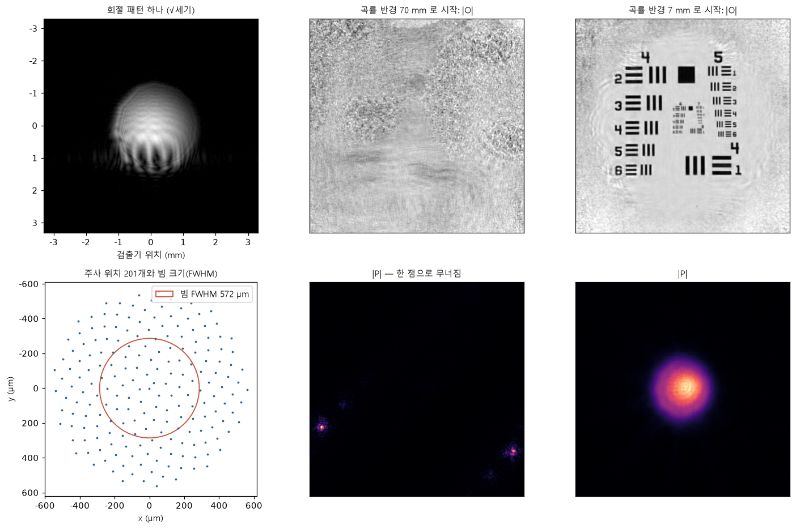
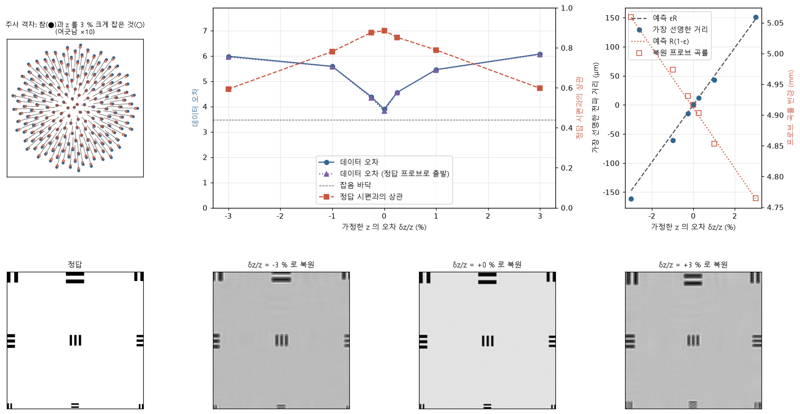
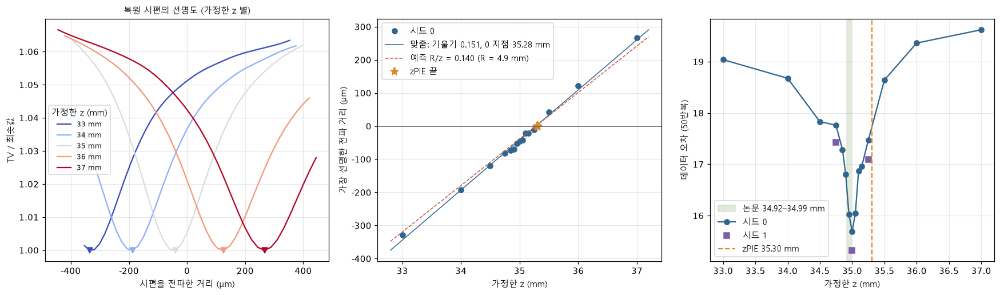
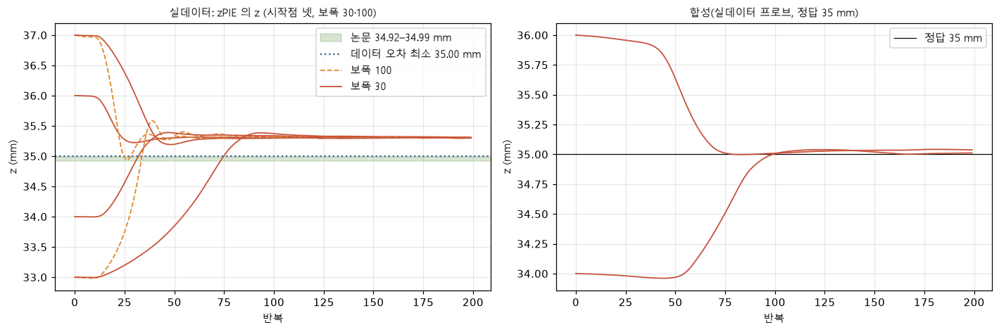
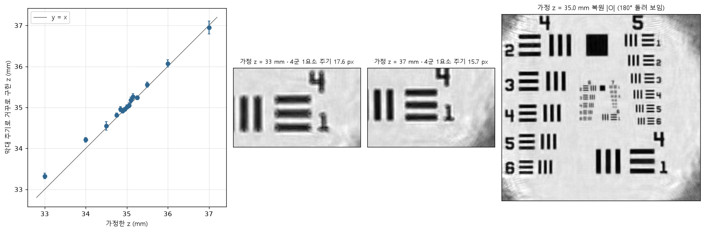
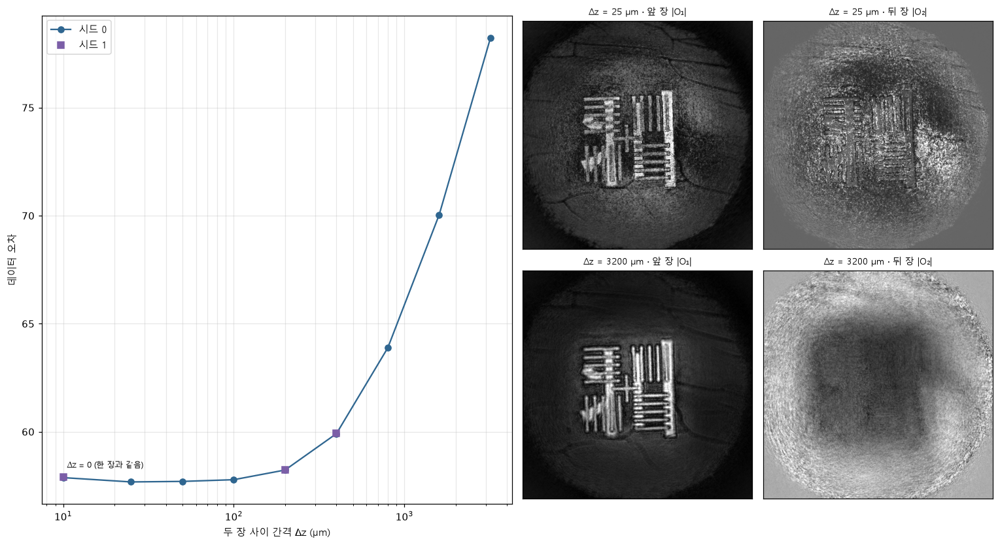

[12편](/posts/ptycho-experimental-cpm/)은 실측 데이터 한 벌을 시드 문제까지 따라가며 풀었다. 그 과정에서 한 번도 의심하지 않은 숫자가 있다. 시편에서 카메라까지의 거리 $z$ 다. 시편면 화소 크기 $$\Delta_o = \lambda z/(N\Delta_d)$$ 에 들어가는 값인데, 데이터 파일에 적힌 38.6 mm를 그대로 썼다. 그런데 이 거리는 실험에서 가장 재기 어려운 값이다. 카메라 센서는 하우징 안쪽에 묻혀 있고 시편 홀더의 두께도 정확히 알기 어렵다. 자로 재면 1 mm 안팎은 쉽게 틀린다.

층 사이 간격도 같은 물음이다. 12편의 시편은 두 층으로 되어 있었지만 한 장의 투과 함수로 근사했다. 두 층을 나누려면 둘 사이를 빛이 얼마나 전파했는지 알아야 한다. 이번 편은 이 두 거리가 데이터에서 얼마나 정해지는지 묻는다.

데이터는 두 벌을 쓴다. 거리는 Loetgering 등이 자동 초점 알고리즘 zPIE를 발표하며 공개한 USAF 표적 데이터로 보고, 층은 12편의 두 층 데이터로 본다. 앞의 것을 고른 까닭은 크기를 아는 막대가 찍혀 있어 찾은 거리를 검산할 수 있을 것 같았기 때문이다. 그 검산은 기대한 대로 되지 않았다. 왜 그런지가 이번 편의 중심이다.

## 1. 데이터는 무엇이고, 왜 처음에는 풀리지 않았나?

시편은 USAF 1951 해상도 표적이다. 708.8 nm 빛으로 비추고 시편에서 약 35 mm 떨어진 카메라로 회절 패턴 201장을 찍었다. 패턴은 4×4 화소를 묶어 364×364이고, 묶은 화소는 18.16 µm, 카메라 폭은 $$D = N\Delta_d$$ = 6.61 mm다. 기록된 거리 35 mm를 넣으면 시편면 화소는

$$
\Delta_o = \frac{\lambda z}{D} = \frac{708.8\ \mathrm{nm} \times 35\ \mathrm{mm}}{6.61\ \mathrm{mm}} = 3.75\ \mu\mathrm{m}
$$

다. 주사 위치는 해바라기 씨앗처럼 퍼진 나선(Fermat spiral)이고, 범위는 1.1 mm, 가장 가까운 이웃까지는 중앙값 67.6 µm다. 논문이 밝힌 빔 크기(반치폭) 572 µm에 견주면 이웃한 두 위치는 지름으로 88 % 겹친다.

거리를 얼마나 정확히 알아야 하는지 가늠할 눈금이 하나 있다. 피사계 심도(depth of field)다. zPIE 논문은 이것을

$$
\Delta z_{\mathrm{DoF}} = \lambda \left(\frac{2z}{D}\right)^2 = 79.5\ \mu\mathrm{m}
$$

로 둔다. 검출 개구수 $$\mathrm{NA} = D/(2z)$$ 로 쓰면 $$\lambda/\mathrm{NA}^2$$ 이고, [9편](/posts/ptycho-autodiff-multislice/)에서 두 장을 가르는 눈금으로 쓴 것과 같은 꼴이다. 시편을 이만큼 앞뒤로 옮겨도 이 장치로는 상이 거의 달라지지 않는다.

12편의 설정을 그대로 가져와 이 데이터를 풀었더니 프로브가 한 점으로 무너졌다. 시편 쪽에는 주사 위치를 따라 찍힌 점무늬만 남았다(그림1 가운데). 패턴을 다시 보니 원인이 보였다. 그림1 왼쪽 위처럼 밝은 원판 안에 막대의 그림자가 비친다. 빔이 시편 바로 앞에서 모였다가 퍼지면서 시편을 확대해 투사하는 점 투사(point projection) 기하다. 12편의 데이터와 두 가지가 달랐다.

첫째는 위치 파일의 축 순서다. 이웃한 패턴 441쌍에서 그림자가 움직인 방향을 위치의 차와 맞춰 보면, 12편 데이터는 검출기의 행이 위치 파일의 첫 열을 따르는데 이 데이터는 둘째 열을 따른다. 파일마다 축 규약이 다른 것이다. 둘째는 초기 프로브의 곡률이다. 12편은 PtyLab의 예제처럼 곡률 반경 $2z$ 의 이차 위상을 넣어 출발했다. 여기서 그 값(70 mm)으로 출발하면 축을 바로잡아도 무너진다. 곡률 반경 7·13·25 mm, 부호를 뒤집은 것, 곡률 없음을 20반복씩 견주었더니 7 mm에서만 표적이 섰다(데이터 오차 15.5, 나머지는 60–83). 나중에 복원된 프로브의 곡률 반경은 약 4.9 mm였다. 12편 데이터의 프로브(복원한 곡률 반경 약 11 mm)보다 두 배 넘게 세게 휜 빔이다.

_그림1. 회절 패턴 하나(왼쪽 위)와 주사 위치(왼쪽 아래). 곡률 반경 70 mm로 출발하면 프로브가 한 점으로 무너지고(가운데), 7 mm로 출발하면 표적이 선다(오른쪽). 둘 다 축 순서를 바로잡은 뒤 20반복이다. 시편은 180° 돌려 보였다_

두 단서는 모두 패턴 안에 있었다. 축 규약은 그림자가 움직이는 방향이 알려 주었고, 빔이 세게 휘었다는 것은 그림자가 비친다는 사실 자체가 알려 주었다. 곡률의 정확한 값은 몇 가지를 견줘서 골라야 했다. 평균 패턴의 원판 크기로 어림한 13 mm로는 풀리지 않았기 때문이다. 위치 파일을 믿기 전에 패턴부터 보는 것이 순서다. 그리고 이 강하게 퍼지는 빔이 이번 편 나머지의 결론을 좌우한다.

## 2. 거리가 틀리면 무엇이 틀어지는가?

장치는 주사 위치 $$\mathbf{r}_j$$ 를 미터로 기록한다. 알고리즘은 이것을 시편면 화소로 바꿔 쓴다.

$$
\mathbf{p}_j = \frac{\mathbf{r}_j}{\Delta_o} = \frac{D\,\mathbf{r}_j}{\lambda z}
$$

거리를 $$z(1+\epsilon)$$ 로 잘못 알면 모든 위치가 $$1/(1+\epsilon)$$ 배로 줄어든다. 격자가 가운데를 중심으로 오그라드니 어긋남은 가운데에서 0이고 가장자리로 갈수록 커진다. zPIE 논문의 식 1이 말하는 것이 이것이다. 주사 반경 0.55 mm는 147화소이므로 $\epsilon$ = 1 %면 가장자리 위치가 1.5화소 어긋난다. 그림2 왼쪽 위는 $\epsilon$ = 3 %의 격자를 어긋남만 열 배로 키워 그린 것이다.

이 어긋남이 그대로 복원을 망가뜨리지는 않는다. 퍼지는 빔에는 어긋남을 흡수하는 빠져나갈 길이 있다. 프레넬 축척 정리(Fresnel scaling theorem)다. 점광원에서 퍼지는 구면파로 비춘 얇은 시편 뒤의 세기는, 같은 시편을 평면파로 비추고 더 짧은 거리에서 잰 세기를 확대한 것과 같다는 정리다. 이것을 출사파에 적용해 보자. 원시야 세기는 출사파를 얼마나 더 전파한 뒤에 재든 바뀌지 않는다. 각스펙트럼 전파는 회절파에 위상만 곱하기 때문이다. 곡률 반경 $R$ 인 프로브를 쓴 출사파를 거리 $L$ 만큼 더 전파한 다음 정리를 적용하면, 같은 패턴을 내는 다른 모형이 나온다. 그 모형에서는 배율을 $$M = 1 + L/R$$ 라 할 때

1. 주사 격자가 $M$ 배다.
2. 시편이 $M$ 배 확대되고 $L/M$ 만큼 전파되어 있다. 곧 초점이 어긋나 있다.
3. 프로브의 곡률 반경이 $R + L$ 이다.

프로브의 진폭이 천천히 변한다는 근사가 붙지만, 근사가 맞는 만큼 두 모형은 데이터로 거의 구별되지 않는다. 거리를 잘못 알아 생긴 격자 오차 $$1-\epsilon$$ 을 이 모형이 맞추려면 $$M = 1-\epsilon$$, 곧 $$L = -\epsilon R$$ 이다. 그러면 세 가지를 예측할 수 있다. ① 복원한 시편의 크기가 가정한 거리에 반비례해 바뀐다. ② 시편을 $$+\epsilon R$$ 만큼 전파해야 다시 초점이 맞는다. ③ 복원한 프로브의 곡률 반경이 $$R(1-\epsilon)$$ 이 된다.

이 데이터의 프로브는 곡률 반경이 약 4.9 mm다. $\epsilon$ = 1 %, 곧 거리 0.35 mm의 오차가 초점으로는 49 µm만 어긋난다. 거리 오차가 $$R/z \approx 0.14$$ 배로 줄어 피사계 심도(79.5 µm)보다 작은 초점 이동으로 바뀌는 것이다.

정답을 아는 합성 데이터로 확인했다. 기하는 zPIE 데이터와 같게 두었다. 시편은 막대 표적, 프로브는 실측 데이터를 35 mm로 복원해 얻은 것(곡률 반경 4.91 mm)이다. 패턴에는 실측과 같은 총세기로 포아송 잡음을 넣었다. 정답 35 mm를 기준으로 −3 %부터 +3 %까지 일곱 거리로 고정해 100반복씩 복원했다. 이 복원에는 l2 정규화를 걸지 않았다. 까닭은 아래에 쓴다.

_그림2. 합성 데이터(정답 35 mm). 3 % 틀린 주사 격자(왼쪽 위, 어긋남 ×10), 데이터 오차와 정답 시편과의 상관(가운데 위), 가장 선명한 전파 거리와 프로브 곡률 반경을 프레넬 축척 정리의 예측과 견준 것(오른쪽 위), 정답과 −3 %·0 %·+3 %로 복원한 시편의 가운데 부분(아래)_

그림2 오른쪽 위처럼 세 예측이 맞는다. −3 %로 복원한 시편은 161 µm 옮겨야 가장 선명하고(예측 147 µm), 프로브 곡률 반경은 5.06 mm다(예측 5.06 mm). +3 %에서는 151 µm와 4.77 mm로, 예측은 147 µm와 4.76 mm다. 시편은 정답에서 멀어진다. 정답과의 상관이 0.89에서 0.59–0.60으로 떨어지고, 아래 줄에서 보듯 막대 가장자리에 무늬가 생기고 자리가 옮겨 간다.

데이터 오차는 어떤가? 35 mm에서 3.89로, 정답 시편과 프로브로 계산한 오차(잡음 바닥) 3.48에 가깝다. ±0.25 %에서는 4.4–4.6, ±3 %에서는 6.0–6.1로 오른다. 정답 프로브에서 출발해도 3.81, 4.3–4.6, 6.0–6.1로 같다. 근사가 완전하지 않아 데이터 오차에 골이 남고, 그 골은 정답에 있다. 다만 깊지 않다. 거리를 3 % 틀린 복원은 정답 시편과의 상관을 3분의 1 잃는데, 오차는 잡음 바닥의 두 배도 되지 않는다.

이 얕은 골은 쉽게 묻힌다. 12편의 설정은 둘째 라운드에 l2 정규화를 걸어 매 반복 시편과 프로브를 0.99배로 줄인다. 같은 합성 데이터를 그 설정으로 풀면 오차가 모든 거리에서 13–14로 함께 올라가 골이 사라진다. 그래서 이번 편은 거리를 견줄 때 l2가 걸리기 전의 오차를 쓴다.

빔이 완만하면 사정이 다르다. 곡률 반경이 약 95 mm인 프로브로 같은 실험을 하면, 1 %의 거리 오차를 흡수하는 데 1 mm 가까운 초점 이동이 필요하다. 그때 복원은 예측한 초점 이동의 16–61 %만 따라갔다. 빠져나갈 길이 멀면 복원이 그 길을 끝까지 가지 못한다. 이번 데이터처럼 강하게 퍼지는 빔에서는 그 길이 짧아서, 거리 오차가 시편의 배율과 초점 속에 고스란히 숨는다.

## 3. 선명도로 거리를 찾을 수 있는가?

거리를 33 mm부터 37 mm까지 바꿔 가며 고정하고 각각 100반복 복원했다. 그리고 복원한 시편을 각스펙트럼(angular spectrum) 전파로 앞뒤 ±400 µm(±5 피사계 심도)까지 옮겨 가며 선명도를 쟀다. 선명도는 zPIE 논문의 전변동(total variation, TV)

$$
S(\Delta) = \sum_{x,y} \sqrt{\lvert \partial_x O_\Delta \rvert^2 + \lvert \partial_y O_\Delta \rvert^2 + \epsilon}
$$

이다. $$O_\Delta$$ 는 시편을 $\Delta$ 만큼 전파한 복소 투과 함수, $\epsilon$ = 0.01이다. 이 시편에서는 초점이 맞을 때 TV가 가장 작다. 초점을 벗어나면 막대 가장자리에서 무늬가 번져 나가 기울기의 합이 커지기 때문이다.

_그림3. 가정한 거리마다 복원한 시편의 TV 곡선(왼쪽, ▼가 최소), 가장 선명한 전파 거리(가운데), 데이터 오차(오른쪽)_

그림3 왼쪽에서 TV의 최소는 가정한 거리를 따라 움직인다. 33 mm로 풀면 시편은 −329 µm 옮겼을 때 가장 선명하고, 37 mm로 풀면 +266 µm에서 가장 선명하다. 가운데 그림처럼 이 관계는 곧은 선이다. 기울기는 0.151이고 0을 지나는 곳은 35.28 mm다. 2절의 예측은 기울기 $R/z$ 다. 35 mm에서 복원한 프로브의 곡률 반경 4.91 mm를 넣으면 0.140이다. 예측과 측정이 8 % 안에서 맞는다. 프로브 곡률 자체도 예측을 따른다. 33 mm와 37 mm에서 복원한 프로브의 곡률 반경은 5.20 mm와 4.59 mm로, $R(1-\epsilon)$ 의 5.19 mm와 4.63 mm에 가깝다.

zPIE는 이 성질을 반복 안에서 쓴다. 매 반복 시편을 ±1 피사계 심도 안의 11개 면으로 전파해 TV를 재고, TV의 무게중심이 0에서 벗어난 만큼 $z$ 를 고친다. 무게중심 쪽으로 쏠림을 되먹이는 모멘텀(마찰 0.7)도 붙어 있다. 33, 34, 36, 37 mm에서 출발해 200반복 돌렸더니 여섯 번 모두 35.30 mm 근처(35.298–35.309 mm)에 모였다(그림4). 출발점과 보폭에 상관없이 같은 곳이다. 되먹임의 부호는 정답을 아는 합성 데이터에서 정답 쪽으로 가는 쪽을 골랐다. PtyLab의 구현과 같고 논문의 식과는 반대다. 보폭은 PtyLab의 기본값 100과 그보다 작은 30을 썼다. 같은 설정을 2절의 합성 데이터에 쓰면 34 mm와 36 mm에서 출발해 200반복 뒤 35.01 mm와 35.04 mm로 정답을 찾는다(그림4 오른쪽).

_그림4. zPIE의 반복별 거리. 실측(왼쪽)에서는 시작점과 보폭이 달라도 35.30 mm로 모인다. 초록 띠는 논문이 보고한 범위, 점선은 그림3 오른쪽의 데이터 오차 최소다. 합성 데이터(오른쪽)에서는 정답 35 mm로 간다_

그런데 논문이 같은 데이터에서 얻은 값은 34.92–34.99 mm다. 0.3 mm, 피사계 심도로 넷 가까이 차이가 난다. 어느 쪽이 맞는가? 정답이 없는 실측에서 남는 판정 기준은 [11편](/posts/ptycho-experimental-fpm/)과 12편에서처럼 데이터 오차다. 그림3 오른쪽이 고정한 거리마다의 데이터 오차다. 2절에서 본 대로 l2 정규화가 오차를 모든 거리에서 함께 끌어올리므로(여기서는 2–3씩), 비교는 l2가 걸리기 전인 첫 라운드 끝(50반복)에서 했다. 35.00 mm에서 가장 낮고(15.7, 시드를 바꾸면 15.3), ±0.05 mm에서 16.0–16.1, ±0.1 mm에서 16.8–16.9로 오른다. 33 mm와 37 mm에서는 19.0과 19.6이다. 데이터 오차의 골은 논문의 범위와 맞고 zPIE의 답과는 맞지 않는다.

두 기준이 왜 갈리는가? 기울기 0.15가 답이다. 0.3 mm의 거리 차이는 초점으로는 0.3 × 0.15 ≈ 45 µm, 피사계 심도의 절반에 불과하다. 퍼지는 빔이 거리 오차를 일곱 배 작은 초점 이동으로 바꿔 놓으니, 초점을 피사계 심도 안으로 맞춰도 거리는 피사계 심도의 몇 배까지 흔들린다. 반면 데이터 오차는 초점을 거치지 않고 격자와 패턴이 서로 맞는지를 직접 잰다. 합성 데이터에서 zPIE가 정답을 찾았으니 알고리즘 자체에 치우침이 있는 것은 아니다. 실측 시편에서 TV가 가장 작은 면이 데이터 오차가 고르는 면과 45 µm쯤 어긋나 있는 것인데, 그 까닭은 따로 밝히지 못했다. 다만 그만한 어긋남으로도 0.3 mm의 거리 차이가 생긴다는 것은 분명하다. 강하게 퍼지는 빔에서는 초점 기준이 무디다.

## 4. 막대 선폭은 왜 검증이 되지 못하는가?

USAF 표적의 막대는 크기가 정해져 있다. 군 $g$, 요소 $e$ 의 막대 쌍은 1 mm에 $$2^{g+(e-1)/6}$$ 개이고, 4군 1요소의 선폭은 31.25 µm다. 복원한 시편에서 막대의 주기를 화소 단위로 재면 화소 크기가 나오고, 화소 크기에서 $$z = \Delta_o D/\lambda$$ 가 나온다. 4군 여섯 요소의 가로·세로 막대 묶음 12개에서 세 막대의 단면에 가장자리가 흐린 사각형 셋을 맞춰 주기를 쟀다. 35.00 mm로 복원한 시편에서 이렇게 구한 거리는 35.01 ± 0.05 mm(평균의 표준오차)다. 4군 1요소의 선폭은 가로 31.5 µm, 세로 31.2 µm로 공칭값과 1 % 안에서 맞는다. 데이터 오차의 골과 같은 답이니 검증이 끝난 것처럼 보인다.

같은 측정을 다른 거리로 복원한 시편에 해 보면 사정이 달라진다(그림5 왼쪽). 33 mm로 복원한 시편의 막대는 33.33 mm를, 37 mm로 복원한 시편의 막대는 36.95 mm를 가리킨다. zPIE가 고른 35.30 mm의 복원은 35.25 mm를 가리킨다. 막대가 내놓는 답은 언제나 복원에 넣은 거리다. 4군 1요소의 주기는 33 mm에서 17.6화소, 37 mm에서 15.7화소로, 가정한 거리에 반비례해 바뀐다(그림5 가운데). 2절의 예측 ①이 그대로 나타난 것이다. 복원은 시편의 배율을 주사 격자에 맞춰 늘이고 줄인다.

_그림5. 막대 주기로 거꾸로 구한 거리(왼쪽, 오차 막대는 표준오차)는 가정한 거리를 그대로 따라간다. 같은 창에서 본 4군 1요소(가운데 둘)는 가정한 거리에 따라 크기가 바뀐다. 오른쪽은 35.0 mm로 복원한 표적이다. 시편은 모두 180° 돌려 보였다_

그러니 복원 하나에서 잰 막대 선폭은 거리를 가려 주지 못한다. 막대가 확인해 주는 것은 시편이 주사 격자와 맞는다는 것, 곧 주사 장치의 눈금이다. 거리의 오차는 배율과 초점과 프로브 곡률이 나눠 가지므로 막대에는 남지 않는다. zPIE 논문도 4군 1요소의 선폭이 31.1 µm로 공칭값 31.3 µm와 1 % 안에서 맞는다고 보고했다. 이 데이터에서는 그런 일치가 거리를 고르는 근거가 되지 못한다. 거리를 가려 주는 것은 데이터 오차와, 퍼지는 빔 때문에 무뎌진 초점 신호뿐이다.

## 5. 두 층은 나눌 수 있는가?

12편의 데이터로 돌아간다. 원 논문(Du 등)에 따르면 이 데이터는 시편에서 되돌아온 빛을 찍는 반사 배치로 얻었다. 시편은 두께 약 50 nm의 반투명 금속 패턴 두 층을 투명한 폴리머 층이 떼어 놓은 것이다. 위층에는 막대와 십자로 된 표적이 있고, 아래층에는 긴 띠 모양의 다른 패턴이 있다. 12편은 이 시편을 한 장의 함수로 풀었다. 그 복원을 다시 보면 막대 표적 밑으로 아래층의 긴 띠와 비스듬한 조각이 또렷이 겹쳐 보인다(그림6 오른쪽 위). 원 논문의 현미경 사진에서 두 층을 함께 본 모습과 같다. 두 층에서 되돌아온 빛이 한 면에 겹쳐 들어온 것이다.

두 층을 따로 꺼낼 수 있는가? [9편](/posts/ptycho-autodiff-multislice/)의 두 장 모형을 시험했다. 앞 장 $$O_1$$ 을 지난 빛이 간격 $$\Delta z$$ 만큼 전파한 뒤 뒤 장 $$O_2$$ 를 지난다.

$$
\psi_j = O_2(\mathbf{r}-\mathbf{r}_j)\cdot \mathcal{P}_{\Delta z}\!\left[ O_1(\mathbf{r}-\mathbf{r}_j)\, P(\mathbf{r}) \right]
$$

이 식은 빛이 두 장을 차례로 지나는 투과의 모형이다. 반사 시편이라면 두 층에서 되돌아온 빛이 더해지는 꼴이어야 하니 이 시편에 꼭 맞는 모형은 아니다. 그래도 두 층이 이 조명이 가를 수 있을 만큼 떨어져 있다면, 한 장 모형과의 차이가 어떤 꼴로든 데이터에 드러날 것이다.

모형에 한 가지 손볼 곳이 있다. 12편은 프레넬 회절의 이차 위상 $$\exp(i\pi r^2/\lambda z)$$ 를 프로브에 흡수해 원시야 모형으로 풀었다. 두 장에서는 그럴 수 없다. 이 위상은 뒤 장을 지난 출사파에 곱해져야 하는데, 프로브에 넣어 두면 장 사이 전파보다 먼저 곱해진다. 2절의 정리에 따르면 그것은 뒤 장을 $$1 + \Delta z/z$$ 배 확대한 모형이다. 간격 1.6 mm면 4 %다. 그래서 두 장 모형에서는 이 위상을 검출기 쪽에 따로 곱했다.

이 조명으로 얼마나 가까운 두 장까지 가를 수 있는가? 9편에서는 프로브의 개구수로 정한 $$\lambda/\mathrm{NA}^2$$ 의 3분의 1쯤에서 두 장이 갈렸다. 12편과 같은 방식으로 한 장 복원해 얻은 프로브는 반치 반지름이 389 µm이고, 검출기 쪽 이차 위상을 떼어 낸 곡률 반경은 약 15.7 mm다. 시편을 비추는 빛의 반각이 0.025 안팎이니 $$\lambda/\mathrm{NA}^2$$ 는 1.2 mm, 그 3분의 1은 약 0.4 mm다. 그보다 가까운 두 장은 이 조명으로 가르기 어렵다.

간격을 0부터 3.2 mm까지 아홉 가지로 바꿔 가며 복원했다. 출발점은 12편과 같은 방식으로 얻은 한 장 복원(앞 장)과 빈 뒤 장이고, 100반복이다. 간격 0은 두 장의 곱이 한 장과 같으니 대조군이다.

_그림6. 두 장 모형의 간격에 따른 데이터 오차(왼쪽, 간격 0은 한 장과 같다)와, 25 µm·3.2 mm에서 복원한 앞 장·뒤 장의 진폭(오른쪽). 앞 장에는 위층의 막대와 아래층의 띠가 겹쳐 있다_

그림6 왼쪽에서 오차는 간격 0의 57.9에서 거의 움직이지 않는다. 가장 낮은 25–50 µm에서도 0.35 % 낮을 뿐이다. 200 µm부터는 오히려 오르고, 800 µm에서 10 %, 3.2 mm에서 35 % 높다. 시드를 바꿔도 소수 둘째 자리까지 같다. 영상도 같은 말을 한다. 앞 장에는 어느 간격에서나 위층의 막대와 아래층의 띠, 그리고 가는 금이 함께 초점이 맞아 있다. 아래층의 띠가 뒤 장으로 넘어가는 간격은 없었다. 뒤 장에는 25 µm에서 막대의 잡음 섞인 사본이, 3.2 mm에서는 뭉개진 얼룩이 남는다.

즉, 간격을 0.4 mm 넘게 벌리면 데이터와 뚜렷이 어긋나고, 그보다 가까운 간격은 한 장과 구별되지 않는다. 적어도 한 장에서 이어 100반복 하는 범위에서는 그렇다. 두 층이 이 조명이 가르는 깊이보다 훨씬 가까이 있다는 뜻이다. 한 장 복원을 앞뒤 6 mm까지 전파하며 TV를 재도 같다. 가장 선명한 면은 하나뿐이고, 나머지 작은 골들은 TV가 6–11 % 크다. 둘째 초점이라 부를 만한 면이 없다.

원 논문은 바로 이 한계를 짚는다. 다층 타이코그래피의 깊이 분해능은 피사계 심도 수준에 묶인다는 것이다. 그래서 이 실험은 파장을 708.8 nm부터 802.8 nm까지 51개로 훑었다. 파장마다 한 장 복원을 한 뒤 파장 축으로 푸리에 변환해 광간섭 단층촬영처럼 깊이를 갈랐고, 깊이 분해능은 광원의 대역폭이 정하는 2 µm였다. 그렇게 위층과 아래층의 단층상이 따로 나왔다. 공개된 TwoLayer 데이터에는 이 실험의 가장 짧은 파장인 708.8 nm 하나만 들어 있다. 한 파장, 한 조명 각도의 데이터에는 이 두 층을 가를 깊이 정보가 없다.

## 정리

zPIE 데이터는 두 가지를 맞춘 뒤에야 풀렸다. 위치 파일의 축 순서와 초기 프로브의 곡률이다. 단서는 둘 다 패턴에 비친 그림자였다.

이 빔처럼 강하게 퍼지는 빔에서는 거리의 오차가 그대로 남지 않는다. 프레넬 축척 정리를 따라 시편의 배율, 초점, 프로브의 곡률이 나눠 가진다. 합성 데이터에서 세 예측이 모두 맞았고, 데이터 오차에는 정답에 얕은 골만 남았다.

거리를 찾는 기준은 둘이었다. 초점 기준(zPIE)은 거리 오차를 $$R/z \approx 0.14$$ 배로 줄인 신호를 본다. 실측에서는 35.30 mm에 모였다. 데이터 오차는 35.00 mm에 골이 있었고, 논문의 34.92–34.99 mm와 맞았다. 합성 데이터에서는 둘 다 정답을 찾았다. 막대 선폭은 기준이 되지 못했다. 복원에 넣은 거리를 그대로 돌려주었고, 확인해 준 것은 주사 장치의 눈금이었다.

두 층은 한 파장 데이터로 갈리지 않았다. 한 장 복원에 두 층이 이미 겹쳐 있었고, 두 장 모형은 간격을 0.4 mm 넘게 벌리면 데이터와 어긋났으며 그보다 가까우면 한 장과 다르지 않았다. 원 실험은 파장을 훑어 2 µm 깊이 분해능으로 두 층을 갈랐다.

정답 없이 거리를 정할 때는 그 거리를 무엇이 정하는지부터 따져야 한다. 같은 데이터에서도 초점, 데이터 오차, 막대가 서로 다른 답을 내거나 아무 답도 내지 못한다.

## 다음 편

14편은 12편이 예고한 나머지 하나인 여러 파장의 데이터를 다룬다. 패턴 하나에 여러 파장의 세기가 더해진 데이터에서 파장마다 프로브와 시편을 되찾는 방법을 보고, 이번 편의 두 층을 가른 타이코그래피 광간섭 단층촬영의 원리, 곧 파장 축의 푸리에 변환이 왜 깊이가 되는지를 따라간다.

## 참고자료

- L. Loetgering, M. Du, K. S. E. Eikema, S. Witte, "[zPIE: an autofocusing algorithm for ptychography](https://doi.org/10.1364/OL.389492)," *Optics Letters* 45(7), 2030–2033 (2020). 거리 자동 초점 알고리즘, 피사계 심도와 TV 선명도, 이번 편 USAF 데이터를 찍은 실험.
- D. M. Paganin, D. Pelliccia, "[X-ray phase-contrast imaging: a broad overview of some fundamentals](https://arxiv.org/abs/2011.05146)," arXiv:2011.05146 (2021), 2.10절. 프레넬 축척 정리.
- A. M. Maiden, M. J. Humphry, J. M. Rodenburg, "[Ptychographic transmission microscopy in three dimensions using a multi-slice approach](https://doi.org/10.1364/JOSAA.29.001606)," *Journal of the Optical Society of America A* 29(8), 1606 (2012). 다층 타이코그래피(3PIE).
- M. Du, L. Loetgering, K. S. E. Eikema, S. Witte, "[Ptychographic optical coherence tomography](https://doi.org/10.1364/OL.416144)," *Optics Letters* 46(6), 1337–1340 (2021). 두 층 데이터를 찍은 반사 배치 실험, 시편 구조, 파장 훑기로 얻은 2 µm 깊이 분해능, 다층 타이코그래피의 깊이 분해능이 피사계 심도에 묶인다는 지적.
- L. Loetgering 외, "[PtyLab.m/py/jl: a cross-platform, open-source inverse modeling toolbox for conventional and Fourier ptychography](https://doi.org/10.1364/OE.485370)," *Optics Express* 31(9), 13763 (2023). zPIE 구현과 예제 데이터.
- 데이터: L. Loetgering, [PtyLab zPIE test data](https://doi.org/10.6084/m9.figshare.21804093.v1) (figshare, CC BY 4.0), ptyLab_zPIE.h5. M. Du, [ptyLab example data](https://doi.org/10.6084/m9.figshare.14915628.v1) (figshare, CC BY 4.0), TwoLayer_bin4.hdf5.
- 코드: 저장소의 `_code/ptycho-experimental-distance-layers/` (get_data.py, dz_core.py, synth.py, studies13.py, usaf.py, generate_figures.py).
